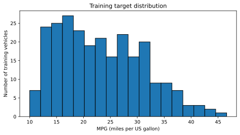
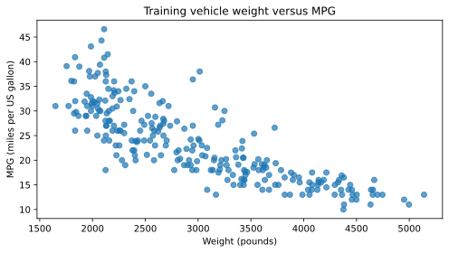
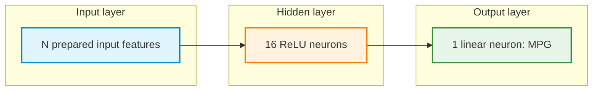
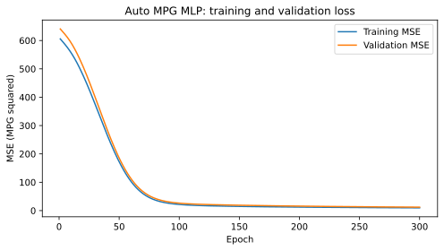
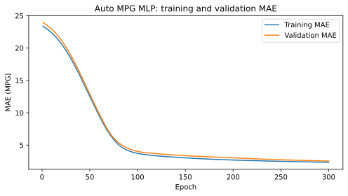

# Pair Programming 1: Auto MPG Regression with an MLP — Teacher solution

> **Teacher-only reference.** Full handout retained, with every TODO completed, discussion answers, real-data execution output, and SVG plots. Student-facing instructions remain as task context.

**Focus:** Apply the neural-network workflow studied in Week 1 to a real-world regression dataset, including missing numerical values and a categorical input.

In Week 1, the cereal-rating and concrete-strength activities introduced regression with a multi-layer perceptron (MLP). This Week 2 exercise applies the same principles to **predicting vehicle fuel efficiency**. The task is to load an unfamiliar dataset, prepare its inputs, build and train an MLP, compare configurations using validation results, and evaluate a selected model on held-out test data.

The [Auto MPG dataset](https://raw.githubusercontent.com/mwaskom/seaborn-data/master/mpg.csv) records information about older cars. The supplied CSV has **398 rows**. Its target, `mpg`, represents **miles per US gallon**; a larger value means that a vehicle can travel farther on one US gallon of fuel. Each row is a vehicle record. The model is a learning exercise, not a reliable estimator for present-day vehicles or engineering decisions.

**Python setup:** Use the [shared Colab installation and import checks](reference/1-python_setup.md#google-colab-setup). These pair-programming exercises require NumPy, pandas, Matplotlib, scikit-learn, Keras, and TensorFlow. Install a package only if its import is missing, then restart the runtime/session if requested and rerun setup.

## Learning objectives

By the end of the session, each pair should be able to:

1. Identify a continuous target, explore its distribution, and explain a mean-prediction baseline.
2. Create training, validation, and test sets without using held-out observations to fit preprocessing.
3. Handle missing numerical inputs, encode a categorical input, and standardize numerical features.
4. Construct, compile, and train a Keras MLP with a **linear** output for regression.
5. Interpret training and validation **MSE** and **MAE**, and compare model configurations using validation results.
6. Select a model **before** final testing and compare its test MAE with the baseline.
7. Interpret numerical predictions in MPG and apply the original preprocessing to a new vehicle record.

## How pair programming works

- **Driver:** Types and runs the code, explaining decisions while coding.
- **Navigator:** Reads the task, checks variable names and shapes, watches for data leakage, and asks questions before execution.
- **Switch roles** after Sections 2, 4, 6, 8, and 10. Both partners should contribute code and explanations.
- Complete sections in order. Expand a **Hint** only after discussing an approach. Hints are not full solutions.
- Keep **test targets and test performance out of model selection**. Test features may be processed using transformations fitted on the training set; the final test assessment belongs in Section 11.
- Record actual outputs. Neural-network training results can vary between runs.

**Work format:** Create a Google Colab notebook with Markdown and Python cells. Complete the `TODO` blocks. Familiar operations remain for the pair to implement. Supplied code is reserved for the initial environment, the less familiar categorical encoding, and plots intended for interpretation rather than plotting-code assessment.

## Workflow


---

## 1. Recall: What changes in a regression task?

**Teacher answers:** MPG is continuous, so this is regression. Sigmoid would restrict predictions to 0–1 rather than the original MPG scale. An estimate of 25 MPG means an estimated 25 miles per US gallon; it is neither a guaranteed measurement nor proof of causation.


| Choice | Binary classification | Auto MPG regression |
|---|---|---|
| Target | Class `0` or `1` | Continuous `mpg` |
| Output layer | One sigmoid neuron | One **linear** neuron |
| Training loss | Binary cross-entropy | Mean squared error (MSE) |
| Reported metric | Accuracy | Mean absolute error (MAE) |
| Interpretation | Estimated class-1 probability | Predicted miles per US gallon |

A linear output does not restrict predictions to the range 0–1. For a regression MLP, the last Dense layer normally uses **one neuron with the default linear activation**. This output can represent a numerical value such as 25.4 MPG. The network is not guaranteed to produce only physically realistic values, so predictions still require interpretation.

**Discuss before coding**

1. Why is this prediction problem regression rather than classification?
2. Why would a sigmoid output be an unsuitable default for predicting MPG?
3. What would a prediction of 25 MPG mean, and what would it *not* establish?


**Reference hint:**


Consider whether the target is a class label or a numerical measurement. Recall the linear output used for cereal ratings and concrete strength in Week 1.

---

## 2. Get the data and inspect its structure

**Teacher answers:** The data has 398 rows, nine columns, no missing target, and six missing horsepower measurements. No target rows are removed. Only weight, horsepower, displacement, model_year, and origin are predictors; name is excluded because this exercise does not encode free text.


The exercise uses **four numerical inputs** and the categorical field `origin`.

| Field | Role | Meaning |
|---|---|---|
| `mpg` | Target | Fuel efficiency, miles per US gallon |
| `weight` | Numerical input | Vehicle weight, pounds |
| `horsepower` | Numerical input | Engine power, horsepower |
| `displacement` | Numerical input | Engine displacement, cubic inches |
| `model_year` | Numerical input | Two-digit model year, such as `76` for 1976 |
| `origin` | Categorical input | Recorded region of origin (`usa`, `europe`, or `japan`) |

The extra fields `cylinders`, `acceleration`, and `name` are **not model inputs** in this exercise. In particular, `name` is free text and is not directly passed into the MLP. The addition of `origin` provides practice in encoding categorical features.

**Supplied setup** — run this cell at the beginning of the notebook:

```python
# Install packages first if the Colab environment needs them.
# %pip install numpy pandas matplotlib scikit-learn keras tensorflow

import numpy as np
import pandas as pd
import matplotlib.pyplot as plt
import keras
from keras import Sequential, Input
from keras.layers import Dense
from sklearn.model_selection import train_test_split
from sklearn.impute import SimpleImputer
from sklearn.preprocessing import StandardScaler

keras.utils.set_random_seed(42)

DATA_URL = "https://raw.githubusercontent.com/mwaskom/seaborn-data/master/mpg.csv"
print("Keras backend:", keras.config.backend())

from pathlib import Path
DATA_FILE = Path(__file__).resolve().parent / "data" / "mpg.csv" if "__file__" in globals() else Path("mpg.csv")
```

**Executed successfully.**

```text
Keras backend: tensorflow
```


**Pair tasks**

1. Read `DATA_URL` into a DataFrame called `mpg_data`.
2. Display the first five rows, the shape, the column names, and column data types.
3. Check missing values for all columns. In particular, inspect `mpg` and `horsepower`.
4. Identify the five selected inputs and the one target. Explain why `name` is excluded.
5. Keep `mpg_data` unchanged and use a copy for modeling. If any target (`mpg`) values are missing, remove **only those rows**, and report how many were excluded.

```python
mpg_data = pd.read_csv(DATA_FILE if DATA_FILE.exists() else DATA_URL)
print(mpg_data.head().to_string(index=False))
print("Shape:", mpg_data.shape)
print("Columns:", mpg_data.columns.tolist())
print("Types:\n", mpg_data.dtypes.to_string())
print("Missing:\n", mpg_data.isna().sum().to_string())
working = mpg_data.copy().dropna(subset=["mpg"])
print("Rows removed for missing target:", len(mpg_data)-len(working))
assert mpg_data.shape == (398, 9)
assert len(working) == 398
```

**Executed successfully.**

```text
 mpg  cylinders  displacement  horsepower  weight  acceleration  model_year origin                      name
18.0          8         307.0       130.0    3504          12.0          70    usa chevrolet chevelle malibu
15.0          8         350.0       165.0    3693          11.5          70    usa         buick skylark 320
18.0          8         318.0       150.0    3436          11.0          70    usa        plymouth satellite
16.0          8         304.0       150.0    3433          12.0          70    usa             amc rebel sst
17.0          8         302.0       140.0    3449          10.5          70    usa               ford torino
Shape: (398, 9)
Columns: ['mpg', 'cylinders', 'displacement', 'horsepower', 'weight', 'acceleration', 'model_year', 'origin', 'name']
Types:
 mpg             float64
cylinders         int64
displacement    float64
horsepower      float64
weight            int64
acceleration    float64
model_year        int64
origin              str
name                str
Missing:
 mpg             0
cylinders       0
displacement    0
horsepower      6
weight          0
acceleration    0
model_year      0
origin          0
name            0
Rows removed for missing target: 0
```


**Reference hint:**


Recall `pd.read_csv(...)`, `.head()`, `.shape`, `.dtypes`, `.isna().sum()`, and `.dropna(subset=[...])` from Week 1. A missing target cannot be replaced with a guessed value for supervised training. Missing **input** values will be handled later.

**Checkpoint:** Record the original row count, working row count, target units, selected feature names, and any missing-input concern.

---

## 3. Select features and reserve held-out data

**Teacher answers:** The split has 254 training, 64 validation, and 80 test records. Fitting preprocessing before splitting leaks information from held-out rows. Validation guides selection; the test set provides a final assessment after selection.


Let `X` contain the input columns and `y` contain the `mpg` target. The target must not appear among the model inputs, because that would reveal the answer during training.

**Pair tasks**

1. Select **only** `weight`, `horsepower`, `displacement`, `model_year`, and `origin` as `X`. Select `mpg` as `y`.
2. First reserve **20%** of the observations for `X_test`, `y_test`.
3. From the remaining observations, reserve **20%** for `X_val`, `y_val`.
4. Call the remaining data `X_train`, `y_train`. Use `random_state=42` for both splits and **do not stratify** this regression task.
5. Print all input and target shapes. Confirm that the resulting proportions are approximately **64% training / 16% validation / 20% test**, with no overlap in row indices.

```python
feature_columns = ["weight", "horsepower", "displacement", "model_year", "origin"]
X = working[feature_columns].copy()
y = working["mpg"].copy()
X_train_val, X_test, y_train_val, y_test = train_test_split(X, y, test_size=0.2, random_state=42)
X_train, X_val, y_train, y_val = train_test_split(X_train_val, y_train_val, test_size=0.2, random_state=42)
for name, features, targets in [("train",X_train,y_train),("validation",X_val,y_val),("test",X_test,y_test)]:
    print(name, features.shape, targets.shape)
assert set(X_train.index).isdisjoint(X_val.index)
assert set(X_train.index).isdisjoint(X_test.index)
assert set(X_val.index).isdisjoint(X_test.index)
assert [len(X_train),len(X_val),len(X_test)] == [254,64,80]
```

**Executed successfully.**

```text
train (254, 5) (254,)
validation (64, 5) (64,)
test (80, 5) (80,)
```


**Reference hint:**


Recall the two calls to `train_test_split(...)` used in Week 1. The second call works on the training-plus-validation portion, not the original full DataFrame. The test set is reserved before imputation, scaling, and model selection.

**Discuss:** Why should missing-value replacement and numerical scaling be fitted only after this split? What makes validation different from test data?

---

## 4. Explore training data and establish a mean baseline

**Teacher answers:** The training-mean baseline is 23.492126 MPG. Training weight/MPG correlation is -0.819511: heavier vehicles tend to have lower MPG. Correlation measures a linear association and does not establish causation. Repeated feature/target combinations need not identify the same vehicle. The executed output gives the duplicate count, training horsepower missing count, and a heavy-vehicle example; an extreme value should be investigated rather than removed automatically.


Exploratory analysis can reveal missing measurements, unusual ranges, and patterns that the MLP may need to learn. To avoid inspecting the held-out target distribution during model development, perform this analysis using **training observations only**.

A simple regression **baseline** predicts the **mean training MPG** for every vehicle, regardless of its features. It provides a reference for interpreting the eventual neural-network error. This mean baseline is a simple reference; a training-median baseline minimizes training absolute error among constant predictions and can be compared as an optional extension.

**Pair tasks**

1. Display summary statistics for `y_train` and the four numerical columns in `X_train`.
2. Count missing `horsepower` measurements **within training data**. Investigate one unusually large or small training value without removing the row automatically.
3. Count repeated combinations of selected feature and target values in training data (excluding the row index); explain why repeated measurements do not necessarily represent the same vehicle.
4. Calculate the mean of `y_train` and save it as `baseline_mpg`.
5. Explain why a model should aim for a lower MAE than this baseline.
6. Calculate the correlation between training `weight` and training `mpg`. Describe its sign and one limitation of Pearson correlation.

```python
numeric_columns = ["weight", "horsepower", "displacement", "model_year"]
print("Training summaries:\n", pd.concat([X_train[numeric_columns],y_train],axis=1).describe().to_string())
print("Missing training horsepower:", X_train.horsepower.isna().sum())
print("Heaviest training vehicle:\n", working.loc[[X_train.weight.idxmax()],feature_columns+["mpg"]].to_string(index=False))
repeated = pd.concat([X_train,y_train],axis=1).duplicated().sum()
print("Repeated selected feature/target combinations:", repeated)
baseline_mpg = float(y_train.mean())
correlation = float(X_train.weight.corr(y_train))
print("Training mean MPG:", baseline_mpg)
print("Training weight/MPG correlation:", correlation)
```

**Executed successfully.**

```text
Training summaries:
             weight  horsepower  displacement  model_year         mpg
count   254.000000  250.000000    254.000000  254.000000  254.000000
mean   2983.913386  103.116000    192.572835   76.110236   23.492126
std     846.688602   37.214004    103.072309    3.571358    7.819648
min    1649.000000   46.000000     68.000000   70.000000   10.000000
25%    2212.500000   75.000000    105.000000   73.000000   17.000000
50%    2869.000000   92.000000    148.500000   76.000000   22.450000
75%    3608.000000  124.250000    262.000000   79.000000   29.000000
max    5140.000000  225.000000    455.000000   82.000000   46.600000
Missing training horsepower: 4
Heaviest training vehicle:
  weight  horsepower  displacement  model_year origin  mpg
   5140       175.0         400.0          71    usa 13.0
Repeated selected feature/target combinations: 0
Training mean MPG: 23.492125984251967
Training weight/MPG correlation: -0.8195106416872137
```


**Reference hint:**


Use `.describe()` for numerical summaries, `.mean()` for the training-target mean, and `.corr(...)` to examine a numerical relationship. The baseline uses no learned input-to-output relationship; it is a constant prediction.

### Run and interpret two training-data plots

Run the supplied code, observe the plots, and explain the result. Plotting syntax is **not** the assessed skill here.


**Reference hint:**


```python
plt.figure(figsize=(7, 4))
plt.hist(y_train, bins=18, edgecolor="black")
plt.xlabel("MPG (miles per US gallon)")
plt.ylabel("Number of training vehicles")
plt.title("Training target distribution")
plt.tight_layout()
plt.show()

plt.figure(figsize=(7, 4))
plt.scatter(X_train["weight"], y_train, alpha=0.7)
plt.xlabel("Weight (pounds)")
plt.ylabel("MPG (miles per US gallon)")
plt.title("Training vehicle weight versus MPG")
plt.tight_layout()
plt.show()
```

**Executed successfully.**



[PNG preview](plots/auto-mpg-block-5-figure-1.png)



[PNG preview](plots/auto-mpg-block-5-figure-2.png)


**Pair discussion:** Is MPG spread evenly across the training vehicles? Does greater vehicle weight appear associated with higher or lower MPG? Why does a scatter plot not prove causation?

**Checkpoint:** Record `baseline_mpg`, one relationship seen in the plots, and one reason preprocessing will be needed.

---

## 5. Encode the categorical input `origin`

**Teacher answers:** There are seven model inputs: four numerical features plus three origin indicators. Training, validation, and test columns match exactly. Weight is a measurement; origin is a category with no meaningful numeric distance. Unseen origin categories produce all-zero training-known indicators under the supplied rule. Retaining column names and order preserves the learned meaning of each input.


The `origin` column contains text categories. Dense neural-network layers require numerical inputs. **One-hot encoding** represents each known category with a separate 0/1 indicator column.

Encoding the data partitions independently may produce different feature columns. To keep input meaning and order consistent, the **training** encoded columns define the feature layout for validation, test, and later inference.

**Supplied reference code — categorical encoding:**

```python
numeric_columns = ["weight", "horsepower", "displacement", "model_year"]
categorical_columns = ["origin"]

X_train_encoded = pd.get_dummies(
    X_train, columns=categorical_columns, dtype=np.float32
)

# Use the columns learned from training for held-out observations.
def encode_like_training(frame):
    encoded = pd.get_dummies(
        frame, columns=categorical_columns, dtype=np.float32
    )
    return encoded.reindex(columns=X_train_encoded.columns, fill_value=0)

X_val_encoded = encode_like_training(X_val)
X_test_encoded = encode_like_training(X_test)
```

**Executed successfully.**


**Pair tasks**

1. Run the supplied code. Print the encoded feature names and the shapes of the three DataFrames.
2. Check that training, validation, and test columns have **identical names and order**.
3. Explain why there can be more model-input columns than the five original feature columns.
4. Explain why `weight` should not be one-hot encoded and why `origin` should not be standardized as a continuous measurement.

```python
print("Encoded columns:", X_train_encoded.columns.tolist())
for frame in [X_train_encoded,X_val_encoded,X_test_encoded]:
    print("Encoded shape:", frame.shape)
    assert frame.columns.equals(X_train_encoded.columns)
assert X_train_encoded.shape[1] == 7
```

**Executed successfully.**

```text
Encoded columns: ['weight', 'horsepower', 'displacement', 'model_year', 'origin_europe', 'origin_japan', 'origin_usa']
Encoded shape: (254, 7)
Encoded shape: (64, 7)
Encoded shape: (80, 7)
```


**Discussion:** A category unseen during training becomes all zeros across that category's training-known indicators with this simple encoder. Why must the encoding rule be retained when a model is used later? In a deployed application, unseen categories would require an explicit policy.

---

## 6. Impute missing inputs, then standardize numerical features

**Teacher answers:** Median imputation precedes standardization, and both are fitted only on training numerical columns. Origin indicators remain unchanged. The assertions confirm finite inputs and matching widths. Separate held-out fitting would use unavailable population information and change the meaning of the model input space.


Missing `horsepower` values cannot be sent directly into the MLP as `NaN`. In Week 1, **median imputation** replaced missing entries using a median learned from training observations. The same rule applies here.

Numerical features are then **standardized**, helping optimization when measurements have different scales. For a numerical value $x$, the standardized value $z$ is:

$$
z=\frac{x-\mu_{\mathrm{train}}}{\sigma_{\mathrm{train}}}
$$

Here, $\mu_{\mathrm{train}}$ and $\sigma_{\mathrm{train}}$ denote the **training-feature** mean and standard deviation. Values for validation and test observations are transformed using these same statistics. Imputation happens **before** standardization.

**Pair tasks**

1. Create copies named `X_train_prepared`, `X_val_prepared`, and `X_test_prepared` from the three encoded DataFrames.
2. Create an imputer named `imputer` using `SimpleImputer(strategy="median")` and fit it **only on training** `numeric_columns`. Transform the same columns in validation and test, without refitting.
3. Create a scaler named `scaler` using `StandardScaler()` and fit it **only on the imputed training** `numeric_columns`. Transform the imputed validation and test columns with the same scaler.
4. Leave the 0/1 `origin` indicator columns unchanged.
5. Convert the three prepared DataFrames into NumPy arrays named `train_X`, `val_X`, and `test_X`, using `dtype="float32"`. Create target arrays `train_y`, `val_y`, and `test_y` from their matching target Series.
6. Check shapes, matching feature order, and the absence of missing/non-finite model inputs.

```python
X_train_prepared = X_train_encoded.copy()
X_val_prepared = X_val_encoded.copy()
X_test_prepared = X_test_encoded.copy()
imputer = SimpleImputer(strategy="median")
X_train_prepared[numeric_columns] = imputer.fit_transform(X_train_prepared[numeric_columns])
for frame in [X_val_prepared,X_test_prepared]:
    frame[numeric_columns] = imputer.transform(frame[numeric_columns])
scaler = StandardScaler()
X_train_prepared[numeric_columns] = scaler.fit_transform(X_train_prepared[numeric_columns])
for frame in [X_val_prepared,X_test_prepared]:
    frame[numeric_columns] = scaler.transform(frame[numeric_columns])
train_X, val_X, test_X = [f.to_numpy(dtype="float32") for f in [X_train_prepared,X_val_prepared,X_test_prepared]]
train_y, val_y, test_y = [s.to_numpy(dtype="float32") for s in [y_train,y_val,y_test]]
for features,targets in [(train_X,train_y),(val_X,val_y),(test_X,test_y)]:
    print(features.shape,targets.shape,"finite:",bool(np.isfinite(features).all()))
    assert np.isfinite(features).all() and np.isfinite(targets).all()
np.testing.assert_allclose(imputer.statistics_, X_train[numeric_columns].median().to_numpy())
np.testing.assert_allclose(train_X[:,:4].mean(axis=0),0,atol=1e-6)
np.testing.assert_array_equal(train_X[:,4:],X_train_encoded.iloc[:,4:].to_numpy(dtype="float32"))
print("Training medians:", imputer.statistics_)
print("Training-only scaling means:", scaler.mean_)
```

**Executed successfully.**

```text
(254, 7) (254,) finite: True
(64, 7) (64,) finite: True
(80, 7) (80,) finite: True
Training medians: [2869.    92.   148.5   76. ]
Training-only scaling means: [2983.91338583  102.94094488  192.57283465   76.11023622]
```


**Reference hint:**


For the imputer, use `fit_transform()` on the **training numerical columns**, then `transform()` for validation and test. Repeat the same training-only fitting pattern with the scaler, *after* imputation. A selection such as `frame[numeric_columns] = ...` can assign transformed values back to a DataFrame copy. Use `.to_numpy(dtype="float32")` to prepare Keras inputs.

**Checkpoint:** Confirm that there are no `NaN` values in the model arrays and that every partition has the same number and order of input columns. Explain why fitting separate imputers or scalers on each partition would be incorrect.

---

## 7. Build the regression MLP

**Teacher answers:** The input width is 7. The hidden layer has 7×16+16=128 parameters; the output has 16+1=17; total 145. One numerical target requires one output. Sixteen outputs would predict a 16-component vector rather than one MPG value. A linear output can be negative; positivity is not guaranteed.


The baseline MLP has **one hidden layer with 16 ReLU neurons** and **one linear output neuron**. The model produces one numerical MPG prediction for each input row.



The input box represents **N separate feature values**, not a single input neuron; `N` equals `train_X.shape[1]` after one-hot encoding. A Dense layer connects every incoming value to each neuron and includes **one bias per neuron**.

For a Dense layer, the number of trainable parameters is:

$$
\text{parameters}=(\text{input values}\times\text{neurons})+\text{biases}
$$

**Pair tasks**

1. Create a `Sequential` model named `model`, with an input matching `train_X`.
2. Add **16 ReLU** neurons in one hidden layer.
3. Add **one linear output** for MPG.
4. Run `model.summary()` and calculate the number of trainable parameters manually.

```python
keras.utils.set_random_seed(42)
model = Sequential([Input(shape=(train_X.shape[1],)), Dense(16,activation="relu"),Dense(1)],name="Auto_MPG_baseline")
model.summary()
assert model.count_params() == (7*16+16)+(16+1) == 145
print("Manual total: (7*16+16)+(16+1) =",model.count_params())
```

**Executed successfully.**

```text
Model: "Auto_MPG_baseline"
┌─────────────────────────────────┬────────────────────────┬───────────────┐
│ Layer (type)                    │ Output Shape           │       Param # │
├─────────────────────────────────┼────────────────────────┼───────────────┤
│ dense (Dense)                   │ (None, 16)             │           128 │
├─────────────────────────────────┼────────────────────────┼───────────────┤
│ dense_1 (Dense)                 │ (None, 1)              │            17 │
└─────────────────────────────────┴────────────────────────┴───────────────┘
 Total params: 145 (580.00 B)
 Trainable params: 145 (580.00 B)
 Non-trainable params: 0 (0.00 B)
Manual total: (7*16+16)+(16+1) = 145
```


**Reference hint:**


Use `Input(shape=(train_X.shape[1],))` to match the number of prepared inputs. A Dense layer without an explicit activation uses a linear output by default. For reproducible initialization, call `keras.utils.set_random_seed(42)` immediately before constructing the baseline model.

**Discuss:** Why is only one output neuron needed? Why would 16 output neurons not match the target? Is the linear output guaranteed to be positive?

---

## 8. Compile the MLP for regression

**Teacher answers:** Adam applies updates using backpropagated gradients. MSE is the training objective in MPG squared; MAE reports error in MPG. An error of magnitude 5 contributes 5 to the absolute-error sum and 25 to the squared-error sum before averaging. Signed errors can cancel, concealing large mistakes.


Construction defines the network's computation. Compilation selects the training objective, optimizer, and reported metric. These regression settings were introduced in Week 1:

- **Adam (`"adam"`)** uses gradient information to update weights. Backpropagation computes gradients; the optimizer applies updates.
- **Mean squared error (`"mean_squared_error"`)** is the training loss. Squaring emphasizes larger errors.
- **Mean absolute error (`"mae"`)** measures the average absolute difference between predicted and actual MPG, expressed directly in **MPG**.

For $n$ examples, where $y_i$ is actual MPG and $\hat y_i$ is predicted MPG:

$$
\mathrm{MSE}=\frac{1}{n}\sum_{i=1}^{n}(y_i-\hat y_i)^2
$$

$$
\mathrm{MAE}=\frac{1}{n}\sum_{i=1}^{n}|y_i-\hat y_i|
$$

MSE has units of **MPG squared**, while MAE has units of **MPG**. Both are better suited to this continuous target than classification accuracy.

**Pair tasks**

1. Compile `model` with Adam, MSE as the loss, and MAE as the reported metric.
2. Explain what each `compile()` argument controls.
3. Explain why MAE is easier to interpret in the original target units than MSE.

```python
model.compile(optimizer="adam",loss="mean_squared_error",metrics=["mae"])
print("Compiled: Adam, mean squared error loss, mean absolute error metric")
```

**Executed successfully.**

```text
Compiled: Adam, mean squared error loss, mean absolute error metric
```


**Reference hint:**


Recall the `compile(optimizer=..., loss=..., metrics=...)` call from the Week 1 cereal and concrete regression work. Use `"adam"`, `"mean_squared_error"`, and `["mae"]` for this exercise. The optimizer is not the loss function.

**Discussion:** If a prediction differs from the actual MPG by 5, how does that error contribute to MAE and MSE? Why should the signed errors not simply be averaged?

---

## 9. Train the baseline and interpret learning curves

**Teacher answers:** The embedded curves show the actual 300-epoch run. Training and validation need not follow identical trajectories. A sustained validation deterioration while training improves suggests overfitting; one noisy epoch is insufficient evidence. Validation MAE of 3 MPG means an average absolute error of 3 MPG over the validation observations, not an error bound for every vehicle.


An **epoch** is one pass through the training observations. A mini-batch is the subset of observations used for one training step. `fit()` returns a `History` object that records training and validation values at each epoch.

**Pair tasks**

1. Train `model` on `train_X`, `train_y` with `epochs=300` and `batch_size=32`.
2. Set `validation_data=(val_X, val_y)` and an appropriate `verbose` value.
3. Save the returned object as `history`.
4. Inspect `history.history` and record the final training and validation **MSE** and **MAE**.

```python
history = model.fit(train_X,train_y,epochs=300,batch_size=32,validation_data=(val_X,val_y),verbose=0)
assert len(history.history["loss"]) == 300
print("History keys:",list(history.history))
for key,values in history.history.items():
    assert np.isfinite(values).all()
    print(key,"final:",values[-1])
```

**Executed successfully.**

```text
History keys: ['loss', 'mae', 'val_loss', 'val_mae']
loss final: 9.760437965393066
mae final: 2.3411617279052734
val_loss final: 12.173733711242676
val_mae final: 2.5367250442504883
```


**Reference hint:**


The training arrays are the first two arguments to `fit()`. The named arguments include `epochs`, `batch_size`, and `validation_data`. With the compile settings from Section 8, the history keys include `loss`, `val_loss`, `mae`, and `val_mae`.

### Run and interpret the MSE plot

Run the supplied plotting code. Observe the pattern; plotting syntax is not the assessed objective.


**Reference hint:**


```python
train_mse = history.history["loss"]
val_mse = history.history["val_loss"]
epochs = range(1, len(train_mse) + 1)

plt.figure(figsize=(7, 4))
plt.plot(epochs, train_mse, label="Training MSE")
plt.plot(epochs, val_mse, label="Validation MSE")
plt.xlabel("Epoch")
plt.ylabel("MSE (MPG squared)")
plt.title("Auto MPG MLP: training and validation loss")
plt.legend()
plt.tight_layout()
plt.show()
```

**Executed successfully.**



[PNG preview](plots/auto-mpg-block-12-figure-1.png)


### Run and interpret the MAE plot


**Reference hint:**


```python
train_mae = history.history["mae"]
val_mae = history.history["val_mae"]
epochs = range(1, len(train_mae) + 1)

plt.figure(figsize=(7, 4))
plt.plot(epochs, train_mae, label="Training MAE")
plt.plot(epochs, val_mae, label="Validation MAE")
plt.xlabel("Epoch")
plt.ylabel("MAE (MPG)")
plt.title("Auto MPG MLP: training and validation MAE")
plt.legend()
plt.tight_layout()
plt.show()
```

**Executed successfully.**



[PNG preview](plots/auto-mpg-block-13-figure-1.png)


**Pair discussion**

1. Do the training and validation errors follow the same trend?
2. What might a sustained increase in validation error while training error decreases suggest?
3. Why is one noisy epoch not enough to prove overfitting?
4. If validation MAE is 3 MPG, what does that mean in practical terms?

---

## 10. Pair challenge: Change one thing, then select a model

**Teacher answers:** One permitted change was selected: 8 hidden neurons instead of 16; both models train for 300 epochs with all other specified settings unchanged. The candidate has 73 parameters. The selected model is the 16-neuron baseline, chosen solely by final validation MAE. A larger model is not guaranteed to perform better, and longer training can worsen validation performance. One split and initialization cannot establish universal superiority.


The baseline architecture and training settings are now fixed. Test results are not used to select a configuration. As in Week 1, **validation MAE** is the main comparison measure for this regression task.

**Pair tasks**

1. Choose **one** modification: train for **150** instead of 300 epochs, use **8** hidden ReLU neurons instead of 16, or use **two hidden layers with 16 and 8 ReLU neurons**.
2. Predict how the change might affect validation MAE, and explain the prediction.
3. Build a **fresh** candidate network with newly initialized weights and train it using the same prepared training and validation arrays.
4. Keep the optimizer, loss, metric, batch size, and data split unchanged, except for the single selected modification.
5. Compare the **final epoch's validation MAE** for the baseline and candidate. Record final validation MSE as additional evidence.
6. Assign the trained model with **lower final validation MAE** to `final_model`. Do not inspect test error yet.

```python
print("Prediction before experiment: fewer hidden neurons reduce capacity; validation MAE could improve through less overfitting or worsen through underfitting.")
keras.utils.set_random_seed(42)
candidate = Sequential([Input(shape=(train_X.shape[1],)),Dense(8,activation="relu"),Dense(1)],name="Auto_MPG_candidate")
candidate.compile(optimizer="adam",loss="mean_squared_error",metrics=["mae"])
candidate_history = candidate.fit(train_X,train_y,epochs=300,batch_size=32,validation_data=(val_X,val_y),verbose=0)
assert len(candidate_history.history["loss"]) == 300
assert candidate.count_params() == 73
comparison = pd.DataFrame({"model":["baseline: 16 hidden","candidate: 8 hidden"],"epochs":[300,300],"final_val_mae":[history.history["val_mae"][-1],candidate_history.history["val_mae"][-1]],"final_val_mse":[history.history["val_loss"][-1],candidate_history.history["val_loss"][-1]]})
print(comparison.to_string(index=False))
candidate_wins = candidate_history.history["val_mae"][-1] < history.history["val_mae"][-1]
final_model = candidate if candidate_wins else model
selected_name = "8-neuron candidate" if candidate_wins else "16-neuron baseline"
print("Selected by validation MAE:",selected_name)
```

**Executed successfully.**

```text
Prediction before experiment: fewer hidden neurons reduce capacity; validation MAE could improve through less overfitting or worsen through underfitting.
              model  epochs  final_val_mae  final_val_mse
baseline: 16 hidden     300       2.536725      12.173734
candidate: 8 hidden     300       2.832852      13.745847
Selected by validation MAE: 16-neuron baseline
```


| Model | Hidden layers / epochs | Final validation MAE (MPG) | Final validation MSE (MPG squared) | Observation |
|---|---|---|---|---|
| Baseline | 16 ReLU neurons; 300 epochs | 2.536725 | 12.173734 | Final stored weights |
| Candidate | 8 ReLU neurons; 300 epochs | 2.832852 | 13.745847 | Fresh seeded candidate |


**Reference hint:**


Do not continue training the original baseline as the candidate. Call `keras.utils.set_random_seed(42)` immediately before constructing the fresh candidate. Build a new `Sequential` model, compile it, and call `fit()` on the same train/validation arrays. Compare the **last** `val_mae` entry from each `History` object; those values describe the model weights stored at the end of training. The minimum at an earlier epoch does not automatically restore earlier weights.

**Discuss:** Does adding neurons always improve validation error? Can training longer make validation performance worse? Does one split establish which model would be best for every dataset?

---

## 11. Final evaluation: Held-out test set and mean baseline

**Teacher answers:** The selected model test MAE is 2.287304 MPG and test MSE is 8.359138 MPG squared. The training-mean baseline test MAE is 5.949803 MPG. Baseline minus model MAE is 3.662499 MPG. The test result does not trigger model reselection. These older vehicles and one random split do not establish accuracy for modern vehicles.


The model choice is now fixed. Evaluate **only the selected model** on test observations to obtain an estimate of performance on unseen data. Also compute the error of the training-mean baseline on the **same** test observations.

**Pair tasks**

1. Call `final_model.evaluate(test_X, test_y, ...)` to obtain test MSE and test MAE.
2. Construct a constant prediction for each test row using the `baseline_mpg` calculated from **training** targets in Section 4.
3. Calculate the **test MAE** of this baseline, without fitting a new baseline to test targets.
4. Compare the MLP and the mean baseline using test MAE. State the difference in MPG.
5. Explain why a lower test MAE does not establish suitability for modern vehicles, and why the test result should not trigger another round of model selection.

```python
test_mse, test_mae = [float(v) for v in final_model.evaluate(test_X,test_y,verbose=0)]
baseline_predictions = np.full(test_y.shape,baseline_mpg,dtype="float64")
baseline_test_mae = float(np.mean(np.abs(baseline_predictions-test_y)))
improvement = baseline_test_mae-test_mae
print("Selected model:",selected_name)
print("Test MSE (MPG squared):",test_mse)
print("Test MAE (MPG):",test_mae)
print("Training-mean baseline test MAE (MPG):",baseline_test_mae)
print("Baseline MAE minus MLP MAE (positive means improvement):",improvement)
assert np.isfinite([test_mse,test_mae,baseline_test_mae]).all()
```

**Executed successfully.**

```text
Selected model: 16-neuron baseline
Test MSE (MPG squared): 8.359137535095215
Test MAE (MPG): 2.287304401397705
Training-mean baseline test MAE (MPG): 5.949803149606299
Baseline MAE minus MLP MAE (positive means improvement): 3.662498748208594
```


**Reference hint:**


`evaluate()` returns the metrics selected in `compile()`, including loss and MAE. A mean baseline can be represented by an array filled with `baseline_mpg`, with the same length as `test_y`. Compare absolute errors and calculate their average. Preserve the selected MLP even if its test result is disappointing; report that limitation.

**Checkpoint:** Record selected architecture, test MSE, test MAE, mean-baseline test MAE, and one reason the comparison has limitations.

---

## 12. Numerical predictions and final reflection

**Teacher answers:** The five-record table reports signed errors as prediction minus actual and absolute errors as their magnitudes. The hypothetical vehicle estimate is 21.079712 MPG. It reuses the saved imputer, encoding columns, and scaler without fitting. A measured value would require observing fuel consumption. The earlier workflow remains split → prepare → build → train → validate → test → infer. Backpropagation computes gradients, Adam updates parameters, MSE supplies the objective, and MAE supplies an interpretable error metric. Broader use requires representative modern data and independent evaluation.


A regression MLP produces a numerical estimate, not a class label. Every input used for inference must undergo the **same encoding, imputation, scaling, and column ordering** used during training. Neither the imputer nor the scaler should be refitted on a new vehicle record.

### A. Inspect held-out predictions

**Pair tasks**

1. Use `final_model.predict(test_X[:5])` to obtain predicted MPG for five held-out vehicles.
2. Compare the predictions with `test_y[:5]` and calculate signed errors (`prediction - actual`) and absolute errors.
3. Present the comparison in a small table with units and explain which of those five predictions had the largest absolute error.

```python
five_predictions = final_model.predict(test_X[:5],verbose=0).ravel()
five_results = pd.DataFrame({"row_index":X_test.index[:5],"actual_mpg":test_y[:5],"predicted_mpg":five_predictions,"signed_error_mpg":five_predictions-test_y[:5],"absolute_error_mpg":np.abs(five_predictions-test_y[:5])})
print(five_results.to_string(index=False))
print("Largest error among these five, original row index:",five_results.loc[five_results.absolute_error_mpg.idxmax(),"row_index"])
```

**Executed successfully.**

```text
 row_index  actual_mpg  predicted_mpg  signed_error_mpg  absolute_error_mpg
       198        33.0      34.675991          1.675991            1.675991
       396        28.0      32.015194          4.015194            4.015194
        33        19.0      16.568718         -2.431282            2.431282
       208        13.0      14.000330          1.000330            1.000330
        93        14.0      13.285223         -0.714777            0.714777
Largest error among these five, original row index: 396
```


**Reference hint:**


For one output neuron, `predict()` returns a two-dimensional array with one column. `.ravel()` converts it to a one-dimensional sequence. Subtract actual MPG to get the signed error and use `np.abs(...)` for the absolute error.

### B. Predict MPG for a hypothetical vehicle

The hypothetical vehicle below provides all five inputs expected by this MLP, including the categorical field `origin`.

| `weight` (lb) | `horsepower` | `displacement` (cu in) | `model_year` | `origin` |
|---:|---:|---:|---:|---|
| 3000 | 100 | 200 | 76 | `usa` |

**Pair tasks**

1. Put this single vehicle into a one-row DataFrame using the five feature names.
2. Encode its `origin` and align its columns to `X_train_encoded.columns`.
3. Use the **fitted** imputer and scaler to transform its four numerical columns; do not call either `fit()` or `fit_transform()`.
4. Convert the prepared row to a float32 array and predict MPG using `final_model`.
5. Report the estimate with units and explain why it is not a verified fuel-efficiency measurement.

```python
new_vehicle = pd.DataFrame([{"weight":3000.,"horsepower":100.,"displacement":200.,"model_year":76,"origin":"usa"}])
new_encoded = encode_like_training(new_vehicle)
new_encoded[numeric_columns] = imputer.transform(new_encoded[numeric_columns])
new_encoded[numeric_columns] = scaler.transform(new_encoded[numeric_columns])
assert new_encoded.columns.equals(X_train_encoded.columns)
new_X = new_encoded.to_numpy(dtype="float32")
assert new_X.shape == (1,7) and np.isfinite(new_X).all()
new_mpg = float(final_model.predict(new_X,verbose=0).ravel()[0])
print("Hypothetical vehicle estimated MPG:",new_mpg)
print("This is a model estimate, not a measured fuel-efficiency value.")
```

**Executed successfully.**

```text
Hypothetical vehicle estimated MPG: 21.0797119140625
This is a model estimate, not a measured fuel-efficiency value.
```


**Reference hint:**


`pd.DataFrame([ {...} ])` can represent one observation. Apply `pd.get_dummies(...)`, then `reindex(columns=X_train_encoded.columns, fill_value=0)` exactly as for validation and test inputs. Use `imputer.transform(...)` before `scaler.transform(...)` on the four numeric columns. Input order must match training.

### Exit discussion

1. Which parts of the workflow remained the same as the Week 1 regression activities?
2. Why must imputation, encoding, and scaling learned during training be kept for inference?
3. What do **backpropagation**, **Adam**, **MSE**, and **MAE** each contribute to this MLP exercise?
4. Why was **validation MAE** used for model selection rather than test MAE?
5. What is one limitation of the Auto MPG data, and what additional evidence would be needed before broader use?

## Submission checklist

- [ ] Both partners contributed code and switched Driver/Navigator roles.
- [ ] The CSV was loaded, inspected, and restricted to the selected inputs and target.
- [ ] Training, validation, and test sets were formed before fitted preprocessing.
- [ ] A mean training-MPG baseline and training-only EDA findings were recorded.
- [ ] `origin` was one-hot encoded with consistent columns across splits.
- [ ] Missing numerical inputs were imputed and scaled using **training statistics only**.
- [ ] A regression MLP was constructed with 16 ReLU neurons and one linear output; parameter counts were checked.
- [ ] Adam, MSE, and MAE were used appropriately; training and validation plots were interpreted.
- [ ] A fresh candidate was compared using **validation MAE**, before the test assessment.
- [ ] Selected-model test MAE was compared with the mean-baseline test MAE.
- [ ] Five predictions and one hypothetical new-vehicle prediction were explained, with preprocessing reused correctly.
- [ ] The notebook runs from top to bottom and includes a reflection on leakage, generalization, and limits of the results.

---

**Key connection to Week 1:** The training/validation/test workflow, MLP construction, loss and metric interpretation, and validation-based model selection remain the same. This dataset adds practical experience with **missing inputs**, **categorical encoding**, and **reusing the complete fitted preprocessing process** for new numerical predictions.


## Execution and reproduction

Executed with `G:\AI-ML-Teacher\AI\NN\.conda\nn-course\python.exe` on the real 398-row dataset. All 17 blocks passed sequentially; both models completed 300 epochs. Results vary with library versions and hardware. The data snapshot and provenance are in [data/](data/README.md). [Complete runnable Python](auto_mpg_solution.py) uses the local CSV when available, with the original URL as fallback. Run it from any directory with the course environment activated. The builder that also regenerates this Markdown and its plots is `workspace/week2/build_auto_mpg_teacher_solution.py`, run from the project root.
