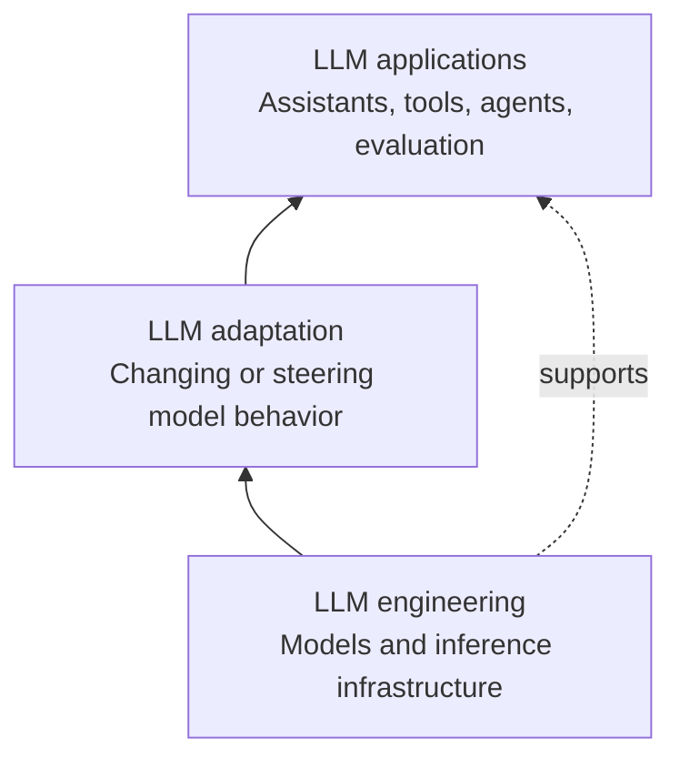
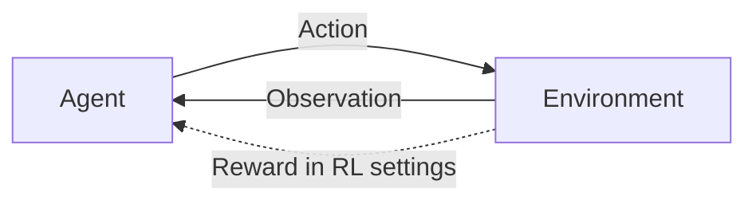
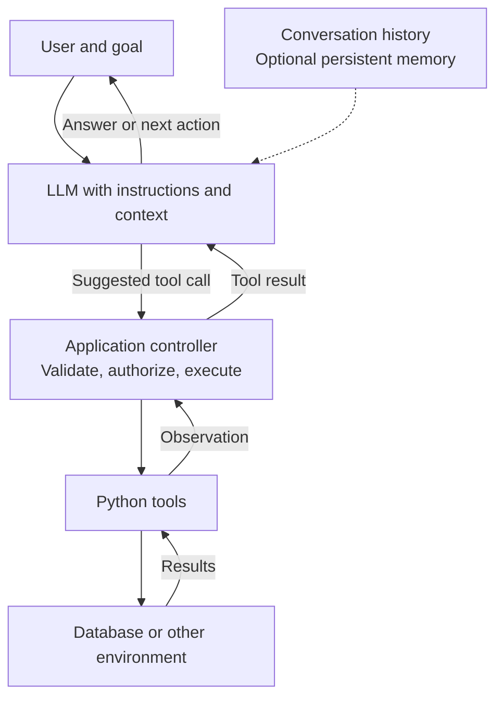
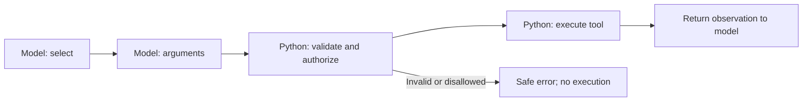
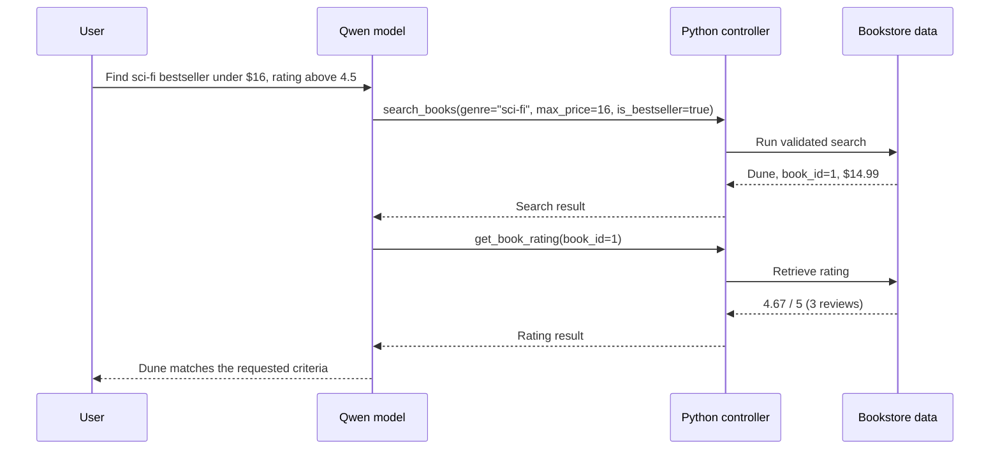
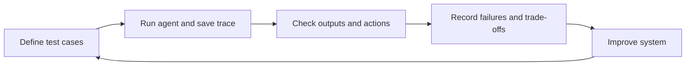
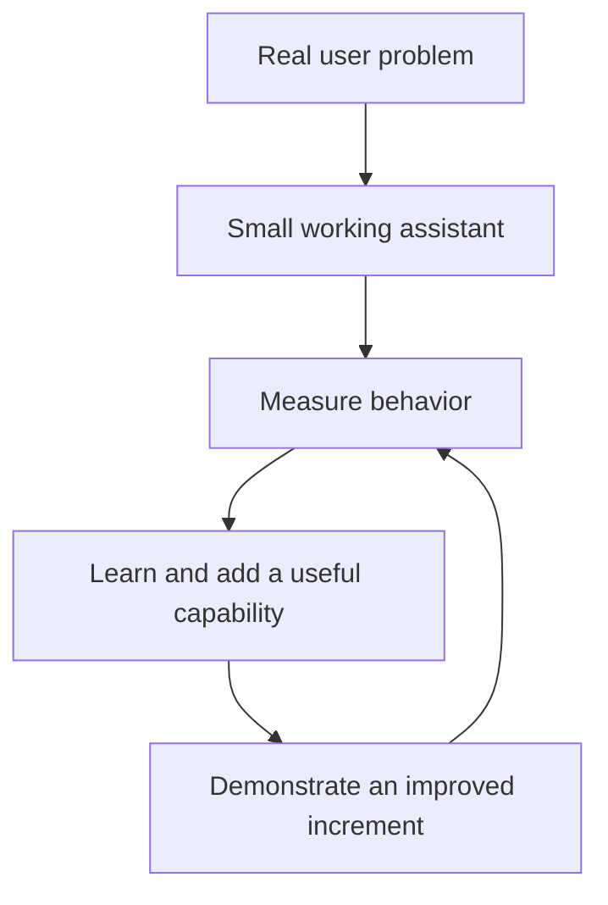

# Lecture 1 — From Language Models to Useful AI Agents


---

## Slide 1 — What are we trying to build?

- A language model can generate responses; a useful AI product must also **solve a real user problem**.
- An AI assistant helps users complete tasks. An agentic system can choose actions, invoke tools, observe results, and continue.
- The engineering question: **How do we build something that works, can be tested, and can be improved?**
- A simpler, reliable design can be better than a highly autonomous one.
- Today's path: **context → agent architecture → tools → execution → evaluation → product development**.

**Central idea:** The goal is not maximum autonomy or the largest number of AI components; it is useful, verifiable behavior.

---

## Slide 2 — Where do agents fit in the LLM stack?

- **LLM engineering:** model architectures, training, inference systems, and computation.
- **LLM adaptation:** techniques that adapt or steer models, including fine-tuning.
- **LLM applications:** assistants, retrieval systems, and tool-using agents built around models.
- These are **overlapping areas**, not rigid boundaries or exact mappings of academic courses.
- This course emphasizes **application engineering and evaluation**.




---

## Slide 3 — From the agent–environment loop to LLM agents

- Agents are not new; what has changed is how language models can help select actions.
- In reinforcement learning, an agent observes an environment, takes actions, and may learn from reward signals.
- Deep RL examples include Atari-playing systems, AlphaGo, and OpenAI Five.
- Language models introduced flexible task interpretation and in-context learning.
- Recent agent applications combine a language model with an **action and observation loop**.
- **Important difference:** most tool-calling demonstrations are not reinforcement-learning training loops. They use an already trained model at inference time.



**Takeaway:** The common idea is interaction; the way the agent decides and learns can differ.

---

## Slide 4 — AI assistant versus AI agent

| AI assistant | AI agent / agentic workflow |
|---|---|
| Primarily supports user tasks and communication | Selects and coordinates actions toward a goal |
| May answer using its prompt or retrieved context | May invoke tools, inspect results, and continue |
| Can contain tools and agentic features | Can appear to the user as an assistant |

- They are **not mutually exclusive labels**.
- Autonomy is a **spectrum**, not a binary property.
- Example: a bookstore assistant becomes more agentic when it searches books, checks ratings, and uses the results to answer.
- A product does **not** need multiple agents or unrestricted actions to be useful.

---

## Slide 5 — What is inside a tool-using agent?

- **Model:** interprets the request and may decide what to do next.
- **Instructions and context:** task, conversation, available tool descriptions.
- **Tools:** defined operations such as searching, calculating, or querying data.
- **Executor / control loop:** validates requests, calls functions, returns outputs, and applies stopping rules.
- **Environment:** data, applications, and services the tools interact with.
- **Memory / planning:** may help with longer tasks, but persistent memory and elaborate planning are **optional**.



**Critical boundary:** The LLM proposes a tool call; **application code performs the operation**.

---

## Slide 6 — Why give an LLM tools?

- A model does not inherently know the current contents of a local database.
- Tools can supply **up-to-date or private facts**, deterministic calculations, and access to software functions.
- They can also change the world (e.g., create an order)—which requires additional safeguards.
- A successful tool result is **evidence**, but the model can still misinterpret it.
- Research landmarks: **WebGPT** (browsing), **MRKL** (modular tools), **Toolformer** (learned tool use), **Gorilla** (API calling).

**Question to carry forward:** Which parts of a task should the LLM decide, and which should deterministic code enforce?

---

## Slide 7 — A tool starts as an ordinary, testable function

- Build the function **without** an LLM; test it independently first.
- A tool needs a useful **name**, **description**, **argument contract**, and **result format**.
- Tool schemas help the model request an operation; they do **not** replace application-level validation or access control.
- Prefer simple, **read-only tools** when starting.

```python
# Simplified illustration: a normal Python function

def get_book_rating(book_id: int) -> dict:
    """Return stored rating information for a book."""
    return {"book_id": book_id, "average_rating": 4.67}

print(get_book_rating(1))  # Test it without an LLM
```

- LangChain can expose a Python function as a tool with a structured input schema.

---

## Slide 8 — Anatomy of a tool call: who does what?

- **Select:** the model proposes a tool name.
- **Arguments:** the model produces values for the tool parameters.
- **Validate and authorize:** Python checks schema, constraints, permissions, and whether the operation is allowed.
- **Execute:** Python calls the registered function.
- **Observe:** the result is returned to the model for a further decision or final response.



- `is_bestseller=true` is a Boolean, not the string `"True"`.
- The model's generated request is **not itself an executed database query**.

---

## Slide 9 — Multi-step bookstore example

**User request:** “Find a sci-fi bestseller under $16 with a rating above 4.5.”



- A multi-step agent **uses previous observations** to choose the next action.
- Stop when the answer is ready, a limit is reached, or an error prevents continuation.
- Inspect **execution traces**, not only the final text.

---

## Slide 10 — Models, frameworks, and deployment choices

- **Qwen in Google Colab:** the model runs locally in the notebook's allocated environment.
- **GroqCloud API:** inference runs on a hosted service; the application still owns its tools and validation.
- **Groq is not Grok:** Groq provides inference infrastructure; Grok is a different model family developed by xAI.
- **LangChain:** defines tool interfaces and provides building blocks for model/tool workflows; it does not remove the need for a safe execution policy.
- Compare models using the **same tasks, tools, and evaluation criteria**.
- Real image input is a separate **multimodal capability**; describe what the model actually observed rather than assuming visual answers are correct.

---

## Slide 11 — Evaluation and responsible execution

- **Three engineering layers:** **system** (architecture and control), **data** (context and test cases), **evals** (evidence and metrics).
- Evaluate **task success**, **tool selection**, **argument correctness**, **grounding**, **efficiency**, and **safety**.
- Assess **consistency** across repeated runs, **robustness** to realistic changes, and **recoverable failures**.
- A polished answer does **not** prove that the tool calls were correct.
- **Privacy example:** an assistant asked for a work summary may inadvertently disclose a private calendar event. Completing the request is not the same as acting appropriately.



- Use permissions, least-privilege access, read-only defaults, confirmations for impactful actions, and trace review.

---

## Slide 12 — From concepts to a working AI product

- Start with **a user, a concrete problem, and a small end-to-end workflow**.
- Develop in increments: **learn → practise → apply → evaluate → improve**.
- Future capabilities: external APIs and MCP; RAG; multi-agent designs; fine-tuning. Introduce them **when useful**, not merely to maximize the feature count.
- Sprint reviews should show **working improvements and evaluation evidence**.
- First practical step: explore the two-tool bookstore assistant; then investigate more complex behavior in the full lab.
- First project step: brainstorm needs, choose a feasible starting idea, and identify the first testable feature.



**Closing question:** What useful decision or action should an assistant perform, and how would its correctness be verified?

---

## Source notes and scope

- Toolformer and Gorilla are introduced here **only as research context**
- Conceptual illustrations and the bookstore tool sequence are aligned with the bookstore notebooks; the sample function on Slide 7 is **illustrative**, not copied verbatim from the database implementation.

