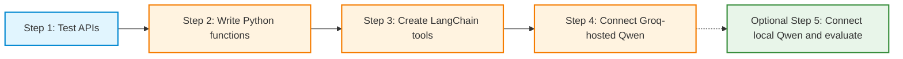
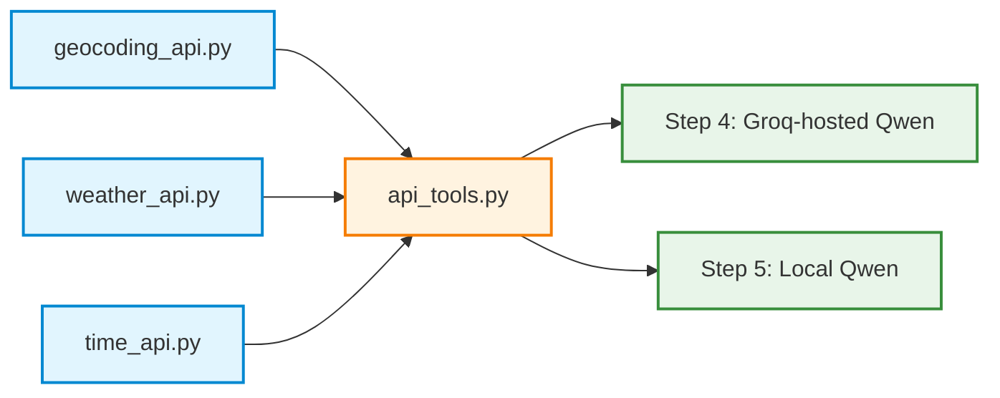

# Step 0 — About the Activity: From APIs to LLM Tools

Use the [activity guide](activity.md) to navigate **Part A — Steps 1–4** and **Part B — optional Step 5**. This overview explains both parts; completing Part A does not require local-model inference or the Step 5 evaluation.

## Activity overview

**Main objective:** Build a small collection of API-powered tools and examine how a language model can request them to obtain current information.

Part A begins with direct HTTP requests, packages them as Python functions and LangChain tools, and connects them to Qwen hosted by **Groq**. Optional Part B reuses the tools with Qwen running locally on a **Google Colab GPU** and adds a structured evaluation. In both parts, inspect tool selection, arguments, execution results, and the accuracy of the final answer.

The APIs support a simple weather-and-local-time scenario. Their outputs can later contribute to a larger trip-planning application; this activity does **not** yet implement a complete trip planner.

| External API | Purpose | Example input |
|---|---|---|
| [Open-Meteo Geocoding](https://open-meteo.com/en/docs/geocoding-api) | Convert a city name into coordinates and timezone | `Berlin` |
| [Open-Meteo Weather](https://open-meteo.com/en/docs) | Retrieve current temperature, humidity, and wind | Latitude and longitude |
| [Time.Now](https://time.now/developer) | Retrieve local time for a timezone | `Europe/Berlin` |

## The five steps

| Step | Focus | Main result | Model required? |
|---|---|---|---|
| **1 — Standalone API requests** | Call each API using `requests.get()`, inspect HTTP responses and JSON | Three working API requests | No |
| **2 — Python functions** | Wrap each request in a function with inputs and returned dictionaries | `geocoding_api.py`, `weather_api.py`, `time_api.py` | No |
| **3 — LangChain tools only** | Add `@tool`, inspect names/descriptions/input schemas, and test with `.invoke()` | `api_tools.py` and three tested LangChain tools | No |
| **4 — Groq-hosted Qwen** | **4A:** Test model access without tools. **4B:** Let Qwen request the existing tools | Model responses and tool-call traces | Yes; hosted by Groq |
| **5 — Local Qwen3.5-4B (optional)** | **5A:** Set up GPU and test the model. **5B:** Connect the tools. **5C:** Evaluate tool calling and answers | Local model traces and an evaluation table if completing Part B | Yes; runs in Colab |

**Sequence:** Complete Steps 1–4 in order. Continue to optional Step 5 when completing Part B. Each new step reuses the functions or tools created in the preceding steps.

## Before starting — Google Colab and the Groq API key

**Platform:** Google Colab with Python. A CPU runtime is sufficient for Steps 1–4. Step 5 uses a GPU runtime to load the local Qwen3.5-4B model.

**Groq API key requirement:** An API key is required for **Step 4A and Step 4B**, because those parts call a Qwen model hosted by Groq. A Groq API key is **not required** for Steps 1–3 or for the local model used in Step 5.

### Prepare Groq access before Step 4

1. Open the [GroqCloud Console](https://console.groq.com/) and create an account if needed.
2. Generate an API key in the [Groq API keys page](https://console.groq.com/keys).
3. Open the Google Colab notebook and select the **Secrets** panel (key icon in the left sidebar).
4. Add a secret named **`GROQ_API_KEY`** and save the generated key as its value.
5. **Enable notebook access** using the toggle beside that secret.
6. In Step 4A, run the provided setup code to read the secret securely and check that the Groq client connects.

**Security rule:** Never paste the key directly into notebook code, Markdown, screenshots, printed output, or submitted files. Do not share or commit the key. Groq API requests are subject to account limits and any applicable usage charges.

### Prepare the runtime for each step

- **Steps 1–4:** Start with a CPU runtime; a GPU is not needed for a Groq-hosted model.
- **Step 5:** Save the notebook, then select **Runtime → Change runtime type → GPU** and reconnect. Changing the runtime can terminate the existing session and remove temporary files, installed packages, and Python variables.
- **After the optional Step 5 runtime change:** Install the required API/tool packages and rerun only the `%%writefile` cells from Steps 2–3 needed to recreate `geocoding_api.py`, `weather_api.py`, `time_api.py`, and `api_tools.py`. Do not run all Part A cells merely to restore files: that also repeats Groq requests. If using separate notebooks, copy the required setup/file-creation cells into the GPU notebook and execute them there.
- **Before testing local tools:** Run the Step 5 file-existence and import checks. Confirm that all four `.py` files are present and that all three LangChain tools import successfully.

Files created using `%%writefile` in the Colab runtime are temporary. Preserve required notebooks and source files in durable storage, such as Google Drive or local downloads.

## Working files and how they connect

The three API files contain the HTTP requests. `api_tools.py` wraps those existing functions for LangChain. The hosted and local model activities reuse **the same three tool definitions**.

## Learning outcomes

At the end of the activity, demonstrate the ability to:

1. Describe the difference between an API request, a Python function, and a LangChain tool.
2. Inspect API responses and return useful fields in a predictable format.
3. Explain how a tool name, description, and input schema help an LLM request an appropriate operation.
4. Distinguish **tool selection by a model** from **tool execution by Python code**.
5. If completing optional Part B, compare remote model access through Groq with local model inference in Colab.
6. Evaluate tool-calling behavior using execution traces and evidence from API results rather than judging only the final answer.

## Completion evidence

For Part A, preserve runnable code, successful output checks, hosted tool-call traces, and reflection answers. If completing optional Part B, also preserve the local traces, Step 5 evaluation, and requested reflection/investigation answers. Ensure that submitted notebooks and files contain **no API key values**. The course project's required local-versus-Groq benchmark is separate from this activity's optional extension.

**Start with:** [Step 1 — Test each API as a standalone request](activity1-steps-1-2.md#step-1-test-each-api-as-a-standalone-request). Read the companion [Theory — From API Calls to LLM Tools](theory.md) alongside the activity.

## References

- [Open-Meteo Geocoding API](https://open-meteo.com/en/docs/geocoding-api)
- [Open-Meteo Weather API](https://open-meteo.com/en/docs)
- [Time.Now Developer API](https://time.now/developer)
- [LangChain tools](https://docs.langchain.com/oss/python/langchain/tools)
- [Groq API keys](https://console.groq.com/keys)
- [Groq tool-use overview](https://console.groq.com/docs/tool-use/overview)
