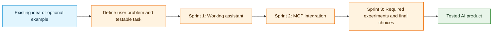

# Optional Project Ideas and Technology Map

**Neural Network Project · Week 2 reference · Nine examples · Three sprints**

## Purpose and current starting point

Project brainstorming and **Sprint 1 planning began in Week 1**. Many teams already have a topic, a Product Backlog, and initial Sprint 1 user stories in GitHub. **No change of topic is required.**

This catalog is an optional resource for teams that have not settled on a topic, are considering an alternative, or want to develop a promising but overly simple idea into a meaningful AI product. An existing project can also use the tables to identify missing capabilities, evaluation opportunities, and possible directions for later sprints.

The course goal is to **engineer a working, useful, and evaluated AI assistant or agent for a real-world problem**, not to implement the greatest number of frameworks. The project runs alongside the Neural Networks course and develops over eight weeks through three Scrum-based sprints.

**Required experiments, justified final choices:** Every team must benchmark a local small Qwen model against a Groq-hosted model on representative project tasks. Teams must also implement and test project-relevant MCP, RAG, fine-tuning, and multi-agent experiments as those topics are introduced. Keep an approach in the final product when the results demonstrate a useful benefit; otherwise explain why it was not retained. The experiments and their evidence are required even when the final product uses the simpler alternative. See the [sprint deliverables](03_Sprint_Deliverables.md) for the required evidence and review schedule.

## Nine optional ideas

The example requests illustrate the role of **tools and data**. They are not fixed specifications or compulsory thesis topics.

| Idea | Example user interaction | Possible tools | Why a database is useful |
|---|---|---|---|
| **1. Smart Home / IoT** | “The living room is cold. Check the temperature, then set a comfortable value.” | `get_temperature`, `list_devices`, `set_thermostat`, `get_energy_usage` | Room/device mapping, sensor readings, preferences, action history |
| **2. University Course Registration** | “Find eligible AI courses with space and no timetable conflicts.” | `search_courses`, `check_prerequisites`, `check_schedule_conflicts`, `prepare_registration` | Courses, sections, prerequisites, enrollment and timetable state |
| **3. Inventory and Supply** | “Find products below the reorder threshold and prepare a supplier order.” | `check_stock`, `find_supplier`, `calculate_reorder`, `draft_purchase_order` | Stock movements, supplier prices, draft orders, audit trail |
| **4. Coding and Debugging** | “Explain a failed test and propose a patch that can be retested.” | `read_file`, `search_code`, `run_tests`, `propose_patch` | Test runs, error records, patch versions, outcomes |
| **5. Public Transport** | “Find an arrival before 09:00 with no more than one transfer.” | `find_stop`, `get_departures`, `plan_journey`, `save_journey` | Stops, timetables, saved journeys, timestamped snapshots |
| **6. Personal Finance** | “Compare this month's spending with category budgets.” | `get_transactions`, `categorize_expense`, `calculate_spending`, `get_budget` | Synthetic transactions, budgets, categories, monthly summaries |
| **7. Restaurant Ordering** | “Prepare a vegetarian pickup order within a €20 limit.” | `search_menu`, `check_availability`, `calculate_total`, `draft_order` | Menu, ingredients, availability, draft and confirmed orders |
| **8. IT Help Desk** | “Investigate a Wi-Fi problem and create a support ticket if needed.” | `search_known_issues`, `run_diagnostic`, `create_ticket`, `check_ticket_status` | Tickets, diagnostics, device types, resolution history |
| **9. Environmental Monitoring** | “Compare station readings and flag values outside defined limits.” | `get_sensor_readings`, `get_air_quality`, `check_thresholds`, `create_alert` | Time-stamped measurements, thresholds, alerts, station metadata |

For all examples, prefer **simulated actions, curated datasets, and approved APIs** when real systems need permissions, contain private data, or could have consequential effects. Database values and API responses are factual inputs to the application; the language model should not invent them.

## How the technologies contribute across the course

| Technology | When it appears | Useful contribution | Evidence to collect |
|---|---|---|---|
| **Python + LangChain tools** | Weeks 1–2; Sprint 1 | Expose validated read, computation, and controlled-action functions | Tool names, arguments, outputs, failures |
| **Local small Qwen model** | Required Sprint 1 benchmark; model work continues later | Test local tool selection and grounded answers | Matched tasks, tool traces, quality, latency, resource use |
| **Groq-hosted model** | Required Sprint 1 benchmark; Qwen is the taught example | Compare hosted inference with local inference for the project | Same task suite, configuration differences, results, justified model choice |
| **SQLite and external APIs** | Sprint 1 onward | Maintain structured state and retrieve changing external data | Reproducible records, data provenance, API error behavior |
| **User interface** | Sprint 1 onward | Make the product usable through a real interaction | Demonstration and tested user journey |
| **MCP client / server** | Weeks 3–4; Sprint 2 | Expose existing functionality through a standard client/server boundary | Capability discovery and successful tool execution |
| **RAG experiment** | Required from Week 5 onward; Sprint 3 | Test whether document retrieval improves project answers | With/without retrieval comparison, retrieved passages, grounding, keep/remove decision |
| **Multi-agent experiment** | Required from Week 6 onward; Sprint 3 | Test whether separated responsibilities improve results | Implemented alternative, matched single-agent baseline, metrics, keep/remove decision |
| **Fine-tuning experiment** | Required in Week 7; Sprint 3 | Train and test one narrowly defined learned behavior | Dataset split, untuned baseline, trained result on held-out data, keep/remove decision |

**Important distinction:** SQLite and APIs answer structured or current-data questions. RAG retrieves relevant *documentary knowledge*. Fine-tuning changes learned model behavior; it does not update the live database or supply current API values. More agents do not automatically improve quality.

## Project-to-technology opportunities

The following table suggests project-relevant ways to complete the **required experiments**. Choose the corpus, training task, agent responsibilities, and MCP boundary based on the actual problem and available data. Whether to retain each tested approach in the final product depends on the measured benefit.

| Project | Potential RAG source | Focused fine-tuning question | Single-agent vs multi-agent test | Natural MCP boundary |
|---|---|---|---|---|
| Smart Home / IoT | Device manuals and operating instructions | Device-command or room-intent extraction | One assistant vs comfort + energy roles | Sensor/device service |
| University Registration | Degree rules and course policies | Course-request constraint extraction | Advisor vs timetable verifier | Course and enrollment service |
| Inventory and Supply | Supplier policies and product catalogs | Product category or reorder-intent classification | Inventory planner vs purchase validator | Stock and supplier service |
| Coding and Debugging | Repository docs and engineering guides | Error-category classification | Diagnose vs patch vs verify | Code/test service |
| Public Transport | Fare and accessibility rules | Travel preference extraction | Route planner vs disruption checker | Timetable and alerts service |
| Personal Finance | Budgeting guidelines | Transaction categorization | Categorizer vs budget analyzer | Transaction-analysis service |
| Restaurant Ordering | Menu and ordering policy documents | Order/constraint extraction | Recommender vs order validator | Menu and order service |
| IT Help Desk | Troubleshooting guides and prior resolutions | Ticket category or urgency classification | Triage vs diagnosis vs escalation | Ticket and diagnostic service |
| Environmental Monitor | Monitoring procedures and environmental guidance | Incident type classification | Monitor vs analyzer vs reporter | Sensor and alert service |

## When an idea needs more depth

A single conversational request that triggers one fixed tool is an introductory demonstration. A stronger project includes a **real user problem**, several meaningful tools, state that must persist, an end-to-end request combining results, handling for failure or conflicting information, and measurable evaluation.

For example, “turn on a light” is a useful first tool test. A richer smart-home workflow checks the device and room, reads the current conditions, applies saved preferences and safety bounds, requests confirmation for a change, executes the action, and verifies the resulting state. Complexity should solve a user need rather than merely increase the number of calls.

## Week 2 reflection — use an existing idea or explore an alternative

1. Describe the current project idea and the user problem it addresses. If no topic is settled, select one optional example to investigate.
2. List two realistic user requests: one straightforward and one requiring several tools or data sources.
3. Name potential tools and identify which query SQLite, call an external API, compute a result, or propose a controlled action.
4. Identify useful persistent data and explain why a database is preferable to hard-coded responses.
5. Propose one **measurable evaluation** that can begin in Sprint 1.
6. Plan the required MCP, RAG, fine-tuning, and multi-agent experiments for later sprints. For each, identify a project question, baseline, practical implementation, and evaluation method. Use the results to decide whether to keep the approach.
7. Update the **existing GitHub Product Backlog** with promising ideas; use **DEEP** to refine the backlog and **INVEST** when writing Sprint Backlog user stories.

The Week 2 coding marathon is an exercise in combining database and API tools. It can inform the course project without replacing its chosen topic.

**Related documents:** The [project brief and use cases](02_Project_Brief_and_Requirements.md) describes the project. The [sprint deliverables](03_Sprint_Deliverables.md) specifies required evidence for the Week 3, 5, and 8 reviews. The ideas in this catalog are optional; the required experiments in the sprint deliverables apply to every team's chosen project.
