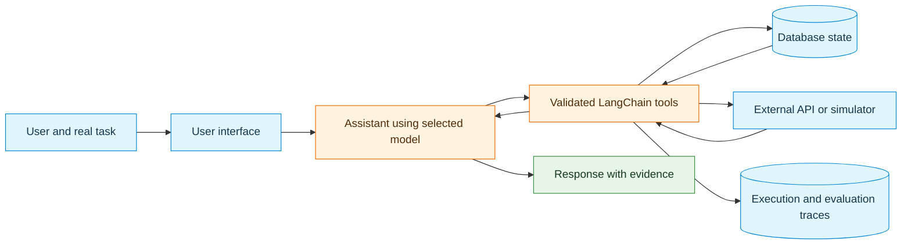

# Neural Network Project — Project Brief and Optional Use Cases

**Eight-week project course · Three development sprints · Week 2 edition**

## 1. What the project is about

This course runs alongside **Neural Networks**. The Neural Networks course examines models and training; this project course focuses on **engineering neural-network-based methods into working AI products**. The aim is to analyse a real-world problem, build a functional AI assistant or agent, test alternative approaches, and deliver a usable, evaluated solution.

An **AI assistant** helps with a task. An **AI agent** can also select tools, perform permitted actions, examine results, and continue toward a goal. A useful assistant can therefore be implemented using agent-like tool calling; the labels are not mutually exclusive.

The central project question is:

> **How can an AI idea become a working, useful, and evaluated product?**

The project is developed **in a team over eight weeks**. Morning sessions (09:00–12:00) introduce techniques; afternoon sessions (13:00–16:00) provide time for implementation, Scrum activities, coding marathons, and project reviews. Independent team work is also expected. The course carries **5 ECTS**, corresponding to approximately **135 hours** of work over the course.

### Current position: Week 2

Project brainstorming and Sprint 1 planning **already began in Week 1**. Existing project topics, Product Backlogs, and Sprint Backlogs should be developed further rather than restarted. The optional ideas later in this document are intended for teams still exploring a topic or seeking a stronger alternative to an overly simple idea.

**Coding Marathon 1 in Week 2** practises LangChain, databases, APIs, and tool calling through a common example. It is a skills exercise, **not a requirement to change the team project to a weather or trip planner**. Reuse useful patterns in the existing project where appropriate.

## 2. What a useful AI product does

A meaningful interaction begins with a user problem, not with a collection of libraries. The assistant should obtain evidence from approved tools and data sources before making claims about current facts or the success of an action.

The language model **requests** a tool call; application code validates permissions, executes the operation, and returns its result. Tool execution success, appropriate tool selection, and factual accuracy are separate evaluation questions.

### Core engineering principles

- **Problem first:** Identify a user, a concrete need, and a task whose outcome can be checked.
- **Working increments:** Preserve a running product at every sprint; use the next sprint to improve it.
- **Appropriate technology:** Use LangChain as the default framework. LangGraph may be selected when explicit orchestration is justified and agreed within the team.
- **State and evidence:** Sprint 1 requires a database and API integration. Choose meaningful records and API operations that serve the user task; document simulated data or a mock API when live access is unavailable. A CSV import or local calculation alone is not an API integration.
- **User experience:** Include a usable interface rather than treating an isolated model call as the complete product.
- **Safety:** Validate tool arguments and permissions. Use explicit confirmation for consequential writes, orders, physical-device changes, or registrations.
- **Evaluation throughout:** Begin from representative test cases and improve the tests as the application grows.
- **Required comparison before selection:** Benchmark local and Groq-hosted models, and implement and evaluate MCP, RAG, fine-tuning, and multi-agent alternatives in the relevant sprints. Use project evidence to choose the final model and architecture.
- **Team understanding:** All members should contribute to implementation and be able to explain technical choices and individual contributions.

The course encourages experimentation and learning from failures. **More agents, tools, or frameworks do not automatically mean a better solution.** A simpler system with stronger evidence can be preferable.

### Required experiments and final product decisions

Every team must carry out the following comparisons on its own project:

- **Models:** Run a local small Qwen model and a Groq-hosted model on the same representative tasks, using the same domain tools and scoring criteria. Select the model configuration that best meets the project's quality, reliability, latency, resource, and cost needs. The final product may use the local model, the hosted model, or a combination justified by the results.
- **MCP:** Implement and test an MCP client/server path using existing project functions. Compare it with direct tool access and explain the architectural and operational tradeoffs.
- **RAG:** Build a small project-relevant retrieval pipeline and compare answers with and without retrieved documentary evidence.
- **Fine-tuning:** Complete a focused training experiment and compare the trained model with its untuned baseline on held-out examples of the same behavior.
- **Multi-agent systems:** Implement a small multi-agent alternative and compare it with the single-agent baseline on equivalent tasks.

For each comparison, submit the experiment code, configuration, test data/cases, observed results, limitations, and a written decision: **what was tried, what changed, and why the approach was kept or removed**. A design sketch, literature discussion, or feasibility study alone does not replace the implemented experiment. Record failed attempts and resource problems honestly; an experiment that could not be completed remains an unresolved requirement rather than evidence that the approach has no benefit.

Keep approaches that demonstrate a useful benefit for the intended user after considering quality, reliability, latency, resource/cost needs, and maintenance complexity. Approaches that do not justify their overhead may be removed from the final application, but their code and evaluation evidence must remain reproducible. The final demonstration shows the chosen product; the report and sprint evidence show the alternatives tested and the reasons for the decisions. Required sprint experiments and evidence are specified in the [sprint deliverables](03_Sprint_Deliverables.md).

## 3. Roadmap and connection to the existing plan

| Stage | Review or activity | Product direction |
|---|---|---|
| **Week 1** | Brainstorming, Product Backlog, Sprint 1 planning in GitHub | Initial problem, user stories, and test ideas |
| **Week 2** | Coding Marathon 1: tools, external APIs, LangChain | Reusable implementation skills and Sprint 1 progress |
| **Week 3 — Sprint 1 Review** | First product presentation; Sprint 2 planning | **Usable interface, tools, database/API integration, local-vs-Groq benchmark and justified model choice** |
| **Week 4** | Coding Marathon 2: MCP clients and servers | Reuse approved domain functions through MCP |
| **Week 5 — Sprint 2 Review** | Improved product; Sprint 3 planning | MCP integration, additional useful capability, stronger evaluation |
| **Weeks 6–7** | Multi-agent work, fine-tuning, Coding Marathon 3 | Implement and evaluate required RAG, training, and architecture experiments |
| **Week 8 — Sprint 3 Review** | Final working product demonstration | Selected product architecture, all required experiment evidence, security and justified keep/remove decisions |

Week 5 introduces RAG; Week 6 introduces multi-agent systems; Week 7 includes fine-tuning and security/reliability. Every team must implement and evaluate these approaches, then retain those whose benefits justify their use in the project. The final Sprint Review is in Week 8; the Project Exam is held separately.

**Sprint planning:** Maintain a Product Backlog in GitHub using **DEEP** principles and a Sprint Backlog of user stories using **INVEST** principles. Record progress, source code, tests, reviews, decisions, and individual contributions. See the [sprint deliverables](03_Sprint_Deliverables.md) for the sprint-specific evidence.

## 4. Optional project descriptions

The following use cases are **inspiration and refinement examples**, not a list from which a new topic must be selected. Each suggests a user interaction, tools, persistent data, and ways to scope the required later experiments. Adapt the experiment to the project; retaining the tested approach is a separate decision based on results.

### 4.1 Smart Home / IoT Assistant

**Example request:** “The living room is cold. Check the temperature, adjust the thermostat to 23°C if permitted, and show energy usage.”

**Tools:** `list_devices`, `get_temperature`, `set_thermostat`, `turn_on_light`, `get_energy_usage`.

**Database:** Rooms, devices, sensor readings, user preferences, energy usage, and action history. The database links devices to rooms and preserves readings needed for comparisons; action history records what was actually requested or changed.

**Interaction:** Read sensor state → identify target device → validate bounds/permissions → confirm a change → execute a simulated or authorized action → verify new state.

**Later experiments:** MCP device server; RAG over manuals; command-intent fine-tuning; single assistant compared with comfort and energy specialist roles. Use simulated hardware when real devices are unavailable.

### 4.2 University Course Registration Agent

**Example request:** “Find AI-related courses with available seats, valid prerequisites, and no timetable conflict.”

**Tools:** `search_courses`, `check_prerequisites`, `check_schedule_conflicts`, `get_available_seats`, `prepare_registration`.

**Database:** Courses, prerequisites, sections, timetables, enrollments, and registration attempts. Structured data allows precise checking of eligibility and schedule overlap.

**Interaction:** Search → verify constraints → explain eligible options → prepare a draft enrollment → confirm any authorized state change.

**Later experiments:** MCP course service; RAG over academic policies; extraction of course constraints; one assistant compared with advising and verification roles. Use fictional registration data unless official access is provided.

### 4.3 Inventory and Supply Management Agent

**Example request:** “Find low-stock products and draft a replenishment order within a €500 budget.”

**Tools:** `check_stock`, `get_sales_history`, `find_supplier`, `calculate_reorder`, `draft_purchase_order`.

**Database:** Products, stock movements, suppliers, prices, sales, and draft orders. Transaction records make calculations and later auditing reproducible.

**Interaction:** Identify shortages → compare supplier costs → calculate permitted quantities → save a draft → explain the decision. Avoid uncontrolled real purchases.

**Later experiments:** MCP inventory/supplier interface; RAG over supplier terms; category classification; inventory-planner versus purchasing-validator evaluation.

### 4.4 Coding and Debugging Assistant

**Example request:** “Examine a failing Python test, explain the likely cause, and propose a minimal fix.”

**Tools:** `read_file`, `search_code`, `run_tests`, `inspect_error_log`, `propose_patch`.

**Database:** Test results, error logs, change history, and project metadata. Before/after runs show whether a proposed fix actually helps.

**Interaction:** Inspect permitted files → run allowed tests in an isolated environment → diagnose → propose a patch → seek approval before modifying files → rerun tests.

**Later experiments:** MCP repository/test service; RAG over documentation and code; bug-category classification; diagnosis, patching, and verification roles. Do not permit unrestricted shell commands.

### 4.5 Public Transport Assistant

**Example request:** “Find a route arriving before 09:00 with at most one transfer.”

**Tools:** `find_stop`, `get_departures`, `search_routes`, `plan_journey`, `save_commute`.

**Database:** Stops, routes, saved journeys, preferences, and timestamped schedule snapshots. Stored records allow repeatable tests and make the source and age of travel information clear.

**Interaction:** Resolve locations → obtain schedule data → check arrival/transfer constraints → present options with timestamps → optionally save a journey.

**Later experiments:** MCP transit provider; RAG over fare or accessibility rules; travel-constraint extraction; journey planner versus disruption checker. Static timetable data must not be labeled real-time.

### 4.6 Personal Finance Assistant

**Example request:** “Summarize spending this month and compare each category with its budget.”

**Tools:** `get_transactions`, `categorize_expense`, `calculate_spending`, `get_budget`, `compare_months`.

**Database:** Synthetic transactions, categories, budgets, and summaries. Persistent records support correct arithmetic and corrections to transaction categories.

**Interaction:** Import a sample CSV → aggregate with deterministic tools → compare budgets → explain differences with source figures.

**Later experiments:** MCP budgeting service; RAG over categorization guidance; transaction-classification fine-tuning; categorizer and budget-analyst comparison. Use synthetic data rather than private banking records.

### 4.7 Restaurant Ordering Assistant

**Example request:** “Prepare a vegetarian pickup order for under €20, then show the total.”

**Tools:** `search_menu`, `get_ingredients`, `check_availability`, `calculate_total`, `draft_order`.

**Database:** Menu, ingredients, stock, drafts, orders, and preferences. Prices and availability must come from records rather than model guesses.

**Interaction:** Apply preferences → check availability and dietary information → compute total → show a draft → confirm before creating an order.

**Later experiments:** MCP ordering service; RAG over menus/policies; structured order extraction; recommendation versus order validation. Do not guarantee allergy safety from incomplete ingredient records.

### 4.8 IT Help-Desk Assistant

**Example request:** “The campus Wi-Fi is failing. Run the permitted checks and create a support ticket if required.”

**Tools:** `search_known_issues`, `get_device_info`, `run_diagnostic`, `create_ticket`, `check_ticket_status`.

**Database:** Tickets, devices, diagnostics, issue categories, and resolution history. Ticket state persists across interactions; historical records support evaluation.

**Interaction:** Gather symptoms → check known issues → perform approved diagnostics → suggest supported steps → confirm ticket creation.

**Later experiments:** MCP help-desk service; RAG knowledge base; ticket-category fine-tuning; triage, diagnosis, and escalation roles.

### 4.9 Environmental Monitoring Agent

**Example request:** “Compare air-quality and temperature readings at several locations and flag values above configured thresholds.”

**Tools:** `get_sensor_readings`, `get_air_quality`, `compare_locations`, `check_thresholds`, `create_alert`.

**Database:** Stations, readings, units, timestamps, thresholds, alerts, and snapshots. The database supports trends and explains why an alert was raised.

**Interaction:** Select locations → retrieve or simulate measurements → verify units/timestamps → compare with documented thresholds → report findings and missing data.

**Later experiments:** MCP sensor server; RAG over monitoring guidance; incident-label classification; monitor versus analyzer/reporting roles.

## 5. Refine an existing project before adding technologies

Use these checks during Sprint 1 backlog refinement:

| Question | Evidence to record |
|---|---|
| What real task is being solved? | Intended user, request, constraints, expected result |
| Why is an LLM useful? | Where tool selection, language understanding, or evidence synthesis adds value |
| What information must be trustworthy? | Database/API fields and validation rules |
| Which operation changes state? | Draft, confirmation, permission check, audit log |
| How will success be checked? | At least one reproducible end-to-end test and an expected outcome |
| What can be postponed? | Nonessential APIs, extra roles, advanced model changes |

Use cases that only produce a generic chat answer are weak starting points. Prefer an interaction where **tool data materially changes the response** and can be verified.

### Compact project-description worksheet

- **Existing project title or optional idea:** [Title]
- **Problem and intended user:** [Specific need]
- **Working Sprint 1 user journey:** [Request → tool results → verified output]
- **Expected UI:** [For example, Streamlit or another accessible interface]
- **Core tools and data:** [Tool names, inputs, outputs, database/API source]
- **Saved state:** [Tables and justification]
- **Safety and failure case:** [Validation, unavailable data, confirmation]
- **Initial evaluation:** [Shared tasks for local and Groq-hosted models, expected tools/answers, comparison metrics]
- **Next GitHub action:** [Refine Product Backlog item and Sprint 1 user story]
- **Required experiment plan:** [MCP boundary, RAG corpus, training behavior and held-out data, single-agent/multi-agent comparison]
- **Decision evidence:** [What was tried, measured outcomes, what was kept or removed, and why]

**Related documents:** Use the [optional project ideas](01_Project_Ideas_and_Technology_Map.md) for inspiration and the [sprint deliverables](03_Sprint_Deliverables.md) for review requirements. A Sprint 1 presentation is required; the [Sprint 1 presentation template](04_Sprint_1_Presentation_Template.pptx) is an optional format for covering the required evidence.
