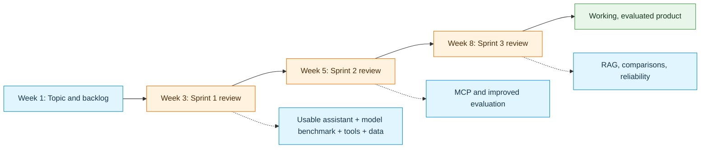
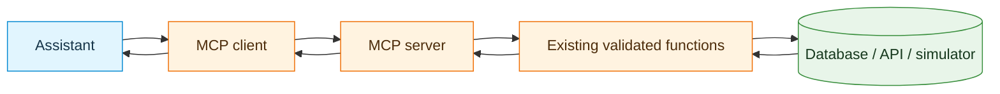

# Neural Network Project — Sprint Milestones and Deliverables

**Week 2 guidance · Existing team projects · Sprint Reviews in Weeks 3, 5, and 8**

## 1. Starting point and principle

Project brainstorming, Product Backlogs, and **Sprint 1 planning began in Week 1**. Continue with the selected topic unless the team has a documented reason to change direction. The nine ideas in `01_Project_Ideas_and_Technology_Map.md` are **optional inspiration**, not compulsory replacements for existing projects.

Each sprint should deliver a **working improvement to the same AI product**. The purpose is to investigate the problem, implement and validate a useful solution, compare alternatives, and explain what the evidence supports. Adding more features is not itself proof of improvement.

**Experimentation is required; final adoption depends on evidence.** Every team must benchmark local and Groq-hosted models and implement and evaluate the MCP, RAG, fine-tuning, and multi-agent experiments scheduled below. For each, explain what was tried, what the results showed, and why the approach was kept or removed. The final product may use a simpler configuration when the comparisons support it. Preserve runnable experiment code and evaluation evidence for approaches that are not retained.

### Working rhythm

- **Morning, 09:00–12:00:** New concepts and guided exercises.
- **Afternoon, 13:00–16:00:** Team development, coding marathons, Scrum planning, reviews, and integration.
- **Independent development:** Continue implementation, evaluation, coordination, and documentation outside class.
- **GitHub:** Maintain source code, tests, Product Backlog, Sprint Backlog, decisions, progress, and review evidence.

The course has **three coding marathons (Weeks 2, 4, and 7)** and **three sprint reviews (Weeks 3, 5, and 8)**. Marathon exercises help build implementation skills; their example applications do **not** have to become the team project. Coding marathons and sprint deliverables are distinct assessment components.

The course assessment assigns **10% to Sprint 1, 10% to Sprint 2, and 15% to Sprint 3**. Each coding marathon is assessed separately, alongside other course components; the separate Project Exam follows the final review.

## 2. Sprint 1 — First usable AI product

**Sprint 1 Review / Presentation: Week 3**  
**Project objective:** Demonstrate a usable first version of the selected AI assistant or agent.

The course milestone calls for **a user interface, tools, a database, external API integration, and a required benchmark of local small Qwen against a Groq-hosted model**. Select the product's model configuration using the benchmark evidence. LangChain is the default tool/agent framework. The Week 2 activities provide examples with Groq-hosted Qwen and locally running Qwen3.5-4B; those implementations can be reused or adapted without changing the project's topic.

### Expected product capabilities

1. **Problem and user journey:** State the target user and a task with an observable result.
2. **Usable interface:** Provide a simple interaction surface, such as Streamlit or another suitable interface, for submitting requests and viewing results.
3. **Model benchmark and selection:** Run the project with a local small Qwen model and a Groq-hosted model. Compare them on the same core tasks, then connect the interface to the configuration selected from the results. The final product may use local inference, hosted inference, or a justified combination; both benchmark implementations and their results must be available.
4. **Meaningful tools:** Use appropriately described, typed, validated Python/LangChain tools, including database access and API access that serve the use case. Document a mock API if live access is unavailable; label its data and behavior clearly.
5. **Persistent application data:** Provide a reproducible SQLite database (or a justified equivalent) containing relevant domain information or saved state.
6. **Tool combination:** Demonstrate at least one end-to-end task requiring two or more distinct tools. Show how their results are combined or passed to a dependent step and materially affect the answer.
7. **Evidence and safeguards:** Test missing data or errors, distinguish simulated from live information, and protect side-effecting actions with permissions and confirmation.

**Required local-versus-Groq benchmark:** Run the **same core requests** with local small Qwen and a Groq-hosted model using the same underlying domain tools, tool-choice policy, task constraints, and scoring criteria. Record model IDs, prompts, generation settings, hardware, quantization where used, and tool-call handling. Compare task success, argument validity, execution outcomes, groundedness, repeated calls, latency, and resource/cost needs. Separate deliberate pacing and provider failures from model behavior. Disclose unavoidable configuration differences rather than attributing all differences to hosting alone. Local model setup may be completed outside scheduled class time, as in Step 5 of the Week 2 activity.

**Required decision:** Explain which configuration best serves this project and why. Cite results and tradeoffs rather than claiming one model is universally best. Keep the alternative implementation and its benchmark evidence even if it is not used in the final interface.

### Required Sprint 1 evaluation

Start with a small repeatable suite, rather than relying on a single impressive answer. Include a routine request, a multi-tool request, and a missing-data or conflicting-constraint case. Add a controlled state-change scenario where it belongs to the project.

| Evaluation case | Expected evidence | Observed tools and arguments | Response grounded in data? | Failure or improvement |
|---|---|---|---|---|
| Routine request | [Expected result] | [Actual calls] | [Yes / Partial / No] | [Finding] |
| Multi-tool request | [Expected tool combination] | [Actual calls] | [Yes / Partial / No] | [Finding] |
| Missing data or constraint | [Expected safe behavior] | [Actual calls] | [Yes / Partial / No] | [Finding] |
| Optional write/draft | [Expected permission and state] | [Actual calls] | [Yes / Partial / No] | [Finding] |

Record relevant tool names, inputs, outputs, repeated calls, exceptions, and final answers. A repeated call is not automatically wrong; explain whether it provided useful new evidence. When comparing models, identify whether automatic or forced tool calling was used.

### Sprint 1 review evidence

- [ ] GitHub repository contains runnable code/notebook and setup instructions, with secrets excluded.
- [ ] README explains the **existing project idea**, user task, data sources, limits, and how to reproduce a demo.
- [ ] Functional user interface using the selected model configuration.
- [ ] Runnable local small-Qwen and Groq-hosted benchmark implementations, matched test cases, configuration records, results, and a justified model choice.
- [ ] Tool catalog, database schema/sample data, and external API integration with provenance or simulated-data labels.
- [ ] At least one successful end-to-end multi-tool demonstration with supporting tool results.
- [ ] Initial evaluation cases, trace excerpts, a failure example, and a proposed improvement.
- [ ] Updated Product Backlog and Sprint 1 Backlog in GitHub; completed and unfinished work identified.
- [ ] Evidence of team contributions and the ability to explain implementation choices.
- [ ] Sprint 1 presentation, using the [Sprint 1 presentation template](04_Sprint_1_Presentation_Template.pptx) or an equivalent format covering the required evidence.

**Review discussion:** What works now? Which user task is supported? Which failures were observed? What is the next highest-value improvement?

## 3. Sprint 2 — MCP integration and stronger product

**Sprint 2 Review / Presentation: Week 5**  
**Project objective:** Improve the working product with MCP and additional useful functionality, while strengthening evaluation.

Weeks 3–4 introduce **MCP clients and servers**. Sprint 2 should reuse working domain functions from Sprint 1 where possible rather than replace proven business logic with new copies.

### Expected product capabilities

1. Implement an **MCP server** exposing a meaningful selection of approved project capabilities.
2. Implement an **MCP client** that discovers and invokes those capabilities.
3. Demonstrate a working product request from the interface/assistant through the MCP client and server to the underlying Python functions and data source. A standalone client check is useful preparation but does not replace the integrated demonstration.
4. Preserve validation, permission checks, and clear error messages at the server boundary.
5. Add one useful product improvement guided by Sprint 1 findings and existing Product Backlog priorities.
6. Compare direct-tool behavior and MCP-based behavior on equivalent tasks; document architectural differences and observed reliability.

**Required decision:** Use the comparison to explain the value and cost of MCP for the project. Implement and demonstrate the MCP path for this sprint even if the evidence later supports returning to direct access. A later removal must preserve the MCP experiment and its evaluation evidence.

### Sprint 2 review evidence

- [ ] Working MCP server/client with documented startup and connection instructions.
- [ ] MCP capability list, input schemas, and updated architecture diagram.
- [ ] Trace of successful capability discovery and tool execution, plus an error case.
- [ ] Before/after evaluation for representative Sprint 1 tasks, noting whether functionality was preserved.
- [ ] Decision record explaining MCP's observed benefits, integration costs, and intended role in the product.
- [ ] Demonstration of the added user-facing capability or quality improvement.
- [ ] Updated tests, README, GitHub Product Backlog, and Sprint 2 Backlog.
- [ ] Sprint 2 review findings and prioritized Sprint 3 user stories.

**Review discussion:** What did MCP change in the application architecture? Was tool behavior preserved? Which errors or integration costs were introduced? Which improvements matter to the intended user?

## 4. Sprint 3 — Integrated, evaluated AI product

**Sprint 3 Review / Presentation: Week 8**  
**Project objective:** Deliver and validate the most useful version of the product, supported by completed model, MCP, RAG, fine-tuning, and multi-agent comparisons, documented safeguards, and justified final design choices.

Weeks 5–7 introduce RAG, multi-agent systems, fine-tuning, and reliability/security. **Every team must implement and evaluate a focused project experiment for each of RAG, fine-tuning, and multi-agent systems.** Scope each experiment to a small representative task so that it can be completed and checked. A design-only proposal or feasibility discussion does not replace the experiment. Document failed attempts and resource constraints; if an experiment remains incomplete, identify that requirement as unresolved and do not claim that the approach was shown to be ineffective.

Use the comparisons to decide what to keep. A technique that improves the relevant outcome enough to justify its resource use and complexity should be retained; a technique without demonstrated benefit may be removed. Both outcomes require evidence. The final application need not run all experimental alternatives, but the submitted project must show that they were implemented, tested, and considered in the decision.

### A. RAG: retrieving relevant knowledge

Build and run a retrieval process over a small project-relevant corpus (for example manuals, policies, troubleshooting articles, or specifications). Compare the same questions with and without retrieval, keeping the model and other settings fixed where possible. Record document sources and permissions, show which passages were retrieved, and evaluate whether retrieval improves grounding, completeness, or missing-evidence behavior enough to justify its overhead. Decide whether to keep RAG in the final product.

**Evidence:** Corpus description, runnable ingestion/retrieval pipeline, shared questions, with/without retrieval results, retrieved passages, source-supported answers, missing-evidence cases, and a justified keep/remove decision.

### B. Fine-tuning: testing a targeted behavior

Identify a narrow project behavior suitable for training, such as intent classification, constraint extraction, ticket categorization, or structured output. Prepare training and held-out test examples, run a focused fine-tuning experiment, and compare the trained model with the same model's untuned baseline on the held-out test set. Keep test examples out of training and model-selection decisions. Use task-relevant metrics and record the model, training settings, resource needs, failures, and limitations. Fine-tuning is **not** a substitute for querying live data or retrieving documents. Decide whether the measured improvement justifies keeping the tuned component.

**Evidence:** Dataset provenance and split, runnable training configuration/code, evidence of the training run, untuned and tuned held-out results, resource/quality tradeoffs, limitations, and a justified keep/remove decision. A feasibility study alone does not satisfy this experiment.

### C. Multi-agent systems: evaluate before adopting

Implement a small division of project responsibilities, such as planning and verification, and run it as a multi-agent alternative. Compare the same representative tasks with the existing **single-agent baseline**, using equivalent tools, data, model configuration, and evaluation criteria where possible. Record task success, tool calls, groundedness, latency, resource/cost needs, failure handling, and complexity. Keep the multi-agent design if its benefits justify its overhead; otherwise retain the single-agent solution and explain the evidence.

**Evidence:** Runnable single-agent and multi-agent implementations, architecture comparison, equivalent tasks, execution traces, measured results, and a justified keep/remove decision. A design sketch without execution does not satisfy this experiment.

### D. Security, reliability, and usability

Examine input validation, tool permissions, confirmation for side effects, secret management, prompt-injection risks from untrusted tool results/documents, failure behavior, and the quality of the user interface. Re-run the evaluation cases saved from Sprints 1–2 to identify regressions.

### Required experiment and decision summary

For each model, MCP, RAG, fine-tuning, and multi-agent comparison, include:

- **Project question:** What outcome was the approach expected to improve?
- **Baseline and alternative:** What was implemented and compared? Identify configurations and differences.
- **Method:** Which shared tasks/data, metrics, and resource conditions were used? Repeat representative cases when behavior varies.
- **Observed results:** What improved, failed, stayed unchanged, or introduced overhead? Link code, traces, and measured results.
- **Decision:** What was kept, changed, or removed from the final product, and why do the results support that choice?
- **Reproducibility and limits:** How can the experiment be rerun, and which uncertainties or unresolved failures remain?

Also compare reliability with the earlier product version and record regressions. A useful conclusion may be: "We tried both approaches on these tasks; the alternative added latency without improving task success, so we kept the baseline." Support that statement with the actual results, even when they contradict the expected outcome.

### Sprint 3 final review evidence

- [ ] Working integrated product with interface and reproducible execution/deployment instructions.
- [ ] Updated architecture showing the selected model, tools, persistence, APIs, and experimental approaches retained in the final product.
- [ ] Systematic evaluation results with comparable baselines and trace examples.
- [ ] Completed RAG implementation and with/without retrieval comparison, with a justified keep/remove decision.
- [ ] Completed fine-tuning run and untuned-versus-tuned held-out evaluation, with a justified keep/remove decision.
- [ ] Executed single-agent-versus-multi-agent comparison, including measured benefits, overhead, and a justified keep/remove decision.
- [ ] Consolidated decision history for models, MCP, RAG, fine-tuning, and multi-agent design; runnable experiment code/evidence retained for approaches removed from the final application.
- [ ] Security/reliability discussion and documented safeguards.
- [ ] Final GitHub code, data/setup scripts where permitted, tests, and project documentation.
- [ ] Sprint 3 presentation and demonstration, including team decisions and individual contributions.

The final **Project Exam** takes place separately from the Week 8 Sprint Review.

## 5. GitHub and Scrum expectations throughout

At planning and review time, maintain:

- **Product Backlog:** Continually refined using **DEEP** principles (detailed appropriately, estimated, emergent, prioritized).
- **Sprint Backlog:** User stories with **INVEST** characteristics (independent, negotiable, valuable, estimable, small, testable) and explicit acceptance checks.
- **Sprint Goal:** One coherent product improvement, not only a list of technologies.
- **Progress evidence:** Commits, tests, issues, decisions, review notes, and demonstrations.
- **Teamwork:** Fair distribution of implementation work, integration of contributions, and readiness to explain the code and choices.

Use AI coding assistants to explore, implement, or debug, but **review and test generated code**. Document external data provenance, avoid publishing credentials and private information, and take responsibility for submitted decisions.

## 6. Final review questions for every sprint

1. What user problem can the product solve at the current sprint review?
2. Which functions/tools and data sources were actually used?
3. What evidence demonstrates correct execution and a grounded answer?
4. What failed, what was changed, and what remains unresolved?
5. Did the new capability improve the product or only add complexity?
6. Which GitHub user stories are completed, and what is the next Sprint Goal?
7. How did different team members contribute to implementation and evaluation?
8. Which alternatives were implemented and compared, what did the results show, and why were they kept or removed?

**Related documents:** The [project ideas catalog](01_Project_Ideas_and_Technology_Map.md) contains optional topics; the [project brief](02_Project_Brief_and_Requirements.md) describes the project and examples; the [Sprint 1 presentation template](04_Sprint_1_Presentation_Template.pptx) provides an optional review format. Use this document for required sprint evidence; the catalog's optional examples do not replace those requirements.
