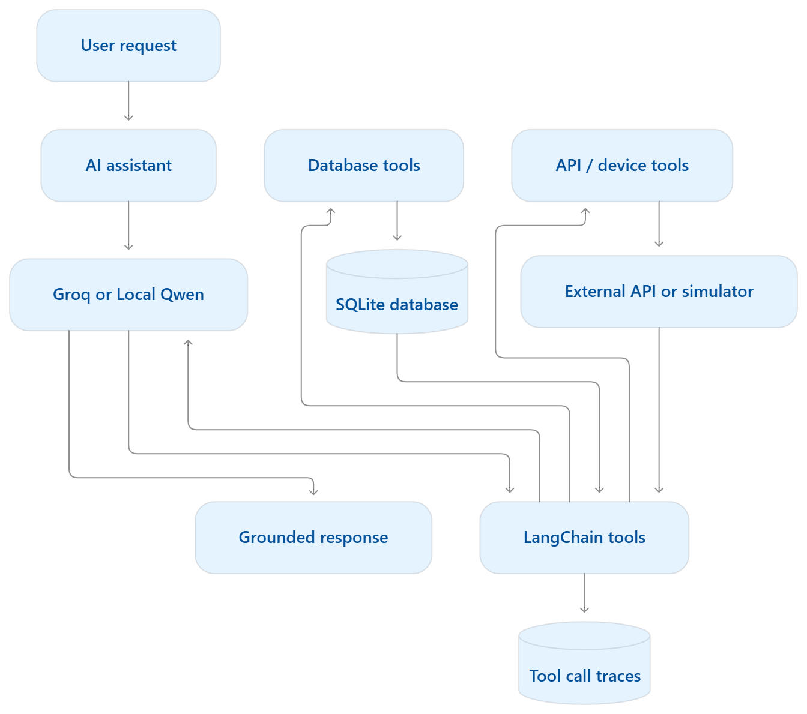

I would present these as nine suggested AI-agent projects that can evolve across three sprints, rather than nine isolated application ideas.

The key is to ensure that even a relatively simple project has enough depth to support the technologies introduced later: MCP, RAG, fine-tuning, and multi-agent systems.

For example, a smart home assistant that only turns lights on and off is too simple. But an assistant that manages devices, understands user preferences, monitors sensor readings, explains its decisions, and evaluates energy consumption can become a substantial project.

# 1. Common project architecture

Every project should begin with the same fundamental architecture introduced in the bookstore and weather activities.

The project should involve more than asking an LLM questions. It should demonstrate how an LLM selects tools, retrieves information, performs controlled actions, and combines results.

## Agreed experimentation and selection principle

Teams must implement and benchmark local small Qwen and a Groq-hosted model on representative project tasks, then justify the configuration used in the product. MCP, RAG, fine-tuning, and multi-agent work must likewise be implemented and evaluated in focused project experiments during the relevant sprints. The required learning outcome is evidence from trying and comparing the approaches, followed by a justified keep/remove decision. Final products need not retain approaches whose measured benefits do not justify their overhead. Preserve experiment code and results even when an approach is removed; a design or feasibility discussion alone does not replace execution.

## Three-sprint roadmap

| Sprint                           | Technologies                                      | Required project progress                                                                                                             |
| -------------------------------- | ------------------------------------------------- | ------------------------------------------------------------------------------------------------------------------------------------- |
| Sprint 1 — Working AI assistant  | Python, SQLite, APIs, LangChain, Groq, local Qwen | Build and benchmark local/hosted versions on the same tasks; demonstrate the product using a justified model choice. |
| Sprint 2 — MCP integration       | MCP server and client                             | Expose existing capabilities through an MCP server and access them through an MCP client. Demonstrate that the assistant still works. |
| Sprint 3 — Intelligent assistant | RAG, fine-tuning, multi-agent systems             | Implement and compare with/without RAG, untuned/tuned behavior, and single/multi-agent execution; retain approaches with demonstrated project benefit. |

MCP does not replace the database or business logic; it provides a standardized interface for exposing tools, resources, and prompts. The existing Python functions can therefore be reused in Sprint 2.&#x20;

[image](https://www.google.com/s2/favicons?domain=https://py.sdk.modelcontextprotocol.io\&sz=32)

MCP Python SDK

+1

# 2. Suggested project ideas

## Project 1 — Smart Home and IoT Assistant

Very good fit for all three sprints

User scenario: "It is cold in the living room. Set the temperature to 23°C, turn on the lights, and show today's energy usage."

| Component            | Suggestions                                                                                 |
| -------------------- | ------------------------------------------------------------------------------------------- |
| Tools                | `get_temperature`, `turn_on_light`, `set_thermostat`, `get_energy_usage`, `list_devices`    |
| Database             | `rooms`, `devices`, `sensor_readings`, `energy_usage`, `user_preferences`, `action_history` |
| Why SQLite?          | Stores device information, temperature history, preferences, and actions for later analysis |
| Interaction          | Chat with the assistant to monitor and control devices and request summaries                |
| External integration | Simulated devices or an IoT API; real hardware is optional                                  |

Future development: Sprint 2 can expose device controls and sensor readings through an MCP server. Sprint 3 can use RAG to answer questions from device manuals, fine-tuning to improve command interpretation, and multiple agents to separate device control from energy optimization.

A simulator should be provided when physical IoT hardware is unavailable. Temperature limits and confirmation for sensitive actions should be enforced by application code.

## Project 2 — University Course Registration Agent

Excellent database-centered project

User scenario: "Find two AI-related courses next semester that have available seats, satisfy my prerequisites, and do not conflict with my timetable."

| Component            | Suggestions                                                                                                        |
| -------------------- | ------------------------------------------------------------------------------------------------------------------ |
| Tools                | `search_courses`, `check_prerequisites`, `check_schedule_conflicts`, `get_available_seats`, `register_course`      |
| Database             | `courses`, `students`, `prerequisites`, `sections`, `enrollments`, `timetables`                                    |
| Why SQLite?          | Provides structured course relationships, prerequisites, capacity, registration history, and timetable information |
| Interaction          | Search courses, construct a timetable, verify eligibility, and request enrollment                                  |
| External integration | Simulated registration API or institution-provided course information                                              |

Future development: MCP exposes the registration and timetable tools. RAG retrieves degree requirements and academic policies. Fine-tuning can be tested on course-request classification. A multi-agent design could compare a course advisor, timetable planner, and registration verifier.

A particularly useful evaluation is checking whether the assistant correctly rejects a registration when prerequisites are missing, a section is full, or timetable conflicts exist.

Real registration actions should require explicit confirmation. A simulated university system is sufficient for the course project.

## Project 3 — Inventory and Supply Management Agent

Excellent fit for evaluation and multi-agent work

User scenario: "Check which products are running low, compare suppliers, and prepare a replenishment order within a €500 budget."

| Component            | Suggestions                                                                                              |
| -------------------- | -------------------------------------------------------------------------------------------------------- |
| Tools                | `check_stock`, `get_sales_history`, `find_supplier`, `estimate_reorder_quantity`, `draft_purchase_order` |
| Database             | `products`, `suppliers`, `stock_movements`, `sales`, `purchase_orders`, `supplier_prices`                |
| Why SQLite?          | Maintains inventory quantities, sales history, suppliers, reorder decisions, and pending orders          |
| Interaction          | Ask about inventory, low-stock products, and recommended purchases                                       |
| External integration | Supplier API or simulated supplier quotations                                                            |

Future development: MCP exposes stock-management functions. RAG retrieves supplier catalogs and purchasing policies. Fine-tuning can focus on product categorization. Multi-agent systems could compare an inventory analyst and purchasing agent with a single-agent approach.

This is a particularly strong choice because many recommendations can be checked numerically. The final answer should agree with stock levels, prices, and budget constraints.

## Project 4 — Coding and Debugging Assistant

User scenario: "The Python project fails during testing. Identify the failure, explain the likely cause, and suggest a correction."

| Component            | Suggestions                                                                                      |
| -------------------- | ------------------------------------------------------------------------------------------------ |
| Tools                | `read_file`, `search_code`, `run_tests`, `inspect_error_log`, `suggest_fix`, `apply_patch`       |
| Database             | `projects`, `test_runs`, `error_logs`, `patch_history`, `evaluation_results`                     |
| Why SQLite?          | Tracks recurring problems, code changes, previous fixes, and test outcomes                       |
| Interaction          | Submit a repository or code sample, request debugging, inspect explanations, and approve changes |
| External integration | Git repository, test runner, issue tracker, or documentation service                             |

Future development: MCP can expose code-inspection and testing tools. RAG retrieves project documentation and relevant code. Fine-tuning can classify bug types or improve structured diagnostic reports. A multi-agent comparison could use a debugging agent, patch-generation agent, and testing agent.

For safety and reproducibility, code execution should occur in an isolated test environment with controlled permissions. The project should not permit unrestricted shell execution or automatically apply arbitrary model-generated patches.

## Project 5 — Public Transport Assistant

User scenario: "Find a journey from home to the university tomorrow morning that arrives before 9:00 and involves at most one transfer."

| Component            | Suggestions                                                                                          |
| -------------------- | ---------------------------------------------------------------------------------------------------- |
| Tools                | `find_stop`, `get_departures`, `search_routes`, `plan_journey`, `get_service_alerts`, `save_commute` |
| Database             | `stops`, `routes`, `saved_journeys`, `user_preferences`, `schedule_snapshots`                        |
| Why SQLite?          | Stores transport reference data, preferred routes, saved journeys, and historical searches           |
| Interaction          | Ask for routes, compare travel options, save frequent journeys, and inspect service disruptions      |
| External integration | Transport schedule API or static GTFS data                                                           |

Future development: MCP exposes schedules and route-search functions. RAG retrieves ticket rules and accessibility information. Fine-tuning can focus on travel-intent and constraint extraction. A multi-agent comparison could separate route planning and service-disruption verification.

This project is attractive but depends on available transport data. Static schedules should not be misrepresented as real-time departure information.

## Project 6 — Personal Finance Assistant

User scenario: "Summarize my spending this month, identify the largest spending categories, and compare the results against my budget."

| Component            | Suggestions                                                                                                               |
| -------------------- | ------------------------------------------------------------------------------------------------------------------------- |
| Tools                | `get_transactions`, `categorize_expense`, `get_budget`, `calculate_spending`, `compare_months`, `detect_unusual_expenses` |
| Database             | `transactions`, `categories`, `budgets`, `accounts`, `monthly_summaries`                                                  |
| Why SQLite?          | Maintains transaction histories, category classifications, budget limits, and previous analyses                           |
| Interaction          | Upload a sample CSV statement, ask financial questions, set budgets, and inspect spending trends                          |
| External integration | CSV import or mock banking API                                                                                            |

Future development: MCP exposes transaction-analysis tools. RAG retrieves financial policies or transaction-category guidance. Fine-tuning can classify transaction descriptions. A multi-agent comparison could separate categorization, financial analysis, and explanation.

I recommend using synthetic financial data and focusing on budgeting and explanation rather than investment recommendations or real payments.

## Project 7 — Restaurant Ordering Assistant

User scenario: "Find a vegetarian meal under €20, show the total price, and prepare an order for collection."

| Component            | Suggestions                                                                                                               |
| -------------------- | ------------------------------------------------------------------------------------------------------------------------- |
| Tools                | `search_menu`, `check_availability`, `filter_dietary_options`, `calculate_order_total`, `place_order`, `get_order_status` |
| Database             | `menu_items`, `ingredients`, `stock`, `customers`, `orders`, `order_items`                                                |
| Why SQLite?          | Stores menu details, availability, dietary information, customer preferences, and order status                            |
| Interaction          | Explore the menu conversationally, compare dishes, build a cart, and confirm an order                                     |
| External integration | Mock restaurant-ordering API                                                                                              |

Future development: MCP exposes menu and ordering functions. RAG retrieves menu descriptions and restaurant policies. Fine-tuning can improve order-intent extraction and structured order generation. Multiple agents could separate menu recommendations, order validation, and fulfillment.

The key difference between a simple chatbot and an agent is that the system checks menu availability and calculates totals using tools instead of inventing them.

For any dietary restriction or allergy, the assistant should avoid guaranteeing safety from incomplete ingredient data. Placing an order should require confirmation.

## Project 8 — IT Help-Desk Assistant

One of the strongest projects for Sprint 3

User scenario: "The university Wi-Fi is not working on my laptop. Help diagnose the problem and create a support ticket if necessary."

| Component            | Suggestions                                                                                                           |
| -------------------- | --------------------------------------------------------------------------------------------------------------------- |
| Tools                | `search_known_issues`, `get_device_info`, `run_diagnostic`, `create_ticket`, `check_ticket_status`, `escalate_ticket` |
| Database             | `tickets`, `devices`, `issue_categories`, `diagnostic_results`, `ticket_history`                                      |
| Why SQLite?          | Stores support requests, device information, issue history, and resolution outcomes                                   |
| Interaction          | Explain a problem, follow troubleshooting steps, open a ticket, and monitor its status                                |
| External integration | Simulated IT service API or issue tracker                                                                             |

Future development: MCP exposes troubleshooting and ticket-management tools. RAG searches technical documentation and previous solutions. Fine-tuning can classify ticket categories and urgency. Multi-agent systems can be tested using a triage agent, technical support agent, and escalation agent.

This is one of my favorites for the course because RAG, fine-tuning, and multi-agent design each solve a clearly different problem.

## Project 9 — Environmental Monitoring Agent

Strong API + database project

User scenario: "Compare air quality and temperature across monitoring locations, identify unusual readings, and explain which locations need attention."

| Component            | Suggestions                                                                                                                |
| -------------------- | -------------------------------------------------------------------------------------------------------------------------- |
| Tools                | `get_sensor_readings`, `get_air_quality`, `compare_locations`, `check_thresholds`, `create_alert`, `get_historical_trends` |
| Database             | `monitoring_stations`, `sensor_readings`, `thresholds`, `alerts`, `historical_snapshots`                                   |
| Why SQLite?          | Preserves time-series sensor values, thresholds, and alert histories for comparisons                                       |
| Interaction          | Ask about environmental conditions, investigate changes, compare locations, and request alerts                             |
| External integration | Open-Meteo Air Quality and other environmental monitoring APIs                                                             |

Future development: MCP exposes monitoring functions. RAG retrieves environmental documentation and standards. Fine-tuning can classify incident descriptions. Multi-agent systems could separate observation, analysis, and reporting.

The central evaluation is whether the assistant's conclusions actually follow from measured data and configured thresholds.

# 3. Which projects are best for the course?

I would distinguish technical suitability from the attractiveness of the topic.

| Project                  | Sprint 1 feasibility     | RAG potential | Fine-tuning potential | Multi-agent potential |
| ------------------------ | ------------------------ | ------------- | --------------------- | --------------------- |
| Smart Home / IoT         | High with simulation     | High          | Medium                | High                  |
| Course Registration      | High with mock data      | High          | Medium                | High                  |
| Inventory Management     | High                     | High          | High                  | High                  |
| Coding Assistant         | Medium                   | Very high     | Medium                | High                  |
| Public Transport         | Medium                   | Medium        | Medium                | High                  |
| Personal Finance         | High with synthetic data | Medium        | High                  | Medium                |
| Restaurant Ordering      | High                     | Medium        | Medium                | High                  |
| IT Help Desk             | High                     | Very high     | High                  | Very high             |
| Environmental Monitoring | High                     | High          | Medium                | High                  |

These are instructional estimates, not measured model-performance results.

For teams still looking for a project, my strongest starting recommendations would be IT Help Desk, Inventory Management, University Course Registration, Smart Home, and Environmental Monitoring. They provide accessible data models, meaningful tool workflows, and clear ways to evaluate performance.

# 4. What each sprint should add

## Sprint 1 — Tools and working assistant

Every project should demonstrate:

- Runnable local small-Qwen and Groq-hosted benchmark versions, matched project tasks and results, and a functioning product using the justified selected configuration.
- At least four meaningful tools, including database access and a controlled action or update.
- SQLite persistence across multiple requests.
- At least one multi-step request requiring a combination of tools.
- A small evaluation suite comparing correct tool selection, argument validity, execution success, groundedness, repeated calls, and latency.

The local Qwen implementation can be completed outside scheduled class time, consistent with the morning activity structure.

The model comparison is required. The final product may use hosted inference, local inference, or a justified combination; it does not need to expose both benchmark alternatives in its interface.

## Sprint 2 — MCP client and server

The key requirement should be to preserve the working Sprint 1 application while changing how its capabilities are exposed.

For example, the Smart Home project could implement an MCP server exposing `get_temperature`, `set_thermostat`, and `get_energy_usage`. The assistant uses an MCP client to discover and call these capabilities instead of directly importing all functions.

The project should demonstrate a separate MCP server, a working client, capability discovery, tool execution, and error handling.

This makes MCP an architectural improvement rather than merely adding a decorator to existing functions.

## Sprint 3 — RAG, fine-tuning, and multi-agent comparison

These technologies should have distinct purposes.

Every team must run a small project-relevant RAG experiment, a focused fine-tuning run, and an implemented multi-agent comparison against the appropriate baselines. The project report must explain what was tried, what the measured results showed, and why each approach was kept or removed. Retaining all three in the final application is not required. Incomplete experiments must be reported as unresolved, rather than presented as evidence that a technology offers no benefit.

| Technology  | Main question                                                                       | Example                                                  |
| ----------- | ----------------------------------------------------------------------------------- | -------------------------------------------------------- |
| RAG         | How can the assistant access relevant knowledge that is not in the model's context? | IT assistant retrieves troubleshooting documentation     |
| Fine-tuning | Can training improve a specific behavior or structured task?                        | Classify IT tickets or transaction categories            |
| Multi-agent | Does dividing responsibilities improve task results?                                | Compare one IT assistant against triage + support agents |

I would emphasize that fine-tuning is not simply an alternative to RAG. RAG is useful for retrieving changing or reference knowledge. Fine-tuning can improve specific learned behaviors when an appropriate training dataset is available.

Also, a multi-agent system should not automatically receive higher marks because it uses more agents. The comparison needs to establish whether it improves accuracy, reliability, or task completion enough to justify additional latency and complexity.

# 5. Avoiding projects that are too simplistic

I recommend defining a minimum level of project complexity.

A project that simply calls one tool and returns its result is a demonstration, not a sufficiently developed course project.

A stronger project must support stateful interactions, multiple tools, at least one multi-step workflow, and measurable outcomes.

For example:

Smart Home Assistant

Too simple

"Turn on the living-room light."

One request, one tool, no meaningful reasoning.

Appropriate project scope

"The living room is cold. Check the current temperature, apply the preferred comfort setting, adjust the thermostat if needed, and explain the estimated effect on energy usage."

Requires device information, stored preferences, several tool calls, controlled actions, and an evidence-based explanation.

This principle applies to all nine project ideas.

# 6. How to connect project selection to the code marathon

At the end of the weather and trip-planner marathon, I suggest including a short project brainstorming activity.

Each team should identify a user problem, propose at least four tools, specify which operations use an API or database, and describe how the application will become more capable in Sprints 2 and 3.

They should also propose one evaluation question that has an objectively checkable outcome.

For example, rather than "Does the university assistant give good advice?", use "Does it reject courses with unmet prerequisites or timetable conflicts?"

This gives a concrete basis for implementation and future comparisons.

## One additional recommendation

I would provide these nine projects as a project idea catalog, with a common three-sprint specification. The catalog should inspire project choices without forcing every team into exactly the same architecture.

An effective project proposal should demonstrate three things:

A real user problem, tools and data that are necessary to solve it, and a way to measure whether the solution works.

That will help teams improve simplistic ideas and provide a consistent foundation for teaching MCP, RAG, fine-tuning, and multi-agent systems over the following weeks.
