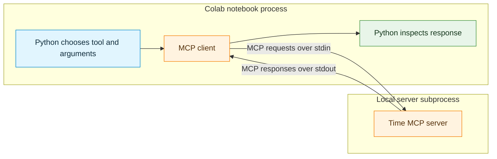
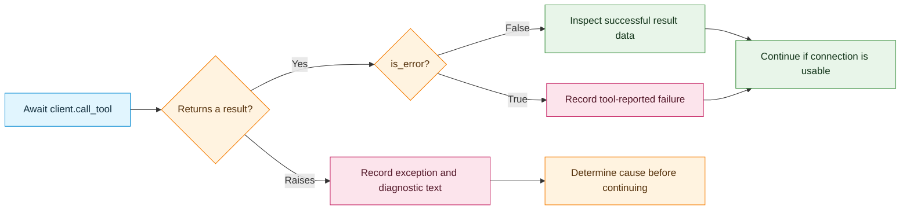

# Activity 1 — Understanding MCP Clients: Connect, Discover, and Call Tools

**Format:** Short guided demonstration  
**Estimated scope:** 30–45 minutes  
**Environment:** Google Colab, Python 3.11 or later, CPU runtime  
**Required packages:** Python MCP SDK and `uv`  
**Language model:** Not required  
**LangChain:** Not required  
**External API key:** Not required

## Learning objective

Use the official Python MCP SDK to connect to an existing Model Context Protocol (MCP) server, discover its tools, inspect their input schemas, invoke them with arguments, and examine successful and unsuccessful responses.

### What you need to know

You should be able to run Python notebook cells, read dictionaries, and recognize function calls. No earlier course activity is required. Create a new Colab notebook and run the code cells below in order, keeping their outputs. The `%pip` cell and top-level `async with` blocks are notebook syntax; the cells are not a standalone Python script.

MCP is a protocol through which an application accesses capabilities provided by a server. In this activity, your notebook is the application containing an MCP client. You explicitly choose each tool and its arguments in Python; no language model makes those decisions. A server can offer tools, resources, and prompts, but this activity uses tools only.

By the end of the demonstration, the following distinctions should be clear:

- A **server** advertises and implements capabilities.
- A **client** connects to a server, discovers available tools, and requests operations.
- A **tool schema** describes valid arguments; it is not a tool result.
- A **tool call** is an explicit request, while a **tool result** records the outcome.
- MCP can operate without LangChain or a language model.

## 0. The scenario and architecture

The example uses the [Time MCP Server](https://github.com/modelcontextprotocol/servers/tree/main/src/time), an existing reference server that provides current time information and timezone conversions. It exposes two relevant tools:

| Tool name | Purpose | Main arguments |
|---|---|---|
| `get_current_time` | Retrieve the current time for an IANA timezone | `timezone` |
| `convert_time` | Convert a clock time between timezones | `source_timezone`, `time`, `target_timezone` |

An **IANA timezone** is a regional identifier such as `Europe/Helsinki` or `Asia/Tokyo`. It is preferable to a hard-coded UTC offset because regional offset rules can change with daylight saving time.



**Transport:** `stdio` (standard input and standard output). The client launches the server as a child process and exchanges MCP protocol messages with it. There is no public server URL and no separate server notebook to run in this demonstration.

The Time server computes timezone information locally. Internet access is required to install the notebook dependencies and, on first launch, to download the server and its dependencies through `uvx`. Once installed, time calculations use the runtime clock and timezone database rather than a weather or time web API.

---

## Step 1 — Prepare Google Colab and the server configuration

**Goal:** Install the client SDK and configure the existing server command. Installing an MCP client library does not automatically connect to a server.

### 1.1 Install the dependencies

Select a CPU runtime in Google Colab. Run this cell:

```python
%pip -q install -U "mcp>=2,<3" uv
```

The `mcp` package provides the **Python MCP client SDK**. The `uv` package provides `uvx`, a command that can download and run an existing Python MCP server in an isolated environment. A GPU, Groq API key, and LangChain are unnecessary for this demonstration.

**Compatibility note:** These cells use the SDK v2 `Client` interface and snake_case result attributes. SDK v1 examples use different client setup and attribute names; do not mix them into these cells. `uvx` runs the server in a separate environment and resolves its dependencies independently. The server release determines its SDK requirements; do not assume that it requires v1. Record the client version below and the server version in Step 2 when reporting results. The [Time server package metadata](https://github.com/modelcontextprotocol/servers/blob/main/src/time/pyproject.toml) declares its current requirements.

If installation reports that no matching SDK v2 distribution is available, confirm that the notebook uses Python 3.11 or later and has access to the public package index. An institution-managed package mirror may not contain the required release. An SDK v1 installation cannot run these v2 cells unchanged.

### 1.2 Import the client and configure a server process

Run this cell after installation:

```python
import json
import shutil
from importlib.metadata import version

from mcp import Client, StdioServerParameters
from mcp.types import TextContent

uvx_path = shutil.which("uvx")
assert uvx_path is not None, (
    "uvx was not found. Confirm that the uv installation succeeded, "
    "then restart the Colab runtime if necessary."
)

TIME_SERVER = StdioServerParameters(
    command=uvx_path,
    args=["mcp-server-time"],
)

print("MCP Python SDK version:", version("mcp"))
print("Server launcher:", uvx_path)
print("Server package: mcp-server-time")
```

**Observe:** `TIME_SERVER` holds launch instructions. It does not contain the server's tools or start the server yet. The server is launched when the MCP client connection is opened.

**Concept check:** Identify the difference between an executable command (`uvx`) and the MCP server package that it starts (`mcp-server-time`).

---

## Step 2 — Establish an MCP client connection

**Goal:** Connect to the Time MCP server and inspect connection information. The connection is active only inside the `async with` block.

```python
async with Client(TIME_SERVER) as client:
    print("Connected to the MCP server.")
    print("Negotiated protocol version:", client.protocol_version)
    print("Server identity:", client.server_info)
    print("Server capabilities:", client.server_capabilities)

print("The connection has been closed.")
```

**Observe:** Entering this context starts a local server subprocess and establishes the protocol connection; exiting closes the connection and shuts down that subprocess. Each later `async with Client(TIME_SERVER)` block creates a fresh client and server process. Run each complete block together in one notebook cell; do not try to use its `client` after the block exits. The exact server version and protocol metadata can depend on the installed server release.

**Why `await` and `async with`?** MCP requests may involve waiting for communication with a server. The Python client API uses asynchronous operations to avoid blocking other work while communication takes place. Google Colab supports `await` directly in notebook cells, so no `asyncio.run(...)` call is required here.

**Record:** Which object represents the MCP client? Which object describes the subprocess to launch? At what point does the server start?

---

## Step 3 — Discover tool definitions

**Goal:** Ask the server what tools it provides. No current-time calculation or timezone conversion is requested in this step.

```python
async with Client(TIME_SERVER) as client:
    response = await client.list_tools()

    print("Number of tools in this response:", len(response.tools))
    print("More result pages:", response.next_cursor is not None)

    for tool in response.tools:
        print("\nTOOL NAME:", tool.name)
        print("DESCRIPTION:", tool.description)
        print("INPUT SCHEMA:")
        print(json.dumps(tool.input_schema, indent=2))
```

**Observe:** `client.list_tools()` sends the MCP `tools/list` request; `client.call_tool(...)` sends `tools/call`. These are SDK methods and protocol operation names, respectively. The server returns tool metadata, including names, descriptions, and JSON-compatible input schemas. Inspect the `properties`, `required`, and `type` fields in each schema. The Time server normally fits into a single response page. If `next_cursor` is not `None`, this cell has shown only one page; a complete discovery workflow must request subsequent pages using `client.list_tools(cursor=response.next_cursor)` until the cursor is `None`.

### 3.1 Record the discovered schema

Complete the following table from the actual output rather than from assumptions:

| Tool | Required fields | Expected argument types |
|---|---|---|
| `get_current_time` | | |
| `convert_time` | | |

**Concept checks:**

1. Which specific field identifies the operation that can be requested?
2. Which part of the schema indicates mandatory arguments?
3. Does `list_tools()` execute either time-related tool? Explain using the returned data.
4. How does discovery differ from importing a known Python function or LangChain tool by name?

**Important:** A schema is a description of accepted inputs. It does not guarantee that every argument value is meaningful, or that a later tool call will succeed.

---

## Step 4 — Call a discovered tool

**Goal:** Invoke `get_current_time` with a specific timezone and examine the returned content.

```python
async with Client(TIME_SERVER) as client:
    result = await client.call_tool(
        "get_current_time",
        {"timezone": "Europe/Helsinki"},
    )

    print("Tool reported an error:", result.is_error)
    print("Structured content:", result.structured_content)
    print("Text content blocks:")

    for block in result.content:
        if isinstance(block, TextContent):
            print(block.text)
```

**Observe:** The returned time is obtained at execution time, so no fixed timestamp is expected. A successful call may return text content without a separate `structured_content` dictionary, depending on the server implementation and negotiated protocol.

### Reading the response correctly

| Field | Meaning |
|---|---|
| `result.content` | Content blocks returned by the server, potentially including text or other media |
| `result.structured_content` | Optional structured result; may be `None` |
| `result.is_error` | Indicates whether the tool reported an error |

The code checks `isinstance(block, TextContent)` because not every MCP content block is necessarily text. This avoids incorrectly assuming that all content has a `.text` attribute.

**Check your result:** A successful current-time response should identify the requested timezone and include a datetime. Check that the datetime includes an offset; do not compare it with a fixed example timestamp. If `is_error` is true, treat the content as a diagnostic rather than a time value.

**Mini-experiment:** Change `Europe/Helsinki` to `Asia/Tokyo`, then `America/New_York`. Record the reported timezone and datetime for each call. Exact times differ across runs.

**Concept check:** Identify the Python statement that actually requests execution of the tool in the separate local server process. Explain why the client itself does not need the source code of the Time server's time calculation.

---

## Step 5 — Call a second tool with multiple arguments

**Goal:** Apply the same client pattern to `convert_time`, whose input schema requires several fields.

```python
async with Client(TIME_SERVER) as client:
    result = await client.call_tool(
        "convert_time",
        {
            "source_timezone": "Europe/Helsinki",
            "time": "14:30",
            "target_timezone": "Asia/Tokyo",
        },
    )

    print("Tool reported an error:", result.is_error)
    print("Structured content:", result.structured_content)

    for block in result.content:
        if isinstance(block, TextContent):
            print(block.text)
```

**Observe:** The tool converts the supplied clock time between the requested timezones. The request supplies a time in 24-hour `HH:MM` format. The server's `convert_time` schema does **not** include a travel date; the reference implementation uses the current date in the source timezone when constructing the source datetime. This example is appropriate for studying tool invocation, but it should not be treated as a verified conversion for a future trip on a particular date, because timezone offsets can change with daylight saving rules.

**Check your result:** Inspect the dates as well as clock times: conversion may cross midnight. Do not assume a constant Helsinki–Tokyo offset throughout the year.

**Experiment:** Replace the target timezone with `Europe/London`. Inspect the returned source and target values and identify which fields remained unchanged in the request.

**Concept check:** Compare the two calls in Steps 4 and 5. What stays the same in the MCP client code, and what changes when a different tool is selected?

---

## Step 6 — Inspect errors and response handling

**Goal:** Distinguish a tool-reported failure from a failure to connect or communicate with the server.

Run the following intentionally invalid requests. The code reports both error results and exceptions because exact error behavior may depend on the server and protocol version.

```python
TEST_CASES = [
    (
        "Invalid timezone",
        "get_current_time",
        {"timezone": "Invalid/NotARealTimezone"},
    ),
    (
        "Missing required argument",
        "get_current_time",
        {},
    ),
    (
        "Unknown tool name",
        "no_such_time_tool",
        {},
    ),
]

async with Client(TIME_SERVER) as client:
    for label, name, arguments in TEST_CASES:
        print("\nCASE:", label)
        try:
            result = await client.call_tool(name, arguments)
            print("Tool error flag:", result.is_error)
            for block in result.content:
                if isinstance(block, TextContent):
                    print("Returned text:", block.text)
        except Exception as exc:
            print("Exception:", type(exc).__name__)
            print("Detail:", str(exc)[:300])
```

**Observe:** Some failures appear as MCP tool results with `is_error=True`; others can be raised as protocol or connection exceptions. An invalid result must not be silently treated as a successful time conversion.

### Two ways a request can fail

An error flag is part of a returned tool result. An exception means the request did not yield that normal result object; it may represent a protocol rejection as well as a communication problem. A protocol exception does not necessarily mean that the connection was lost.



The `try` inside Step 6 catches exceptions from individual calls. A failed launch or connection setup happens while entering `async with`, before that inner `try` runs, so the notebook will instead show a cell error. Inspect the launch command and server diagnostic output in that case.

### Record observations

| Test case | Error flag or exception | Was a normal time result returned? |
|---|---|---|
| Invalid timezone | | |
| Missing argument | | |
| Unknown tool name | | |

**Concept checks:**

1. Why should a client check `is_error` before relying on a tool result?
2. Does discovering a tool guarantee that every possible input will succeed?
3. Why is an unknown tool name different from a valid tool name with invalid arguments?
4. What evidence would distinguish a failed server launch from a tool failure after connection?

---

## Step 7 — Consolidate the MCP client mental model

```mermaid
flowchart LR
    a["Configure launch command"] --> b["Open client context"]
    b --> c["Discover tool schemas"]
    c --> d["Choose tool and arguments"]
    d --> e["Await tool call"]
    e --> f["Inspect content and error flag"]
    f --> g["Record observations"]
    g --> h["Exit context and stop server"]

    classDef input fill:#e1f5fe,stroke:#0288d1,color:#102c3b;
    classDef process fill:#fff3e0,stroke:#f57c00,color:#54300a;
    classDef output fill:#e8f5e9,stroke:#388e3c,color:#14361b;
    class a,d input;
    class b,c,e,f process;
    class g,h output;
```



### Compare direct Python tools with MCP

| Direct Python or LangChain tools | This MCP demonstration |
|---|---|
| Python explicitly imports tool implementations | Client discovers tool descriptions from a server |
| `@tool` wraps a local Python function | MCP server exposes a tool through the protocol |
| `tool.invoke({...})` executes a LangChain tool | `client.call_tool(name, {...})` sends an MCP request |
| Tool logic typically runs in the same Colab process | Tool logic runs in a separate server process in this demonstration |
| Tool descriptions come from locally defined wrappers | Tool descriptions are returned by the server |
| A model may request tools in later steps | No language model is used here |

**Final concept:** MCP standardizes communication between an application and independently provided capabilities. It does not by itself decide which tool should be used in response to a natural-language request.

## Reflection questions

Write concise responses in a final Markdown cell in the Colab notebook.

1. What are the responsibilities of an MCP client and an MCP server?
2. Why is tool discovery a separate operation from tool invocation?
3. Which information does an MCP input schema provide, and what does it not guarantee?
4. What is the role of `stdio` in this demonstration?
5. Why can an MCP client operate without a language model or LangChain?
6. What is the difference between a tool-result error and a connection failure?
7. Suppose you build a trip planner that needs local times in several cities. Which parts of this client workflow could it reuse, and what decisions would the application still need to make?
8. If a second server offered geographical tools, which parts of the client workflow would remain conceptually the same?

## Completion checklist

- [ ] MCP client SDK and `uv` installed in Colab.
- [ ] Client connected to the Time MCP Server.
- [ ] Server identity, protocol version, and capabilities inspected.
- [ ] Available tool names, descriptions, and input schemas recorded.
- [ ] `get_current_time` executed with at least two IANA timezones.
- [ ] `convert_time` executed with three named arguments.
- [ ] At least two invalid requests tested and their outcomes recorded.
- [ ] Reflection questions answered.

**Evidence to retain:** Code cells, relevant outputs, completed schema table, error-observation table, and reflection answers. Current times should be recorded as observed values rather than compared with fixed expected timestamps.

## Applying the workflow to another application

An application can reuse this connection, discovery, invocation, and result-checking workflow for other MCP servers. For example, a trip planner could query time and geographical tools. It would still need to choose relevant tools, supply valid arguments, handle failures, and check that returned information answers the user's question. LangChain or a language model can help organize that application, but neither is required for the MCP exchange demonstrated here.

## References

- [MCP Python SDK — Client documentation (v2)](https://py.sdk.modelcontextprotocol.io/client/)
- [MCP Python SDK — Client transports](https://py.sdk.modelcontextprotocol.io/client/transports/)
- [MCP Python SDK — What's new in v2](https://py.sdk.modelcontextprotocol.io/whats-new/)
- [Time MCP Server — reference implementation and tool schemas](https://github.com/modelcontextprotocol/servers/tree/main/src/time)
- [MCP overview and architecture](https://modelcontextprotocol.io/docs/learn/architecture)
