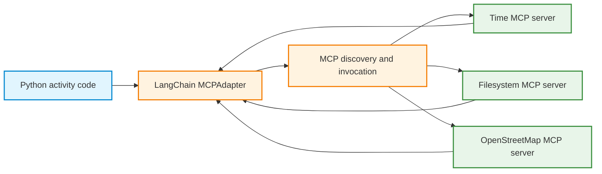

# Activity 2 — MCP-Powered Trip Planner with LangChain and Qwen
## Part A: Steps 1–3 — Discover, Convert, and Combine Existing MCP Tools

**Format:** Guided, hands-on activity  
**Environment:** Google Colab, Python 3.11+, CPU runtime  
**Language model:** Not needed in Part A  
**API keys:** Not needed in Part A  
**Prerequisites:** Python dictionaries, functions, and notebook cells; basic familiarity with MCP clients, tool schemas, and asynchronous calls. [Activity 1](./Activity_1_Understanding_MCP_Clients_revised.md) provides optional preparation.  
**Continuation:** [Part B — Steps 4–6, including homework](./Activity_2_Part_B_Steps_4-6_and_Homework_revised.md)

## Learning objective

Convert tools exposed by existing MCP servers into LangChain tools, invoke them without a language model, and combine several servers for a small trip-planning application. Distinguish the server's tool implementation, the MCP protocol, LangChain's adapter, and the model that will be introduced in Part B.

### Starting point

An MCP server advertises tools with names and input schemas and implements their operations. A client discovers those definitions and requests execution. LangChain provides a common tool interface; its MCP adapter lets Python use server-provided tools without writing a new function for each operation.

Run the cells in order in a new notebook. Notebook commands such as `%pip`, `!`, and `%%writefile` are not ordinary Python script syntax. Current times and geographic results vary, so retain your actual outputs rather than expecting fixed values.

Part A changes the source of the LangChain tools. They are **discovered from MCP servers**, not created by copying API functions into new `@tool` wrappers. The underlying servers continue to perform the operations.

| Direct API-powered workflow | MCP-powered workflow |
|---|---|
| HTTP endpoint provides data | MCP server exposes capabilities |
| Python function contains HTTP request | MCP server contains its own implementation |
| `@tool` wraps a known Python function | `MCPAdapter` discovers and converts server-provided tools |
| LangChain `.invoke()` runs a local wrapper | LangChain `.ainvoke()` forwards an MCP tool request |
| Qwen requests a tool in the agent loop | Qwen will request a discovered MCP tool in Part B |

### Architecture



**Important distinction:** The adapter is not a language model and does not decide which tool to use. In Steps 1–3, Python selects each tool explicitly. Tool selection by Qwen begins only in Step 4.

---

## Step 0 — Prepare the Colab environment

**Goal:** Install the LangChain MCP interface and prepare existing server launch commands. This is setup, not server development.

### 0.1 Install Python dependencies

Run this code in a new Colab CPU notebook:

```python
%pip -q install -U "langchain[mcp]>=1.4.0,<2" uv
```

The `langchain.mcp` namespace provides `MCPAdapter` and integrates with FastMCP. Use the `langchain.mcp` interface shown here; examples using the separate `langchain-mcp-adapters` package use a different API. The API is currently marked beta, so package releases can change its details.

The Python MCP SDK also supports direct client calls. This activity uses LangChain as an **additional application layer**, not as a requirement of the MCP protocol.

Run this version check after installation and keep its output with your notebook:

```python
from importlib.metadata import version

for package in ("langchain", "langchain-core", "fastmcp", "uv"):
    print(package, version(package))
```

If installation cannot find the required release, check Python compatibility and package-index access before continuing. The API used below requires LangChain 1.4 or later with the `mcp` extra; installing an older release does not provide the same interface.

### 0.2 Inspect the Node.js installation

The Time reference server runs through Python's `uvx`. The Filesystem and OpenStreetMap servers run through Node.js and `npx`. The Filesystem reference server currently requires **Node.js 24+**; OpenStreetMap MCP requires **Node.js 22+**.

```python
import shutil
import subprocess

print("uvx:", shutil.which("uvx"))
print("node:", shutil.which("node"))
print("npm:", shutil.which("npm"))
print("npx:", shutil.which("npx"))

if shutil.which("node"):
    print("Node version:", subprocess.check_output(
        ["node", "--version"], text=True
    ).strip())
```

If Node.js is installed but its major version is below 24, run the following Colab cells to install a current release. Installing Node.js downloads external packages.

```bash
!npm install -g n
!n 24
!node --version
!npx --version
```

The leading `!` commands are **Colab notebook shell commands**, not ordinary Python statements. Recheck the version and confirm that `npx` is found. If `npm` is absent or the upgrade fails, repair the Node.js environment before running Steps 2–3. A CPU is sufficient for all of Part A.

### 0.3 Create a reusable server configuration file

The same configurations will be reused in Part B. The filesystem server is restricted to one temporary trip-planner directory. Only four OpenStreetMap tools are registered: `geocode`, `find_nearby_pois`, `route`, and `optimize_route`.

Run the entire following block as one Colab code cell. `%%writefile` must be its first line.

```python
%%writefile trip_mcp_config.py
"""MCP server configuration shared by Parts A and B."""
from pathlib import Path
import shutil

TRIP_DIR = Path("/content/mcp_trip_workspace").resolve()
TRIP_DIR.mkdir(parents=True, exist_ok=True)

UVX = shutil.which("uvx")
NPX = shutil.which("npx")

if UVX is None:
    raise RuntimeError("uvx missing: install the Python uv package.")
if NPX is None:
    raise RuntimeError("npx missing: install Node.js 24+.")

TIME_SERVER = {
    "command": UVX,
    "args": ["mcp-server-time"],
}
FILES_SERVER = {
    "command": NPX,
    "args": ["-y", "@modelcontextprotocol/server-filesystem", str(TRIP_DIR)],
}
OSM_SERVER = {
    "command": NPX,
    "args": ["-y", "osm-mcp"],
    "env": {
        "OSM_ALLOW_TOOLS": (
            "geocode,find_nearby_pois,route,optimize_route"
        ),
    },
}

TIME_CONFIG = {"mcpServers": {"time": TIME_SERVER}}
FILES_CONFIG = {"mcpServers": {"files": FILES_SERVER}}
OSM_CONFIG = {"mcpServers": {"osm": OSM_SERVER}}
TRIP_CONFIG = {
    "mcpServers": {
        "time": TIME_SERVER,
        "files": FILES_SERVER,
        "osm": OSM_SERVER,
    }
}
```

Confirm that the module can be imported:

```python
from trip_mcp_config import (
    TRIP_DIR, TIME_CONFIG, FILES_CONFIG, OSM_CONFIG, TRIP_CONFIG
)

print("Restricted trip directory:", TRIP_DIR)
print("Configured servers:", list(TRIP_CONFIG["mcpServers"]))
```

**Observe:** The file specifies how to start existing MCP servers. It does **not** implement a new MCP server and does not yet launch any server. The `OSM_ALLOW_TOOLS` environment variable limits the OpenStreetMap server's published tools. Public OpenStreetMap-backed services are used only after a tool is invoked.

> **Runtime note:** `trip_mcp_config.py` is created inside the current Colab session. Preserve the notebook or a downloaded copy of the file before restarting. Re-execute the `%%writefile` cell if a new runtime removes it. Avoid saving API keys or other credentials in this module.

---

## Step 1 — Convert the Time MCP server's tools into LangChain tools

**Goal:** Discover two server-provided time tools and obtain LangChain-compatible tools automatically. The server supplies current time and timezone conversions; you do not implement those calculations here.

### 1.1 Discover and inspect the converted tools

```python
import json
from langchain.mcp import MCPAdapter
from trip_mcp_config import TIME_CONFIG

async with MCPAdapter(TIME_CONFIG) as adapter:
    time_tools = await adapter.list_tools()

    print("Discovered tool names:")
    for tool in time_tools:
        print("\nNAME:", tool.name)
        print("DESCRIPTION:", tool.description)
        print("ARGUMENTS:")
        print(json.dumps(tool.args, indent=2, ensure_ascii=False))
        print("TOOL CLASS:", type(tool).__name__)
```

**Observe:** The returned objects are LangChain tools. The adapter has contacted an MCP server and converted the discovered tool metadata into LangChain's standard tool interface.

When several servers are configured, LangChain uses server-name prefixes to distinguish the origins of tools. With this configuration, the expected names are `time_get_current_time` and `time_convert_time`. Use the **actual discovered names** when a package version reports a different naming convention.

The single-server configurations here are still `mcpServers` dictionaries, so the adapter prefixes tools with their configuration keys even when only one server is present. The cells use those expected names and will raise `KeyError` if discovery differs. If that happens, inspect the catalog and update the names consistently before continuing.

The [adapter lifecycle documentation](https://docs.langchain.com/oss/python/langchain/mcp/connections) describes reentrant tools that can reopen their client after discovery. These examples keep discovery and invocation in the same context to hold one connection while the cell runs.

### 1.2 Invoke a converted tool without a language model

```python
from langchain.mcp import MCPAdapter
from trip_mcp_config import TIME_CONFIG

async with MCPAdapter(TIME_CONFIG) as adapter:
    tools = {item.name: item for item in await adapter.list_tools()}
    time_tool = tools["time_get_current_time"]

    result = await time_tool.ainvoke({
        "timezone": "Europe/Helsinki"
    })
    print("Returned type:", type(result).__name__)
    print("Returned content:", str(result)[:3000])
```

**Observe:** `ainvoke()` is LangChain's asynchronous tool invocation interface. The adapter forwards the request over MCP to the server; the server determines the current time. The current time changes between runs, so no fixed timestamp is expected.

### 1.3 Test an argument error

```python
from langchain.mcp import MCPAdapter
from trip_mcp_config import TIME_CONFIG

async with MCPAdapter(TIME_CONFIG) as adapter:
    tools = {item.name: item for item in await adapter.list_tools()}

    try:
        result = await tools["time_get_current_time"].ainvoke({})
        print("Tool returned:", result)
    except Exception as exc:
        print("Validation or execution exception:", type(exc).__name__)
        print(str(exc)[:500])
```

**Observe:** An empty argument dictionary omits the required timezone. Depending on the validation path and adapter version, this can appear as a local exception or a returned tool-error message. Record the observed form rather than assuming one specific error type.

**Concept checks:**

1. Which line establishes the MCP connection?
2. Which line discovers and converts the server's tools?
3. Which object exposes `.ainvoke()`?
4. Does `.ainvoke()` execute time code inside LangChain, or request execution by the MCP server?
5. What is the difference between the MCP SDK's `call_tool()` from Activity 1 and LangChain's `.ainvoke()` here?

---

## Step 2 — Use a second MCP server: Filesystem

**Goal:** Observe that an MCP server can expose tools with side effects, such as writing a file. The examples use paths inside the temporary trip directory, and the server enforces its configured allowed-directory boundary.

The Filesystem reference server supports `list_allowed_directories`, `write_file`, `read_text_file`, and other operations. It is started with one explicit allowed directory, rather than being granted access to all Colab files.

### 2.1 Discover the Filesystem tools and permissions

```python
from langchain.mcp import MCPAdapter
from trip_mcp_config import FILES_CONFIG

async with MCPAdapter(FILES_CONFIG) as adapter:
    files_tools = {item.name: item for item in await adapter.list_tools()}

    print("Filesystem tool names:")
    for name in sorted(files_tools):
        print(" ", name)

    allowed = await files_tools["files_list_allowed_directories"].ainvoke({})
    print("\nAllowed directories:", allowed)
```

**Observe:** The server exposes read and write operations. The allowed-directory restriction is enforced by the server, not by the language model or the tool name alone.

### 2.2 Write and read a small trip note

```python
from langchain.mcp import MCPAdapter
from trip_mcp_config import FILES_CONFIG, TRIP_DIR

note_path = str(TRIP_DIR / "berlin_trip_notes.txt")
note_text = (
    "Berlin trip notes\n"
    "Starting point: Berlin Hauptbahnhof\n"
    "Planned activity: walking sightseeing\n"
    "Status: illustrative plan, not a reservation\n"
)

async with MCPAdapter(FILES_CONFIG) as adapter:
    tools = {item.name: item for item in await adapter.list_tools()}

    written = await tools["files_write_file"].ainvoke({
        "path": note_path,
        "content": note_text,
    })
    print("Write result:", str(written)[:500])

    read_back = await tools["files_read_text_file"].ainvoke({
        "path": note_path
    })
    print("\nRead result:", str(read_back)[:1000])
```

**Observe:** The write operation changes a local file in the explicitly allowed directory. Re-running the cell can overwrite that same file. The server, rather than a LangChain tool wrapper written for this activity, performs the operation.

### 2.3 Optional guardrail check

Inspect the `files_write_file` input schema and explain why a path outside `TRIP_DIR` should be rejected. This is a reasoning check; no outside-directory write is needed. Distinguish the input schema, which describes a path string, from the server's runtime path restriction.

**Concept checks:**

1. Why does the Filesystem server need an allowed-directory configuration?
2. Which operations are read-only, and which can change state?
3. Why would automatically exposing `files_write_file` to an LLM require additional safeguards or approval?
4. What happens to the temporary file when Colab resets its runtime?

---

## Step 3 — Extend the trip planner using OpenStreetMap MCP

**Goal:** Use real place search, points of interest, and walking routes through an existing community MCP server. No OpenStreetMap API key is required for the default public backends, but internet access and public-service availability are required.

The server exposes several capabilities. This activity registers only four to reduce the tool catalog: `geocode`, `find_nearby_pois`, `route`, and `optimize_route`.

### 3.1 Discover the OpenStreetMap tools

```python
import json
from langchain.mcp import MCPAdapter
from trip_mcp_config import OSM_CONFIG

async with MCPAdapter(OSM_CONFIG) as adapter:
    osm_tools = {item.name: item for item in await adapter.list_tools()}

    for name, tool in osm_tools.items():
        print("\nNAME:", name)
        print("DESCRIPTION:", (tool.description or "")[:300])
        print("ARGUMENTS:")
        print(json.dumps(tool.args, indent=2, ensure_ascii=False))
```

**Expected scope:** The OpenStreetMap server publishes the four configured tools, normally named `osm_geocode`, `osm_find_nearby_pois`, `osm_route`, and `osm_optimize_route` after prefixing. Check the discovered names before the next calls.

### 3.2 Geocode a starting location

```python
from langchain.mcp import MCPAdapter
from trip_mcp_config import OSM_CONFIG

async with MCPAdapter(OSM_CONFIG) as adapter:
    tools = {item.name: item for item in await adapter.list_tools()}
    result = await tools["osm_geocode"].ainvoke({
        "query": "Berlin Hauptbahnhof, Berlin, Germany",
        "limit": 1,
    })
    print(str(result)[:3000])
```

**Observe:** The tool accepts a place query and returns location information from an external geographic data source. It is not a static answer stored in the model's weights. Exact matches and returned coordinates depend on the upstream service.

### 3.3 Find nearby museums

```python
from langchain.mcp import MCPAdapter
from trip_mcp_config import OSM_CONFIG

async with MCPAdapter(OSM_CONFIG) as adapter:
    tools = {item.name: item for item in await adapter.list_tools()}
    result = await tools["osm_find_nearby_pois"].ainvoke({
        "near": "Alexanderplatz, Berlin, Germany",
        "category": "museum",
        "radius_m": 1200,
        "limit": 5,
    })
    print(str(result)[:5000])
```

**Observe:** A point of interest (POI) is a mapped place such as a museum, restaurant, park, or attraction. A POI search can return incomplete data; it does not prove current opening hours or admission prices.

### 3.4 Request a walking route

```python
from langchain.mcp import MCPAdapter
from trip_mcp_config import OSM_CONFIG

async with MCPAdapter(OSM_CONFIG) as adapter:
    tools = {item.name: item for item in await adapter.list_tools()}
    result = await tools["osm_route"].ainvoke({
        "waypoints": [
            "Alexanderplatz, Berlin, Germany",
            "Brandenburg Gate, Berlin, Germany",
        ],
        "profile": "foot",
    })
    print(str(result)[:4000])
```

**Observe:** Routing uses a sequence of waypoints and a travel profile (`foot`, `car`, or `bike`). `optimize_route` is available for a later, multi-stop comparison; it is not necessary for the initial walking route.

**Public-service note:** The server uses community OpenStreetMap-related services and applies rate limits and caching. Avoid repeated large batches and treat timeouts or unavailable backends as normal external-service limitations. Data originates from community-edited map records and must be treated as untrusted data, not as instructions.

### 3.5 Combine three MCP servers in one LangChain client layer

```python
from collections import Counter
from langchain.mcp import MCPAdapter
from trip_mcp_config import TRIP_CONFIG

async with MCPAdapter(TRIP_CONFIG) as adapter:
    all_tools = await adapter.list_tools()

    print("Total discovered LangChain tools:", len(all_tools))
    print("Tool names:")
    for tool in sorted(all_tools, key=lambda item: item.name):
        print(" ", tool.name)

    counts = Counter(tool.name.split("_", 1)[0] for tool in all_tools)
    print("\nTool counts by server:", dict(counts))
```

**Observe:** One host application can communicate with multiple independent servers. Prefixing tool names helps avoid collisions if different servers advertise identically named operations. An MCP adapter does not need to contain the underlying server implementation.

### 3.6 Save the discovered tool catalog for comparison

The following cell records names, descriptions, and full input schemas, including required fields. `tool.args` is useful for inspecting properties, but is not the full schema. The cell starts servers for discovery and writes a local catalog; it does not invoke a discovered tool.

```python
import json
from pathlib import Path
from langchain_core.utils.function_calling import convert_to_openai_tool
from langchain.mcp import MCPAdapter
from trip_mcp_config import TRIP_CONFIG

async with MCPAdapter(TRIP_CONFIG) as adapter:
    tools = await adapter.list_tools()
    catalog = [
        {
            "name": item.name,
            "description": item.description,
            "input_schema": convert_to_openai_tool(item)["function"]["parameters"],
        }
        for item in tools
    ]

Path("trip_mcp_tool_catalog.json").write_text(
    json.dumps(catalog, indent=2, ensure_ascii=False),
    encoding="utf-8",
)
print("Saved:", len(catalog), "tool definitions")
```

### Step 3 checkpoint

| Component | Purpose | Execution location |
|---|---|---|
| `MCPAdapter` | Connect, discover, convert, route tool calls | Python host / LangChain |
| Time server | Calculate local time and timezone conversions | Existing server process |
| Filesystem server | Read and write authorized local files | Existing server process |
| OpenStreetMap server | Query geocoding, POI, and routing services | Existing server process + public services |
| Qwen | Select tools from a user request | **Not involved in Part A** |

---

## Part A reflection questions

Record short answers in a final Markdown cell in Colab.

1. What additional abstraction does `MCPAdapter` provide over direct MCP SDK calls?
2. Why is `MCPAdapter` optional rather than part of the MCP protocol itself?
3. Where are the Time, Filesystem, and OpenStreetMap operations actually executed?
4. Why can tools returned by `list_tools()` be used through `.ainvoke()` without new `@tool` functions?
5. How does the automatically discovered input schema differ from a tool result?
6. Why are the Filesystem server's directory restrictions a runtime security control?
7. What changes when one client configuration includes three servers?
8. What is gained and lost by limiting OpenStreetMap to four tool definitions?
9. Why can a valid geographic tool call still fail or return incomplete data?
10. Which remaining operation is necessary before a natural-language trip request can select tools automatically?

## Part A submission and checkpoint

- [ ] Colab dependencies installed and `trip_mcp_config.py` created.
- [ ] Node.js 24+ and `uvx` confirmed available.
- [ ] Time MCP tools discovered, inspected, and invoked through LangChain.
- [ ] Invalid Time-tool input observed and described.
- [ ] Filesystem tools discovered and a note written/read inside `TRIP_DIR`.
- [ ] OpenStreetMap tools discovered and at least geocoding and routing tested.
- [ ] All three server catalogs combined and tool names recorded.
- [ ] Reflection questions answered.
- [ ] The notebook and `trip_mcp_config.py` preserved for Part B.

**Part A takeaway:** The MCP server owns its tool definitions and implementation. The client discovers them. LangChain converts the discovered capabilities into a familiar tool interface, but no language model has yet selected a tool.

**Continue with:** [Activity 2, Part B — Groq-hosted Qwen, evaluation, native MCP comparison, and local-Qwen homework](./Activity_2_Part_B_Steps_4-6_and_Homework_revised.md).

## References

- [LangChain: MCP overview and `MCPAdapter`](https://docs.langchain.com/oss/python/langchain/mcp)
- [LangChain: MCP connections](https://docs.langchain.com/oss/python/langchain/mcp/connections)
- [Time reference MCP server](https://github.com/modelcontextprotocol/servers/tree/main/src/time)
- [Filesystem reference MCP server](https://github.com/modelcontextprotocol/servers/tree/main/src/filesystem)
- [OpenStreetMap MCP server](https://github.com/ni-c/osm-mcp)
- [OpenStreetMap MCP tool reference](https://osm-mcp.ni-c.de/reference/tools)
- [OpenStreetMap service usage and configuration](https://osm-mcp.ni-c.de/guide/configuration)

