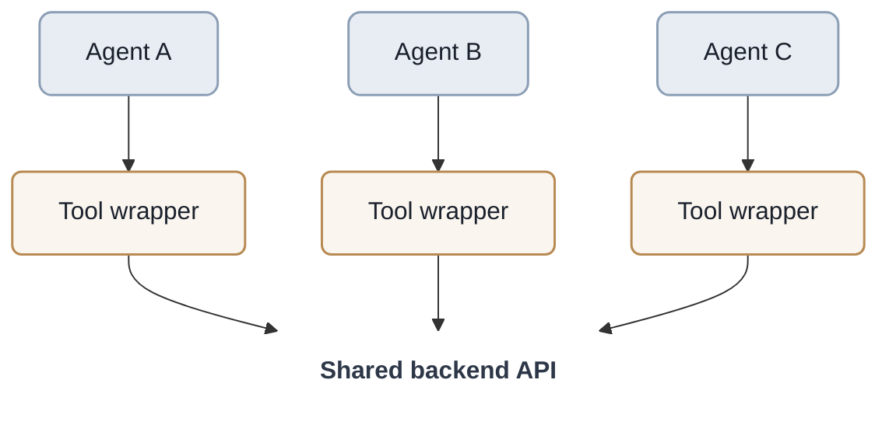
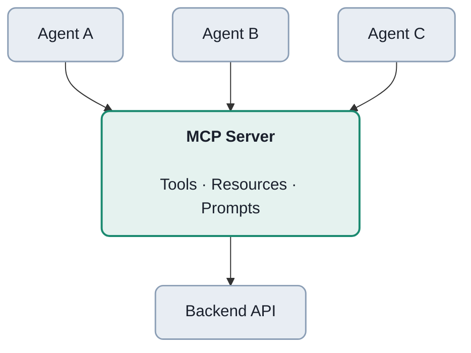
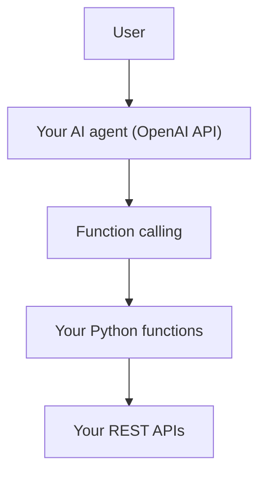
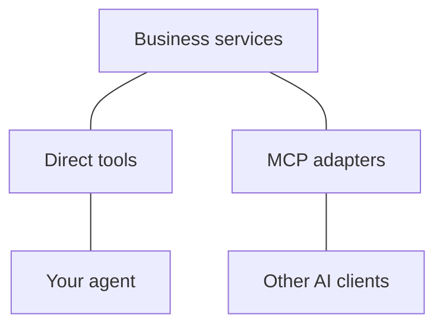

The main reason to use an MCP server instead of generic tools or wrapping an API yourself is interoperability, not additional capability.

If you're building one AI agent that calls a few APIs, you probably don't need MCP. Direct tool/function calling can be simpler, faster, and easier to debug.

MCP becomes valuable when you want to expose the same capabilities to multiple agents, models, or AI applications without implementing integrations separately for each one.

## 1. What's actually different?

Approach A — Direct API wrappers



Approach B — MCP server




Conceptual comparison: direct wrappers are registered separately with each agent; MCP provides a shared protocol interface.

An MCP server is essentially a standardized tool/API adapter. It does not replace your backend API.

## 2. What does MCP give you?

| Capability                        | Direct tools                        | MCP server                                        |
| --------------------------------- | ----------------------------------- | ------------------------------------------------- |
| Call APIs                         | Yes                                 | Yes                                               |
| JSON-schema tool definitions      | Yes                                 | Yes                                               |
| Discover tools dynamically        | Custom implementation               | Standard protocol                                 |
| Reuse across different AI clients | Requires adapters or shared tooling | Standardized interface, subject to client support |
| Expose resources and prompts      | Custom implementation               | Built-in protocol concepts                        |
| Authentication                    | Your implementation                 | Standardized mechanisms available                 |
| Latency and complexity            | Usually lower                       | Additional protocol/integration overhead          |
| Vendor independence               | Depends on architecture             | Better portability                                |

MCP specifies tool discovery/invocation, resources, prompts, and communication mechanisms.&#x20;


## 3. Practical example

Suppose you have a CRM REST API:

```hyyp
GET /customers/{id}
POST /orders
GET /inventory
```

With direct tools, you define:

```
tools = [    get_customer,    create_order,    check_inventory]
```

Then you register them with your LLM framework.

With MCP, you implement nearly the same functions, but expose them through an MCP server. A compatible client can discover them using `tools/list` and call them using `tools/call`.

The underlying business logic can remain exactly the same.

The benefit is that another compatible client can consume the server without you having to create a new tool integration for that client.

## 4. When MCP is actually worth it

MCP makes sense when:

- You're supporting multiple agent frameworks or AI applications.
- You have many tools and want centralized discovery and maintenance.
- You want to distribute integrations to other developers or organizations.
- You want a common interface for tools, contextual resources, and prompt templates.
- You want to separate agent orchestration from service integrations.

But MCP doesn't automatically give you better reasoning, safer execution, or faster tool calls. You still need to implement authorization, validation, permissions, error handling, and observability appropriately.

## 5. When I would skip MCP

For example, if you're building:



And you're not planning to expose those functions to other clients, direct tools are probably the better engineering choice.

MCP introduces another interface to implement, maintain, secure, and debug.

## 6. A useful design pattern

Keep the business logic independent from both MCP and your agent framework:



This gives you flexibility. You can start with direct tools and add MCP later without rewriting your core business logic.

Bottom line: MCP solves the standardization and reuse problem. Tool calling solves the execution problem. If you already control both the agent and all of its tools, MCP may provide very little additional value.

