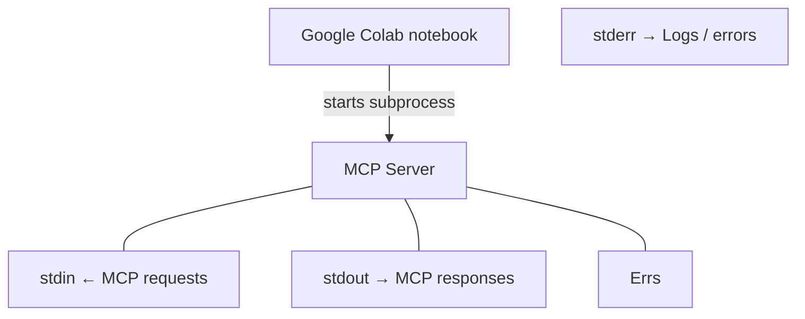

When using MCP in Google Colab, the first setup cell is typically used to prepare the notebook environment before importing MCP.

### Cell 1 — Fix stderr for MCP

```
import syssys.stderr = open("mcp_server.log", "w")
```

Why is this the first cell?

Google Colab runs Python inside a Jupyter notebook, not a normal terminal.

When an MCP client launches a local server using the `stdio` transport, it needs three streams:

| Stream   | Purpose                           |
| -------- | --------------------------------- |
| `stdin`  | Send requests to the MCP server   |
| `stdout` | Receive responses from the server |
| `stderr` | Capture errors and logs           |

Colab's `sys.stderr` may not have a real operating-system file descriptor. This can cause an `UnsupportedOperation: fileno` error when MCP starts the subprocess.


The first cell replaces Colab's stderr with a regular file that supports `fileno()`.

This code is needed in Google Colab because MCP's subprocess handling expects a real operating-system file descriptor for `stderr`, but Colab's notebook environment doesn't always provide one.

It's a compatibility workaround for running MCP servers through the stdio transport inside a Jupyter/Colab notebook.

## 1. What is the problem?

In a normal Python script:

```
import sysprint(sys.stderr.fileno())  # Usually 2
```

`sys.stderr` typically refers to file descriptor `2`, the operating system's standard error stream.

But in Google Colab, Python runs inside an IPython/Jupyter kernel.

Instead of a normal terminal stderr, Colab uses a special stream object that forwards output to notebook cells.

That object may not support:

```
sys.stderr.fileno()
```

This can produce an error such as:

```
io.UnsupportedOperation: fileno
```

## 2. Why does MCP care?

When you use an MCP server over stdio, the client launches the server as a subprocess:




The client uses stdin and stdout to communicate with the MCP server, while stderr is used for diagnostic messages.

Some MCP Python SDK subprocess implementations pass the parent's `sys.stderr` into the child process. This requires a valid OS file descriptor, which can fail with Colab's notebook stream.

## 3. How does your code fix it?

```
import syssys.stderr = open("mcp_server.log", "w")
```

This does three things:

1. Creates a file named `mcp_server.log`.
2. Opens it for writing, providing a valid file descriptor.
3. Replaces Python's `sys.stderr` with that file.

Now when MCP launches the subprocess, its error output can be written to a normal file instead of Colab's special notebook stream.

## 4. Why must it run before importing MCP?

The MCP Python SDK defines its stdio client approximately like this:

```
async def stdio_client(    server,    errlog=sys.stderr):    ...
```

Python evaluates default arguments when the function is defined, not when it is called.

Consequently:

```
import mcpsys.stderr = open("mcp_server.log", "w")
```

may be too late. The SDK may already have captured the original notebook stream.

This behavior is visible in the SDK's implementation.


## 5. Is this workaround always necessary?

No.

| Environment / transport          | Needed?                           |
| -------------------------------- | --------------------------------- |
| Colab + local MCP stdio server   | Sometimes                         |
| Jupyter + local MCP stdio server | Depends on kernel and SDK version |
| Normal Python terminal           | Usually no                        |
| MCP over HTTP                    | No                                |
| Direct Python API tools          | No                                |


Key takeaway: This code is not required by the MCP protocol itself. It's a workaround for incompatibility between notebook stderr handling and certain implementations of the MCP stdio client. If you're connecting to an MCP server over HTTP instead of launching a local subprocess, you don't need it.