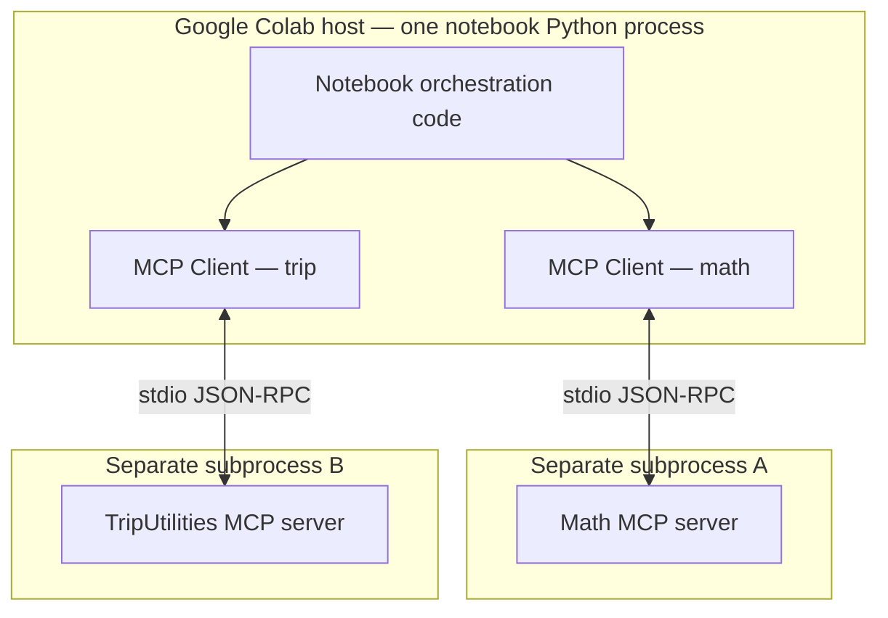
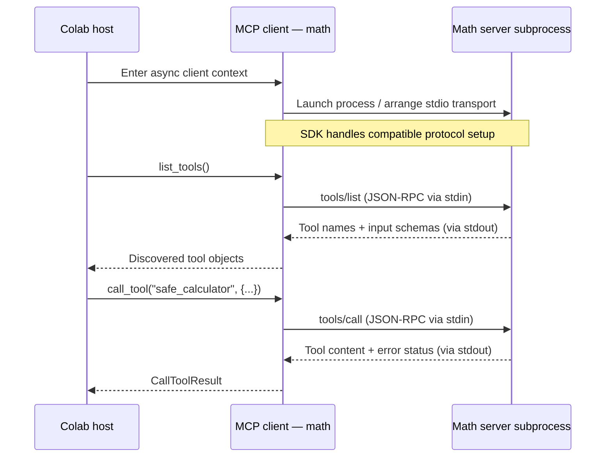
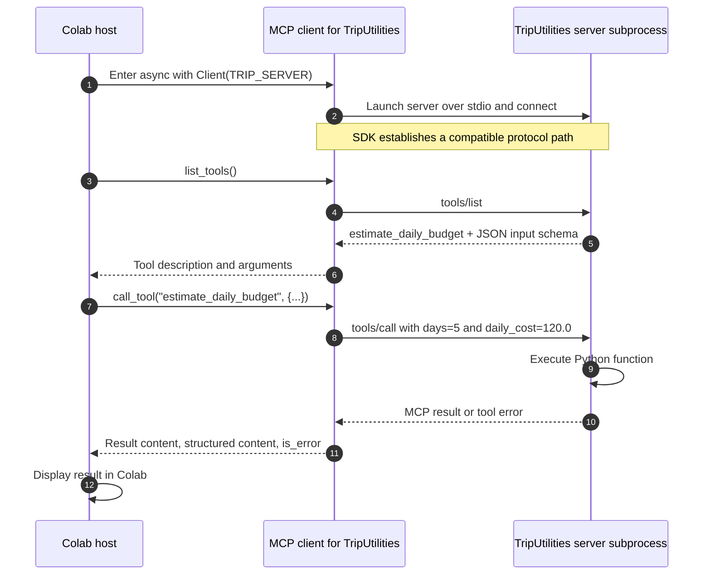

# Architecture overview — MCP with a Colab host

This guide follows the [official MCP architecture overview (2026-07-28)](https://github.com/modelcontextprotocol/modelcontextprotocol/blob/main/docs/docs/2026-07-28/learn/architecture.mdx). It keeps the official concepts and protocol names, while using our **Math** and **TripUtilities** servers instead of unrelated applications.

**What we'll learn:** Who the host, client, and server are; how the data and transport layers fit together; how MCP discovery works; and what happens when a tool is called. You don't need Claude or another language model. Our **Google Colab notebook is the host** and explicitly chooses what to call.

You can follow this before writing any code. When you're ready, continue with [Build an MCP server](02_build_mcp_servers_colab.md) and [Build an MCP client](03_build_mcp_client_colab.md).

> **About the wording:** The concepts, section flow, and protocol terms are drawn from the official guide. Longer explanatory passages are rewritten for this example; use the official link above for the original wording.

## Concepts of MCP

### Scope

MCP specifies exchanges between compatible clients and servers. Its surrounding ecosystem includes the specification, SDKs, development utilities (such as MCP Inspector), and reference servers. The protocol supplies common structures for discovering and using capabilities; it does **not** prescribe how an application should present results, decide which tool to call, or send information to an LLM.

This activity's host is the notebook. Its policy is deliberately simple: execute the specific calls appearing in the code cells. **No model selects tools automatically.**

### Participants: a host and its clients



- **Host:** the application coordinating clients and using their results — here, a Colab notebook.
- **MCP client:** one connected protocol object for one server. It performs discovery and requests operations.
- **MCP server:** a separate program publishing capabilities — here, the two Python files.

One host may own multiple clients. One client connection does not automatically have access to the other server. To combine results, the **host** must explicitly coordinate them. The `Client` object is inside the notebook process; the two `MCPServer` objects are in separately launched Python processes.

**Check:** If Colab needs both budget and calculator results, which component combines them? **Answer:** Colab host code, not either server.

---

### Layers

| Layer | Responsibility | In this notebook |
|---|---|---|
| **Data layer** | JSON-RPC request/response meanings, version/capability information, tools/resources/prompts, notifications | `tools/list`, `tools/call`, names, input schemas, results |
| **Transport layer** | How complete MCP messages move between processes/systems | `stdio`: the server's stdin and stdout pipes |

**Other supported transport:** Streamable HTTP exchanges MCP requests through HTTP POST and may stream responses using SSE. Activity 1 already compared HTTP with stdio; here we hold the transport fixed to reveal server/client roles without network complications. **Transport is not the tool itself**: calling `estimate_daily_budget` does not turn a stdio connection into HTTP.



`stdin` carries requests *into* the server. `stdout` carries protocol messages *out of* the server. Debug printing from the server to `stdout` can damage the message stream; use `stderr` for diagnostics.

---

## Data layer protocol

MCP uses **JSON-RPC 2.0**. The method names are protocol-defined, while the individual tool names are server-defined.

| Message or value | Question it answers | Our example |
|---|---|---|
| Protocol compatibility / optional `server/discover` | Which protocol revision and capabilities can this connection use? | Determined by the SDK when `Client(...)` opens |
| `tools/list` | What tools are available, with which names and JSON input schemas? | `safe_calculator`, `estimate_daily_budget` |
| `tools/call` | Which discovered tool should be invoked with what arguments? | `{"expression": "7 * (3 + 2)"}` |
| `CallToolResult` | What content or tool-reported failure came back? | Text or structured value and `is_error` |

**Revision distinction:** In MCP revision `2026-07-28`, requests are self-contained and declare relevant version and capability information in `_meta`. A client may use `server/discover` to identify supported versions before normal operations, but discovery is not the old mandatory initialization handshake. Older revisions through `2025-11-25` used `initialize` followed by `notifications/initialized`. Activity 1's SDK v2 `Client` defaults to automatic compatibility handling. The **Python package version**, the **MCP protocol revision**, and **stdio/HTTP transport** are three different properties. Read the actual `client.protocol_version` instead of guessing it.

**Stateless does not mean no Python state.** A server can still hold variables or use a database. The modern protocol avoids requiring a continuing protocol-level session for interpreting each request.

**Schematic, not a captured wire trace:**

```json
{"jsonrpc":"2.0", "id":2, "method":"tools/call",
 "params":{"name":"safe_calculator", "arguments":{"expression":"2 + 3"},
 "_meta":{"io.modelcontextprotocol/protocolVersion":"2026-07-28"}}}
```

The real v2 SDK adds other required metadata and handles framing itself. We are not manually constructing JSON-RPC packets or assuming which revision will be negotiated.

---

### Primitives

The server may expose different kinds of information through MCP:

| Primitive | Primary role | How a client accesses it | Used now? |
|---|---|---|---|
| **Tools** | Invoke functions/actions advertised by a server | `list_tools()` then `call_tool()` | **Yes** — both local servers |
| **Resources** | Read server-addressed contextual data | `list_resources()` then `read_resource(uri)` | No; Activity 1 Step 8 covers this |
| **Prompts** | Retrieve reusable message templates | `list_prompts()` then `get_prompt(...)` | No; Activity 1 Step 8 covers this |

A server need not expose all three. The current architecture also defines client-facing input features such as **elicitation** for asking users for information. In the `2026-07-28` protocol, older sampling and logging primitives are deprecated. Neither is needed to demonstrate tool discovery and calls.

**Question:** Is the Python function `safe_calculator` imported into the Colab kernel? **No.** The client discovers its name and JSON schema over the protocol. Only the server subprocess imports and executes its implementation.

---

## Example: how a tool call travels through the architecture

Now that we've met the components, let's follow a request for a trip budget. Notice that **the Colab host chooses the tool**; it is not chosen by MCP itself.



The calculation `5 × 120.0` is **600.0**, but that is a mathematical expectation, not a fabricated MCP response. In the running activity we examine the actual content returned by the server.

### A small distinction worth remembering

`server/discover` (when used) tells a client about protocol support and server capabilities. `tools/list` tells it which individual tools exist and what arguments each tool accepts. `tools/call` asks the server to execute one of those tools. These are three different operations.

### Check your understanding

1. Which process implements `estimate_daily_budget`, and which process selects it?
2. Is `StdioServerParameters(...)` a tool call, an active connection, or a set of launch instructions?
3. Why can two separate MCP clients in Colab use the same `list_tools()` method even when their tools have different inputs?
4. If the calculator and trip servers expose identical tool names, how should the host know which server to contact?

**Next:** [Build an MCP server](02_build_mcp_servers_colab.md) creates the two server programs. [Build an MCP client](03_build_mcp_client_colab.md) connects to them using Activity 1's Python workflow.
