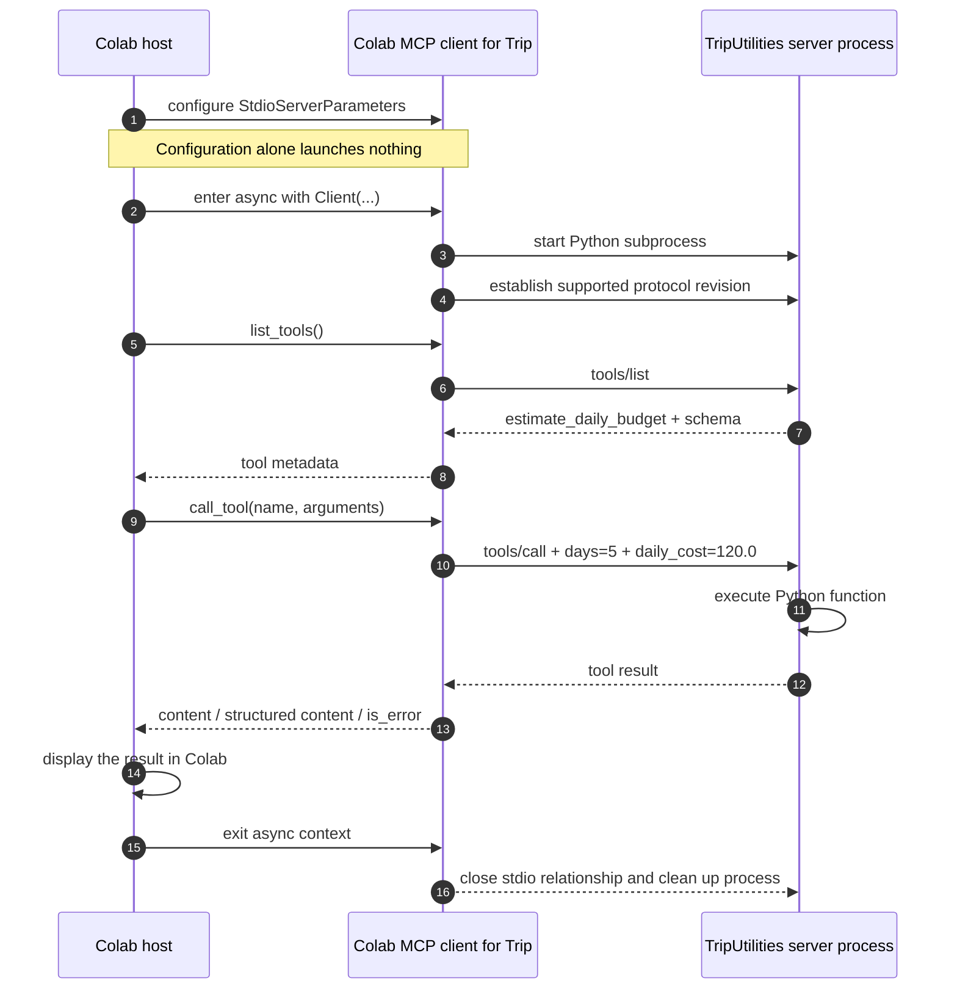

# Build an MCP client — connect to two servers from Colab

This guide follows the structure of the [official **Build an MCP client** tutorial (2026-07-28)](https://github.com/modelcontextprotocol/modelcontextprotocol/blob/main/docs/docs/2026-07-28/develop/build-client.mdx), but uses a simple **Colab notebook as the host** instead of a Claude-powered chatbot. Python explicitly selects the tools, so we can see what the MCP client is doing.

We'll reuse the official Python SDK v2 client pattern from **Activity 1**: `Client`, `StdioServerParameters`, `async with`, `list_tools()`, `call_tool()`, the pagination helper, and the reusable `explore_and_call()` function. Our two server programs are `math_server.py` and `trip_server.py` from [Build an MCP server](02_build_mcp_servers_colab.md). You can review [Architecture overview](01_mcp_architecture_colab.md) at any point.

> **Source note:** The official page's protocol operations and program structure are preserved, but the explanatory prose and examples are adapted for our classroom use. No Anthropic SDK, API key, or chatbot loop is needed.

## System requirements and setting up your environment

Use Google Colab and the same runtime where you ran both `%%writefile` cells in the server guide. If you restarted Colab, rerun those cells first so both server files exist again.

### Colab cell 1: stderr setup (required before any MCP import)

If you're starting in a fresh runtime, make this the very first code cell. If you've **already run this exact cell** in the server guide in the same runtime, don't run it again.

```python
import sys

# MCP launches its servers as subprocesses and hands them this notebook's
# stderr, which must have a real file descriptor. Notebook kernels do not
# provide one, so we point stderr at a log file. The MCP library captures
# stderr the moment it first loads, so this redirect must run before any
# MCP import, which is why it sits at the top of the setup cell.
sys.stderr = open("mcp_server.log", "w")
```

### Colab cell 2: install the MCP SDK (if not already installed)

```python
%pip -q install -U "mcp>=2,<3"
```

**Before the imports:** check that both `.py` files from the server guide exist in the Colab working directory. The client launches those files; it doesn't import their tool functions into the notebook.

```python
from pathlib import Path
assert Path("math_server.py").is_file(), "Run the Math %%writefile cell in guide 2"
assert Path("trip_server.py").is_file(), "Run the TripUtilities %%writefile cell in guide 2"
print("Both server files are ready")
```

## Creating the client

### Imports and setup

The official client quickstart creates a `Client` and opens it in an asynchronous context. We reuse that approach, without Anthropic client code, an API key, a chat loop, or a model-selection loop. The Colab notebook is a minimal host that issues explicit tool calls.

`StdioServerParameters` is **a description of how to start a server** (executable and arguments). Constructing it does not launch anything.

---

```python
import json
import sys
from pathlib import Path
from contextlib import AsyncExitStack
from importlib.metadata import version
from mcp import Client, StdioServerParameters
from mcp.types import TextContent

MATH_SERVER = StdioServerParameters(
    command=sys.executable,
    args=[str(Path("math_server.py").resolve())],
)
TRIP_SERVER = StdioServerParameters(
    command=sys.executable,
    args=[str(Path("trip_server.py").resolve())],
)

print("MCP Python SDK version:", version("mcp"))
print("Math command:", MATH_SERVER.command, MATH_SERVER.args)
print("Trip command:", TRIP_SERVER.command, TRIP_SERVER.args)
```

---

### Server connection management

In `async with Client(MATH_SERVER) as client`, the SDK launches the configured Python script and establishes a compatible MCP connection. Exiting the block closes that relationship and cleans up the stdio process. Opening two successive blocks creates separate client relationships; there is no single client that automatically multiplexes both server programs.

---

```python
async with Client(MATH_SERVER) as client:
    print("Connected to:", client.server_info)
    print("Negotiated protocol version:", client.protocol_version)
    print("Advertised capabilities:", client.server_capabilities)

print("Exited Math client context")
```

---

### Discovering tools

A server supplies the tool list and input schemas. The client does not know or import the underlying Python implementation. The helper below is taken from Activity 1's **pagination** pattern: it follows `next_cursor` until every page has been received. In these tiny servers there will usually be one page, but the reusable client must not assume that for all providers.

---

```python
async def discover_all_tools(client):
    discovered = []
    cursor = None
    while True:
        page = await client.list_tools(cursor=cursor)
        discovered.extend(page.tools)
        cursor = page.next_cursor
        if cursor is None:
            return discovered


async with Client(MATH_SERVER) as client:
    math_tools = await discover_all_tools(client)
    for tool in math_tools:
        print("NAME:", tool.name)
        print("DESCRIPTION:", tool.description)
        print("INPUT SCHEMA:")
        print(json.dumps(tool.input_schema, indent=2))

async with Client(TRIP_SERVER) as client:
    trip_tools = await discover_all_tools(client)
    for tool in trip_tools:
        print("NAME:", tool.name)
        print("DESCRIPTION:", tool.description)
        print("INPUT SCHEMA:")
        print(json.dumps(tool.input_schema, indent=2))
```

---

**Schema reading exercise:** Locate `properties`, each argument's `type`, and `required` in the displayed JSON. They describe what arguments the server expects, **not** the result of executing the tool. Check how `expression` differs from `days` and `daily_cost`.

| Server | Tool | Expected required input |
|---|---|---|
| Math | `safe_calculator` | `expression` — string |
| TripUtilities | `estimate_daily_budget` | `days` — integer; `daily_cost` — number |

JSON Schema names are wire-level names. The Python SDK exposes snake_case fields such as `tool.input_schema`; the wire representation typically uses `inputSchema`.

---

### Calling tools and reading results

`call_tool()` is an explicit request; it is distinct from `list_tools()`. The returned `CallToolResult` may include text content, structured content, and a tool error flag. Printing a value is a host decision — the protocol doesn't automatically show it in a chat window.

---

```python
def show_tool_result(result, max_chars=1200):
    print("Tool error flag:", result.is_error)
    print("Structured content:", result.structured_content)
    for block in result.content:
        if isinstance(block, TextContent):
            print("Text content:", block.text[:max_chars])
        else:
            print("Other content type:", type(block).__name__)


async with Client(MATH_SERVER) as client:
    answer = await client.call_tool(
        "safe_calculator", {"expression": "8273 * 1821"}
    )
    show_tool_result(answer)

async with Client(TRIP_SERVER) as client:
    budget = await client.call_tool(
        "estimate_daily_budget", {"days": 5, "daily_cost": 120.0}
    )
    show_tool_result(budget)
```

---

**Expected calculations (not a fabricated MCP transcript):** The arithmetic expression is `8273 × 1821 = 15,066,133`. The trip estimate is `5 × 120.0 = 600.0`. The exact SDK output can differ in how it presents text versus structured content; use what Colab actually prints and check `is_error`.

**Important:** The tool implementation runs in the server process. The Colab host receives a protocol result, not a Python return object obtained by directly calling the server function.

---

### Reusing the Activity 1 client for either server

Activity 1 used a general `explore_and_call(server_config, label, tool_name, arguments)` routine. The same function works here: it opens a connection, discovers tools, checks the requested name, calls the tool, prints its result, and handles exceptions. The **server configuration**, **tool name**, and **tool arguments** are the varying parts.

---

```python
async def explore_and_call(server_config, label, tool_name, arguments):
    print("\nSERVER:", label)
    try:
        async with Client(server_config) as client:
            tools = await discover_all_tools(client)
            registry = {tool.name: tool for tool in tools}
            print("Discovered tools:", list(registry))
            if tool_name not in registry:
                print("Not called: name was not discovered")
                return
            chosen = registry[tool_name]
            print("Required arguments:", chosen.input_schema.get("required", []))
            result = await client.call_tool(tool_name, arguments)
            show_tool_result(result, max_chars=600)
    except Exception as exc:
        print("Connection, protocol, or local exception:",
              type(exc).__name__, str(exc)[:300])


await explore_and_call(
    MATH_SERVER, "Math", "safe_calculator", {"expression": "7 * (3 + 2)"}
)
await explore_and_call(
    TRIP_SERVER, "TripUtilities", "estimate_daily_budget",
    {"days": 3, "daily_cost": 95.5}
)
```

---

### Coordinating two clients in one host

An MCP host may coordinate **multiple separate clients**. We use `AsyncExitStack` (as in Activity 1's multi-server section), so both subprocesses remain connected at the same time. The host keeps a **server-labeled registry**: tool names alone might collide across unrelated servers.

The calls here are sequential for clarity, even though both connections remain open. There is no orchestration performed by an LLM.

---

```python
SERVER_CONFIGS = {
    "math": MATH_SERVER,
    "trip": TRIP_SERVER,
}

async with AsyncExitStack() as stack:
    clients = {}
    catalogs = {}
    for label, config in SERVER_CONFIGS.items():
        clients[label] = await stack.enter_async_context(Client(config))
        catalogs[label] = {tool.name: tool for tool in
                           await discover_all_tools(clients[label])}
        print(label, "publishes", list(catalogs[label]))

    # Host selects Math from the Math client and Budget from the Trip client.
    math_result = await clients["math"].call_tool(
        "safe_calculator", {"expression": "12 + 8"}
    )
    trip_result = await clients["trip"].call_tool(
        "estimate_daily_budget", {"days": 5, "daily_cost": 120.0}
    )
    print("\nMath MCP result:")
    show_tool_result(math_result, max_chars=300)
    print("\nTrip MCP result:")
    show_tool_result(trip_result, max_chars=300)

print("Both connections have closed")
```

---

## Handling errors

The server and client are independent programs. A wrong request does not always mean the connection failed.

| Scenario | Likely layer | What to inspect |
|---|---|---|
| Valid tool name, negative `days` | Tool implementation | A returned `is_error` flag / tool message, or a raised exception |
| Name not published by the server | Protocol or host validation | Tool registry, protocol error |
| Server file missing | Process launch / transport | Python path and `mcp_server.log` |
| Debug `print()` on stdio server stdout | Transport framing | Server logging and protocol decoding |
| SDK/protocol versions incompatible | Protocol compatibility | Selected protocol revision, SDK version |

The exact form of an error depends on the SDK and server implementation. Never replace an observed error with a successful-looking fabricated result.

---

```python
async with Client(TRIP_SERVER) as client:
    print("Test: negative days")
    try:
        result = await client.call_tool(
            "estimate_daily_budget", {"days": -2, "daily_cost": 80.0}
        )
        show_tool_result(result, max_chars=400)
    except Exception as exc:
        print(type(exc).__name__, str(exc)[:400])

    print("\nTest: unknown tool")
    try:
        result = await client.call_tool("unknown_trip_tool", {})
        show_tool_result(result, max_chars=400)
    except Exception as exc:
        print(type(exc).__name__, str(exc)[:400])
```

---

```python
from pathlib import Path
log_path = Path("mcp_server.log")
print("Diagnostic log exists:", log_path.exists())
if log_path.exists():
    print(log_path.read_text(encoding="utf-8")[-2000:])
```

---

## How the pieces work together

### Trace one tool call



In this interaction, **Colab chooses the tool**. In the official client tutorial, a model can propose tool calls, but even there, the application must route the requested tool name and arguments to a client. A language model is not part of the MCP wire protocol and is not needed to demonstrate the client-server architecture.

### Compare direct Python calls with MCP

| Direct Python functions | Our MCP arrangement |
|---|---|
| `from math_server import safe_calculator` places function code in the importing program | `Client(MATH_SERVER)` speaks a protocol to another process |
| Function signature known through Python source/import | Name, description and schema discovered through `tools/list` |
| Call `safe_calculator("2+3")` directly | Call `client.call_tool("safe_calculator", {"expression":"2+3"})` |
| One program executes function | Server process executes; host receives result through transport |
| Python-specific integration | Common operations across MCP servers with different implementations |

For two tiny functions, a direct import is probably simpler. MCP is valuable when an application wants a common interface to capabilities developed, deployed or maintained independently — and must still manage permissions, error handling, and trust boundaries.

---

## Check your understanding

**Answer after running the cells (use actual Colab output):**

1. Draw the host boundary and mark the two MCP client objects and two Python subprocesses. Is the notebook itself an MCP server?
2. Which code line **describes** a server launch, and which line actually triggers it?
3. What is transported over `stdin` and `stdout`? Where should server diagnostics go?
4. Find the `input_schema` for each discovered tool. Which fields are required and what types do they have?
5. Compare `list_tools()` with `call_tool()` in terms of **metadata** versus **execution**.
6. Compare the observed protocol revision with the installed Python SDK version. Are they the same kind of identifier?
7. When the Colab host opens two clients, does one client automatically see tools from the other server?
8. Why is `is_error` important? Compare a negative budget request with a missing server file or unknown tool name.
9. How would adding a third server change the **configuration** and **client orchestration**? What code could be reused unchanged?
10. Explain why this demonstration can teach MCP architecture without an LLM. What extra tasks would an LLM-powered host introduce?

### Evidence to retain

Include a screenshot or copied record of the **actual** SDK version, two discovered tool schemas, two successful tool results, one error, and your annotated architecture diagram. Do not fill in results from the example text unless Colab actually reports them.

### Instructor answers (conceptual; not fixed runtime logs)

- The host is Colab; the SDK `Client` objects are protocol participants within it; each server is a separate process.
- Creating `StdioServerParameters` is configuration. Entering `async with Client(...)` starts the stdio relationship.
- JSON-RPC operations move over stdin/stdout; diagnostics should use stderr.
- Schemas are discovered server metadata; they do not calculate outputs.
- The host uses a separate logical client connection per server and explicitly selects where to send each call.
- The protocol revision, SDK package version and transport are different dimensions.
- Tool execution can return a tool error; a protocol rejection or connection failure can instead raise an exception.
- New servers can reuse discovery/invocation code, but their tool names, argument contracts and permissions still require attention.
- An LLM-powered host would add model interaction, tool selection or validation, conversation management and presentation; **MCP does not supply those by itself**.

---

## Where to go next

You now have one host, two MCP clients, and two local MCP servers. We used **the same protocol methods** for a calculator and a trip-budget tool. What changed was the server configuration, tool name, input schema, and result—not the basic client workflow.

If a step fails, record what Colab printed (SDK version, selected protocol version, tool schema or exception). Don't substitute example output for an observation.

**Related readings:** [Architecture overview](01_mcp_architecture_colab.md) · [Build an MCP server](02_build_mcp_servers_colab.md) · [Original MCP client tutorial](https://github.com/modelcontextprotocol/modelcontextprotocol/blob/main/docs/docs/2026-07-28/develop/build-client.mdx).
