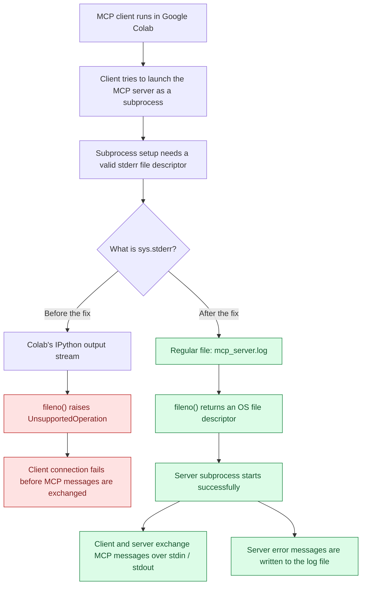

# Why redirect `sys.stderr` to a log file in Colab?

When an MCP client starts a **STDIO MCP server** as a subprocess from Google Colab, it may pass the notebook's `sys.stderr` stream to the subprocess for error messages. Colab's special stream does not always provide the operating-system file descriptor (`fileno()`) that subprocess creation needs.



## The workaround

```python
import sys
sys.stderr = open("mcp_server.log", "w")
```

**Key idea:** The log file is **not** where MCP tool requests and responses go. It simply replaces Colab's notebook `stderr` with a normal file-backed stream that supports `fileno()`. The **STDIO MCP protocol still communicates over the server's `stdin` and `stdout`**.

This is a **Colab/Jupyter environment workaround**, not a general requirement for MCP servers. 

> Redirecting `sys.stderr` changes error output for the whole notebook process.
