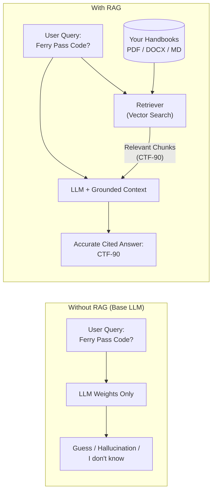
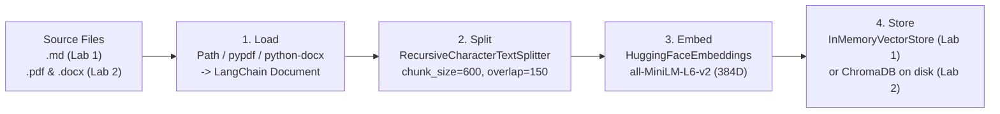
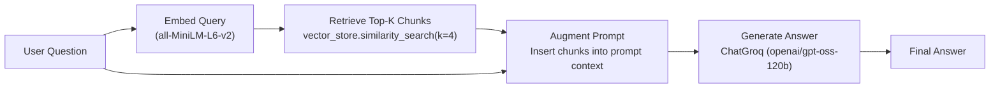
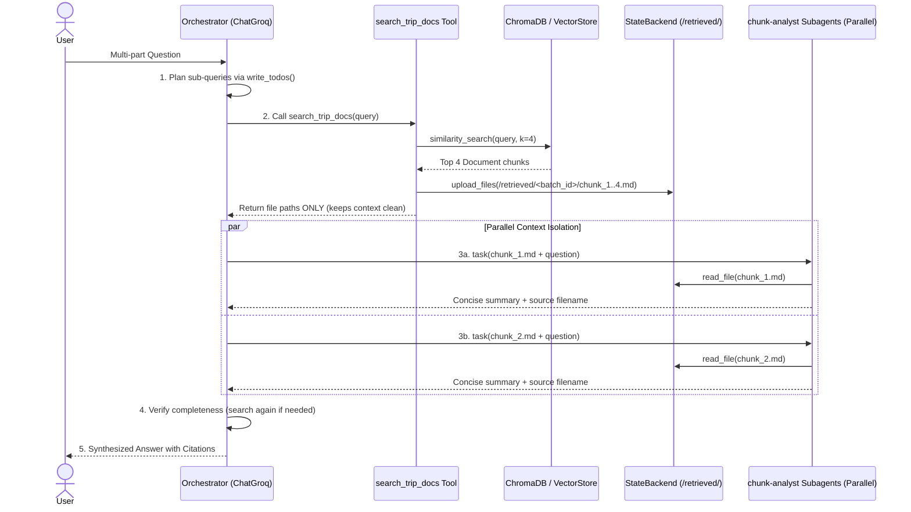
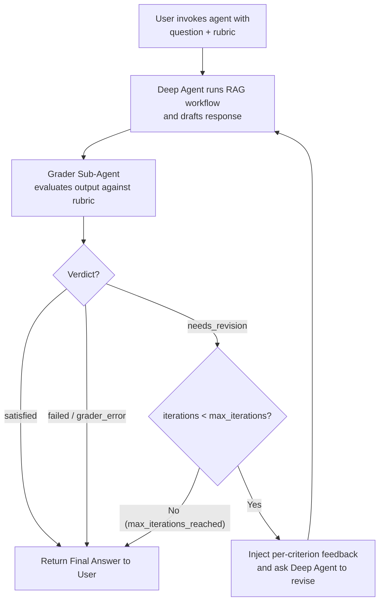

# Theory & Architecture: From Embeddings to Agentic RAG with Deep Agents

This guide explains the theory behind every component we built across our RAG labs (`activity1.md` and `activity2.md`)—from why standard LLMs fail on private data, to 2D vector geometry, LangChain's indexing and retrieval pipeline, **ChromaDB**, **Deep Agents** orchestration, and runtime evaluation with **Grading Rubrics**.

---

## 1. Why Retrieval-Augmented Generation (RAG)?

Large Language Models (LLMs) store knowledge in their neural network weights during pre-training. While this gives them broad general knowledge, it creates three major limitations for real-world applications:

1. **Private or Fictional Data**: An LLM knows nothing about internal company policies, private PDFs, or our fictional travel company (**Vellamo & Pine Atelier**) and its **Solvik Archipelago** rules (such as pass code `CTF-90` or `Protocol Gull`).
2. **Knowledge Cutoff**: Pre-trained weights freeze at a point in time; updating them via fine-tuning every time a schedule or price changes is slow and expensive.
3. **Hallucinations & Context Limits**: If you ask an ungrounded model about unknown facts, it may confidently invent plausible-sounding falsehoods. Conversely, pasting dozens of PDFs and Word documents directly into the prompt hits token limits, increases latency/cost, and degrades accuracy ("context rot").



> [!IMPORTANT]
> **RAG separates reasoning from memory.** The LLM provides language understanding and synthesis, while an external vector store provides up-to-date, verifiable facts at inference time.

---

## 2. How Embeddings Work: Sentence & Semantic Embeddings

Computers cannot directly measure whether *"boat ticket password"* means the same thing as *"Silver Birch Ferry pass code"*. **Embeddings** solve this by converting text into coordinates (vectors) in a geometric space where **meaning corresponds to direction and distance**.

### From Keywords to Semantic Vectors

- **Keyword search (BM25 / exact match)** looks for identical strings. Searching for *"storm evacuation"* might miss a paragraph that only says *"winds exceed 55 knots ... Underground Maintenance Rail (Tunnel 4)"*.
- **Word embeddings** (like early Word2Vec) assign one vector per word, which struggles with polysemy (e.g., *"bank"* of a river vs. *"bank"* account).
- **Sentence / Semantic embeddings** (like HuggingFace's `sentence-transformers/all-MiniLM-L6-v2` used in our labs) read an entire sentence or chunk with a Transformer encoder and pool token representations into a single fixed-length vector—**384 numbers** per chunk—capturing the *overall meaning* of the passage.

### Measuring Similarity with Cosine Similarity

When comparing two embedding vectors $\mathbf{A}$ and $\mathbf{B}$, we usually measure **cosine similarity**—the cosine of the angle $\theta$ between them:

$$\text{cosine\_similarity}(\mathbf{A}, \mathbf{B}) = \frac{\mathbf{A} \cdot \mathbf{B}}{\|\mathbf{A}\| \, \|\mathbf{B}\|}$$

- **Close to `+1.0`**: Vectors point in nearly the same direction (very similar meaning).
- **Close to `0.0`**: Vectors are perpendicular (unrelated topics).
- **Close to `-1.0`**: Vectors point in opposite directions.

### Python Illustration: 3 Vectors in 2D Space

Real embeddings live in 384 dimensions (or 1,536+ for larger models), which humans cannot visualize. The runnable script below creates **3 vectors in 2D space** to illustrate how two semantically similar queries point in nearly the same direction while an unrelated topic points elsewhere:

<details>
<summary>Show Code</summary>

```python
import numpy as np
import matplotlib.pyplot as plt


def cosine_similarity(a: np.ndarray, b: np.ndarray) -> float:
    return float(np.dot(a, b) / (np.linalg.norm(a) * np.linalg.norm(b)))


# Imagine a simplified 2D semantic space:
#   x-axis = "Maritime / Boarding"
#   y-axis = "Fees / Rules"
vectors = {
    "v1: Silver Birch Ferry pass code": np.array([0.90, 0.44]),
    "v2: Boat boarding password": np.array([0.78, 0.63]),
    "v3: Excess luggage storage fee": np.array([-0.55, 0.84]),
}

v1 = vectors["v1: Silver Birch Ferry pass code"]
v2 = vectors["v2: Boat boarding password"]
v3 = vectors["v3: Excess luggage storage fee"]

print(f"Cosine similarity (v1 vs v2 - similar meaning):   {cosine_similarity(v1, v2):.3f}")
print(f"Cosine similarity (v1 vs v3 - different meaning): {cosine_similarity(v1, v3):.3f}")

# Plot the 3 vectors in 2D space
fig, ax = plt.subplots(figsize=(6, 6))
colors = ["tab:blue", "tab:green", "tab:red"]

for (label, vec), color in zip(vectors.items(), colors):
    ax.quiver(0, 0, vec[0], vec[1], angles="xy", scale_units="xy", scale=1, color=color, width=0.012)
    ax.text(vec[0] * 1.06, vec[1] * 1.06, label, fontsize=9, color=color, fontweight="bold")

ax.axhline(0, color="gray", linewidth=0.6, linestyle="--")
ax.axvline(0, color="gray", linewidth=0.6, linestyle="--")
ax.set_xlim(-1.0, 1.35)
ax.set_ylim(-0.2, 1.2)
ax.set_aspect("equal")
ax.set_title("3 Semantic Vectors in 2D Space (Angle = Similarity)")
ax.set_xlabel("Dimension 1 (Maritime / Transit)")
ax.set_ylabel("Dimension 2 (Policies / Fees)")
plt.grid(alpha=0.3)
plt.tight_layout()
plt.show()
```
</details>

> [!TIP]
> You will see `cosine_similarity(v1, v2) ≈ 0.975` (a small angle between blue and green arrows), while `cosine_similarity(v1, v3) ≈ -0.125` (a wide angle pointing toward the red arrow). Our HuggingFace model `all-MiniLM-L6-v2` performs this exact same geometric comparison—just across **384 dimensions** instead of 2!

<details>
<summary><strong>Bonus: Check Real 384D Cosine Similarities with <code>HuggingFaceEmbeddings</code></strong></summary>

You can verify the exact same behavior using the real embedding model from our labs:

```python
import numpy as np
from langchain_huggingface import HuggingFaceEmbeddings

emb_model = HuggingFaceEmbeddings(model_name="sentence-transformers/all-MiniLM-L6-v2")

texts = [
    "Silver Birch Ferry pass code",
    "Boat boarding password",
    "Excess luggage storage fee",
]
e1, e2, e3 = [np.array(emb_model.embed_query(t)) for t in texts]

print("Vector dimensions:", len(e1))
print("Real similarity (ferry pass vs boat password):", round(float(np.dot(e1, e2)), 3))
print("Real similarity (ferry pass vs luggage fee):  ", round(float(np.dot(e1, e3)), 3))
```

</details>

---

## 3. How We Use LangChain for Indexing, Retrieval, Augmentation & Generation

Every RAG system splits into two phases: an **Indexing Pipeline** (preparing your documents once) and a **Query Pipeline** (retrieving, augmenting, and generating answers at runtime).

### Phase A: The Indexing Pipeline



1. **Load (`Document` abstraction)**:
   - In `activity1.md`, we read local `.md` files with `Path.read_text()`.
   - In `activity2.md`, we used `pypdf.PdfReader` for `.pdf` files and `python-docx` (`docx.Document`) for `.docx` files.
   - Both produce LangChain `Document(page_content=..., metadata={"source": filename, ...})` objects so downstream splitters and vector stores treat every format identically.
2. **Split (`RecursiveCharacterTextSplitter`)**:
   - Splitting into ~600-character chunks keeps each vector focused on one topic.
   - Setting `chunk_overlap=150` prevents losing meaning across paragraph boundaries—for example, keeping **Silver Birch Ferry** (Paragraph 1) connected to *"that same ferry ... Pass Code CTF-90"* (Paragraph 2).
3. **Embed (`HuggingFaceEmbeddings`)**:
   - Converts every chunk into a 384-dimensional vector locally without needing an embedding API key.
4. **Store (`InMemoryVectorStore` vs. `Chroma`)**:
   - **`InMemoryVectorStore` (`activity1.md`)**: Fast, zero-setup storage in Python RAM. Great for quick experiments, but wiped whenever the Colab runtime restarts.
   - **`Chroma` / ChromaDB (`activity2.md`)**: Persists vectors, text, and metadata to disk (`persist_directory="./chroma_trip_db"`), supports fast HNSW vector search, and enables metadata filtering (e.g., `filter={"file_type": "docx"}`).

> [!NOTE]
> Because LangChain standardizes the `VectorStore` interface, swapping `InMemoryVectorStore` for `Chroma` required changing only the store initialization—the splitter, embeddings, and retrieval tool stayed identical.

### Phase B: Retrieval, Augmentation & Generation

In a traditional LangChain pipeline, retrieval, augmentation, and generation happen in a fixed linear chain:



- **Retrieval**: Embed the query and fetch the top $k=4$ nearest chunks from the vector store.
- **Augmentation**: Provide retrieved text (and source metadata) as grounded context to the model.
- **Generation**: `ChatGroq(model="openai/gpt-oss-120b", temperature=0)` synthesizes a clear, low-temperature factual answer grounded in those chunks.

---

## 4. Why We Use Deep Agents & Its Benefits

A fixed linear RAG chain (`retriever | prompt | llm`) works well for simple single-fact lookups, **but breaks down on realistic queries**:

- **Multi-part questions** (like asking about *Skylark-4 luggage*, *excess storage fees*, and *Protocol Gull evacuations* in one prompt) need multiple distinct vector searches—one single embedding of the whole question often misses one of the sub-topics.
- **Context bloat ("Context Rot")**: Dumping 8–16 raw retrieved chunks directly into the LLM's main prompt wastes tokens and causes the model to miss details buried in the middle.
- **No self-correction**: If the first search returns irrelevant chunks, a linear chain cannot refine its search query and try again.

**Deep Agents (`create_deep_agent`)** upgrades RAG from a rigid chain into an **autonomous, context-engineered agent**:



### Key Benefits of Deep Agents for RAG

1. **Task Planning (`write_todos`)**: Automatically breaks complex questions into separate focused search queries (e.g., one search for seaplane luggage rules and one for Protocol Gull evacuation).
2. **Filesystem Offloading (`StateBackend`)**: `search_trip_docs` writes full chunk text to `/retrieved/<batch_id>/chunk_i.md` and returns *only the file paths* to the orchestrator. Raw text never clogs the main agent's context window.
3. **Parallel Subagent Delegation & Context Quarantine (`task()`)**:
   - The orchestrator spawns parallel `chunk-analyst` subagents—each starting in an **isolated context** containing only the question and a single file path.
   - Subagents use built-in `read_file` to inspect chunks and return `<300`-word summaries, keeping noisy intermediate file reads isolated from the parent agent.
4. **Flexible Model Routing**: By default, subagents inherit the parent `ChatGroq` model (`openai/gpt-oss-120b`), **or** you can assign a faster/cheaper model (e.g., `llama-3.1-8b-instant`) to `chunk-analyst` while keeping a stronger reasoning model for orchestration.

---

## 5. Evaluation & Grading Rubrics

Building a RAG agent is only half the job—you also need to verify that it retrieves the right evidence and generates faithful answers.

### Why Evaluate RAG?

RAG systems can fail in two distinct places:
1. **Retrieval Failures**: Did ChromaDB and your `chunk_size`/`chunk_overlap` settings actually surface the right chunk? (e.g., failing Demo B when `chunk_overlap=0`).
2. **Generation Failures**: Did the LLM answer every part of the question, cite the real filename (`.pdf`/`.docx`), avoid hallucinations, and ignore any indirect prompt injections hidden in documents?

### Two Ways to Evaluate with LangChain & Deep Agents

#### A. Runtime Self-Evaluation with Grading Rubrics (`RubricMiddleware`)
Available in `deepagents>=0.6.5`, **`RubricMiddleware`** adds an **LLM-as-a-judge** loop directly at runtime before returning an answer to the user:



- You configure `RubricMiddleware(model=grader_model, max_iterations=3)` with a `checkpointer` (e.g., `InMemorySaver()`).
- At `.invoke()` time, you pass `"rubric"` alongside `"messages"` (for example: *"Must cite the handbook filename, answer all parts of the query, and contain no ungrounded facts"*).
- If any criterion fails (`needs_revision`), the grader injects specific feedback and forces the Deep Agent to search again or revise until every criterion passes or `max_iterations` is reached.

#### B. Offline Batch Evaluation with LangSmith
While `RubricMiddleware` checks single runs live in production, **LangSmith** lets you run your agent against a benchmark dataset (such as the 4 questions in **Demo A**) every time you change `chunk_size`, swap embedding models, or update prompts—measuring **Retrieval Relevance**, **Groundedness (Faithfulness)**, and **Correctness** side by side.

> [!WARNING]
> Even with rubric grading enabled, always inspect traces and validate outputs in high-stakes workflows—rubrics catch missing citations and incomplete answers, while human review and LangSmith regression suites catch subtle systemic retrieval issues.

---

## 6. Official LangChain & Deep Agents Documentation Links

- **RAG with Deep Agents (Tutorial & Architecture):** https://docs.langchain.com/oss/python/deepagents/rag
- **Using ChromaDB in Deep Agents RAG:** https://docs.langchain.com/oss/python/deepagents/rag#chroma
- **Deep Agents Overview (Middleware, Planning & Harness):** https://docs.langchain.com/oss/python/deepagents/overview
- **Subagents (Context Isolation, Parallel `task()`, Custom Models):** https://docs.langchain.com/oss/python/deepagents/subagents
- **Filesystem Backends (`StateBackend` & Persistence):** https://docs.langchain.com/oss/python/deepagents/backends
- **Grading Rubrics (`RubricMiddleware`):** https://docs.langchain.com/oss/python/deepagents/rubric
- **Context Engineering for Agents:** https://docs.langchain.com/oss/python/deepagents/context-engineering
- **Semantic Search & Knowledge Bases (Loaders, Splitters, Embeddings):** https://docs.langchain.com/oss/python/langchain/knowledge-base
- **Evaluate a RAG Application with LangSmith:** https://docs.langchain.com/langsmith/evaluate-rag-tutorial