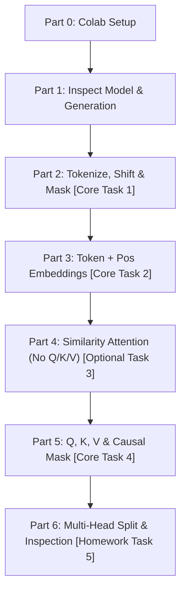
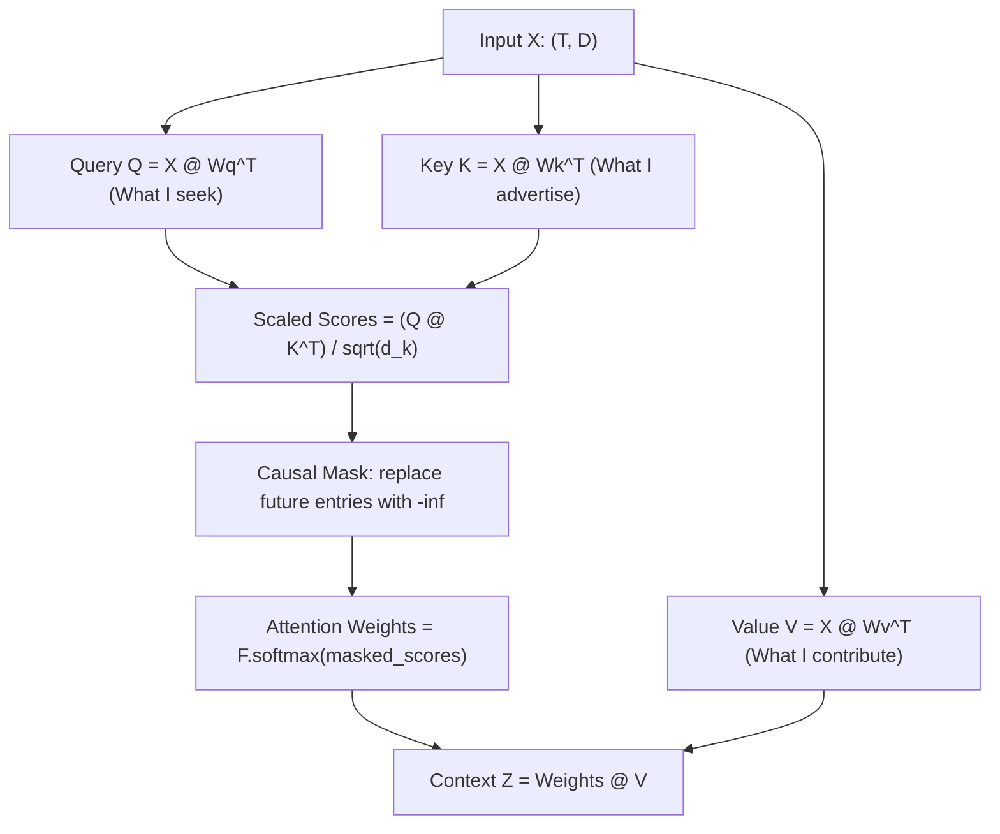

# Activity 1: From Small Vector Math to Multi-Head Causal Attention in `Tiny-2.1`

> [!NOTE]
> For each part:
> 1. Run the **Small Calculation** first to verify the math with small 2D vectors.
> 2. Run the **`Tiny-2.1` Scale-Up** to observe the exact same operation inside the trained 366,528-parameter model.
> 3. Discuss every **"Why?"** question with your group **before** opening the `<details>` Hint and Answer boxes.



---

## Part 0: Standalone Colab Setup

Run these two cells once at the start of a fresh Colab notebook.

```python
!git clone https://github.com/WollyMonjac/Tiny-2.1.git
%cd /content/Tiny-2.1/training
```

```python
import math, struct
import numpy as np
import torch
import torch.nn.functional as F
import matplotlib.pyplot as plt
import train2

print("PyTorch version:", torch.__version__)

def load_v2_bin(path):
    """Load a version-2 ('TNY2') 8-bit weight file into train2.Model."""
    b = open(path, "rb").read()
    assert b[:4] == b"TNY2", "Expected a TNY2 weight file"
    D, L, H, HID = struct.unpack_from("<4h", b, 4)
    off = [12]

    def table(r, c):
        w = np.empty((r, c), dtype=np.float32)
        for i in range(r):
            s = struct.unpack_from("<f", b, off[0])[0]
            w[i] = np.frombuffer(b, np.int8, c, off[0] + 4).astype(np.float32) * s
            off[0] += 4 + c
        return torch.tensor(w)

    def gains():
        g = np.frombuffer(b, "<f4", D, off[0]).copy()
        off[0] += 4 * D
        return torch.tensor(g)

    m = train2.Model(train2.Cfg(D, L, H, HID))
    with torch.no_grad():
        m.emb.weight.copy_(table(train2.VOCAB, D))
        m.pos.weight.copy_(table(train2.CTX, D))
        for blk in m.blocks:
            blk.n1.g.copy_(gains())
            for lin in (blk.q, blk.k, blk.v, blk.o):
                lin.weight.copy_(table(D, D))
            blk.n2.g.copy_(gains())
            blk.f1.weight.copy_(table(HID, D))
            blk.f2.weight.copy_(table(D, HID))
        m.nf.g.copy_(gains())
    assert off[0] == len(b), "size mismatch"
    return m
```

---

## Part 1: Loading `Tiny-2.1`, Testing Answers, and Inspecting the Model

Load the pre-trained `Tiny-2.1` model (`373 KB`, 8-bit weights), test a few prompts, and inspect its PyTorch structure and parameter count.

```python
model = load_v2_bin("/content/Tiny-2.1/dos/TINY.BIN")
model.eval()

questions = [
    "what is 2+2?",
    "what is the capital of france?",
    "spell cat",
    "what is the capital of mars?",
]
answers = train2.answer_many(model, questions)
for q, a in answers.items():
    print(f"Q: {q}\nA: {a}\n")

print(model)
print("\nTotal trainable parameters:", f"{sum(p.numel() for p in model.parameters()):,}")
```

### Code Explanation
* `load_v2_bin(...)`: Unpacks the binary `TNY2` weight file (`381,808 bytes`) into a `train2.Model` with configuration `D=96, L=4, H=4, HID=256`.
* `model.eval()`: Switches the model into evaluation (inference) mode.
* `train2.answer_many(model, questions)`: Encodes each question + `"\n"`, predicts one character at a time (`argmax` over `97` vocabulary scores), appends each predicted token, and stops when the model predicts newline (`ID = 1`).
* `print(model)`: Displays every PyTorch module (`emb`, `pos`, `blocks[0..3]`, `nf`).
* `p.numel()`: Counts the total scalar weights across all parameter tensors (`366,528`).

### "Why?" Questions

**Q1.1:** Why does `print(model)` show `Linear(in_features=96, out_features=96, bias=False)` four times inside every `Block` (`q, k, v, o`), and why does `emb` have shape `(97, 96)` while `pos` has shape `(128, 96)`?

<details>
<summary>Hint</summary>

Check the constants `VOCAB` and `CTX` near the top of `train2.py` and match them to vocabulary size and maximum context length.

</details>

<details>
<summary>Answer</summary>

* `q`, `k`, `v`, and `o` are the four attention linear projections (`Query`, `Key`, `Value`, and `Output`), each mapping a `96`-dimensional token representation to `96` dimensions without bias.
* `emb` has `97` rows (one learned vector of length `96` for each character ID `0..96`).
* `pos` has `128` rows (one learned vector of length `96` for each position index `0..127`, matching maximum context length `CTX = 128`).

</details>

---

**Q1.2:** Look at the model's output for `"what is the capital of mars?"`. Why may `Tiny-2.1` hallucinate a plausible-sounding city name rather than stating that Mars has no capital?

<details>
<summary>Hint</summary>

Think about what an autoregressive character-prediction model is trained to minimize when it encounters the pattern `"what is the capital of <word>?\n"`.

</details>

<details>
<summary>Answer</summary>

A language model does not consult an external factual database or verify premises; it predicts characters according to conditional probabilities learned from training text. Because the prompt template `"what is the capital of ...?\n"` is almost universally followed by city names in training sets, the model may follow that statistical pattern and hallucinate a plausible city name unless it was explicitly fine-tuned on refusal examples for unanswerable questions.

</details>

---

## Part 2: Tokenization, Next-Token Shift, and Loss Masking

### Step 2A — Small Example by Hand & Code (3–7 characters)
Inspect how text turns into integer IDs and how training constructs input–target pairs with a loss mask.

```python
# Tiny-2.1 character rule (from train2.py):
#   0      -> padding
#   1      -> newline '\n'
#   2..96  -> ASCII(c) - 30

word = "cat"
word_ids = train2.encode(word)
print("Word:", word, "-> IDs:", word_ids, "-> Decoded:", repr(train2.decode(word_ids)))

q, a = "2+2?", "4"
full_text = q + "\n" + a + "\n"
ids = train2.encode(full_text)

# Loss mask: 0 for question + first '\n', 1 for answer + final '\n'
mask = [0] * (len(q) + 1) + [1] * (len(ids) - len(q) - 1)

inputs_x  = ids[:-1]
targets_y = ids[1:]
loss_mask = mask[1:]

print("\nAligned training table for '2+2?\\n4\\n':")
for pos in range(len(inputs_x)):
    in_c  = repr(train2.decode([inputs_x[pos]]))[1:-1]
    tgt_c = repr(train2.decode([targets_y[pos]]))[1:-1]
    print(f"  pos {pos}: input={in_c:>3} (ID {inputs_x[pos]:2d}) -> target={tgt_c:>3} (ID {targets_y[pos]:2d}) | mask={loss_mask[pos]}")
```

### Code Explanation
* `train2.encode(s)`: Converts `'\n'` to `1` and printable ASCII (`32..126`) to `ord(c) - 30` (values `2..96`).
* `ids[:-1]` and `ids[1:]`: Creates the training pair by shifting the sequence one step.
* `mask = [0]*(len(q)+1) + [1]*(...)`: Sets the question tokens to `0` and answer tokens to `1`.
* `loss_mask = mask[1:]`: Aligns mask values with `targets_y` so the cross-entropy loss only computes gradients for the answer tokens.

### "Why?" Questions

**Q2.1:** Why does `Tiny-2.1` tokenize **individual characters** (`VOCAB = 97`) instead of whole English words or subwords (which commonly use `VOCAB = 32,000+`)?

<details>
<summary>Hint</summary>

Multiply `VOCAB × 96` for both vocabulary sizes to compare embedding parameter counts.

</details>

<details>
<summary>Answer</summary>

With `D = 96`, a 97-character embedding table requires only $97 \times 96 = 9,312$ parameters (~37 KB). A 32,000-token subword vocabulary would require $32,000 \times 96 \approx 3.07\text{ million}$ parameters—nearly $8\times$ larger than the entire `Tiny-2.1` model combined. Character tokenization also guarantees zero out-of-vocabulary (OOV) tokens for standard ASCII strings.

</details>

---

**Q2.2:** Why does token ID `1` (`"\n"`) appear **twice** in `"2+2?\n4\n"`, and why is the first `"\n"` masked with `0` while the second `"\n"` is masked with `1`?

<details>
<summary>Hint</summary>

Think about which newline is part of the prompt prompt vs. which newline signals the model to stop generating.

</details>

<details>
<summary>Answer</summary>

* The **first `\n`** separates the user's question from the answer. It belongs to the input prompt, so its target has a loss mask of `0` (not graded).
* The **second `\n`** marks the end of the answer. Its target has a loss mask of `1` because the model **must learn** to emit token `1` to stop generation.

</details>

---

### Hands-On Task 1: Inspect Target Alignment on a Sentence
Write a short script using `train2.encode` for `"capital of france?\nparis\n"`:
1. Print total sequence length `T`, `inputs_x`, `targets_y`, and `loss_mask`.
2. Count how many target tokens are graded (`sum(loss_mask)`) vs. ignored (`len(loss_mask) - sum(loss_mask)`).

<details>
<summary>Hint</summary>

Use `mask = [0] * (len(q) + 1) + [1] * (len(ids) - len(q) - 1)` where `q = "capital of france?"` and `a = "paris"`.

</details>

<details>
<summary>Answer / Sample Code</summary>

```python
q, a = "capital of france?", "paris"
ids = train2.encode(q + "\n" + a + "\n")
mask = [0] * (len(q) + 1) + [1] * (len(ids) - len(q) - 1)

inputs_x, targets_y, loss_mask = ids[:-1], ids[1:], mask[1:]
print("Total length T:", len(ids))
print("Graded answer tokens:", sum(loss_mask))
print("Ignored question tokens:", len(loss_mask) - sum(loss_mask))
print("Graded targets:", repr(train2.decode([y for y, m in zip(targets_y, loss_mask) if m == 1])))
```
**Expected observation:** Exactly `6` targets (`'p', 'a', 'r', 'i', 's', '\n'`) have `loss_mask == 1`, while the `18` question targets are ignored (`loss_mask == 0`).

</details>

---

## Part 3: Token Embeddings and Positional Embeddings

### Step 3A — Small Calculation First (2D Toy Vectors)
Verify token embedding lookup and positional addition using **2-dimensional** vectors for `"2+2?"`:

```python
# Toy embedding table: row 0 = '2', row 1 = '+', row 2 = '?'
emb_small = torch.tensor([
    [1.0, 0.0],  # '2'
    [0.0, 1.0],  # '+'
    [0.3, 0.7],  # '?'
])

# Toy position table for positions 0, 1, 2, 3
pos_small = torch.tensor([
    [ 0.1,  0.2],  # pos 0
    [ 0.2, -0.1],  # pos 1
    [ 0.4, -0.1],  # pos 2
    [-0.2,  0.3],  # pos 3
])

# Token indices into emb_small for "2+2?" -> ['2', '+', '2', '?']
toy_ids = torch.tensor([0, 1, 0, 2], dtype=torch.long)

tok_vecs = emb_small[toy_ids]              # shape: (4, 2)
pos_vecs = pos_small[torch.arange(4)]      # shape: (4, 2)
X_small = tok_vecs + pos_vecs              # shape: (4, 2)

print("Token vectors ONLY (row 0 and row 2 are identical):\n", tok_vecs.numpy())
print("Position vectors:\n", pos_vecs.numpy())
print("Combined X = tok + pos (now row 0 and row 2 differ!):\n", np.round(X_small.numpy(), 2))
```

### Step 3B — Scale Up to `Tiny-2.1` (`D = 96`)
Run the exact same lookup and addition inside `Tiny-2.1`:

```python
ids_22 = torch.tensor([train2.encode("2+2?\n4\n")], dtype=torch.long)  # shape: (1, 7)
T = ids_22.shape[1]

with torch.no_grad():
    tok_96 = model.emb(ids_22)                # shape: (1, 7, 96)
    pos_96 = model.pos(torch.arange(T))       # shape: (7, 96)
    X_96 = tok_96 + pos_96                    # broadcasts (7, 96) -> (1, 7, 96)

print("tok_96 shape:", tuple(tok_96.shape))
print("pos_96 shape:", tuple(pos_96.shape))
print("X_96 shape  :", tuple(X_96.shape))
print("First 5 values of '2' at pos 0:", np.round(X_96[0, 0, :5].numpy(), 3))
print("First 5 values of '2' at pos 2:", np.round(X_96[0, 2, :5].numpy(), 3))
```

### "Why?" Questions

**Q3.1:** Why do we map integer IDs to `96`-dimensional vectors (`model.emb`) instead of passing raw integer IDs directly into layers?

<details>
<summary>Hint</summary>

What does linear algebra do with scalar numbers? If `'t'` is ID `86` and `' '` is ID `2`, would multiplying by a weight imply `'t'` has $43\times$ the value of a space?

</details>

<details>
<summary>Answer</summary>

Integer IDs impose an artificial ordering and magnitude scale (`86 > 2`) where none exists semantically. Projecting each ID into a `96`-dimensional continuous vector allows the model to learn independent coordinates for each character and group characters with related roles (such as digits or punctuation) near one another in embedding space.

</details>

---

**Q3.2:** Does an autoregressive Transformer *completely* lose all sense of order without positional embeddings? Why are positional embeddings still essential?

<details>
<summary>Hint</summary>

Review Theory Section 3. Think about what a lower-triangular causal mask does to token visibility: can token 0 see token 3? But can the model easily tell whether a token was 2 steps away vs. 10 steps away?

</details>

<details>
<summary>Answer</summary>

In causal attention, the triangular mask breaks full permutation symmetry because early tokens can only attend to earlier positions while later tokens can attend to more positions. So a causal model is not strictly order-blind. 

However, without explicit positional embeddings, the model cannot readily measure exact token distances, differentiate identical tokens appearing at different positions, or establish absolute slot coordinates. Adding $P[t]$ equips each token with an explicit coordinate in the sequence.

</details>

---

### Hands-On Task 2: Verify Distinct Representations on `"12"` vs. `"21"`
Using `model.emb` and `model.pos`:
1. Compute `tok_12` and `tok_21` (without `model.pos`).
2. Compute `(tok_12[0, 1] - tok_21[0, 0]).abs().max()` (comparing `'2'` in `"12"` with `'2'` in `"21"`).
3. Repeat **after** adding `model.pos(torch.arange(2))`.

<details>
<summary>Hint</summary>

Wrap your evaluation in `with torch.no_grad():` and use `.item()` to extract Python floats.

</details>

<details>
<summary>Answer / Sample Code</summary>

```python
id_12 = torch.tensor([train2.encode("12")], dtype=torch.long)
id_21 = torch.tensor([train2.encode("21")], dtype=torch.long)

with torch.no_grad():
    tok_12 = model.emb(id_12)
    tok_21 = model.emb(id_21)
    diff_no_pos = (tok_12[0, 1] - tok_21[0, 0]).abs().max().item()
    print("Max absolute difference for '2' WITHOUT pos:", diff_no_pos)

    pos_2 = model.pos(torch.arange(2))
    x_12 = tok_12 + pos_2
    x_21 = tok_21 + pos_2
    diff_with_pos = (x_12[0, 1] - x_21[0, 0]).abs().max().item()
    print("Max absolute difference for '2' WITH pos   :", diff_with_pos)
```
**Expected observation:** `diff_no_pos` is `0.0` (both are identical embedding lookups). `diff_with_pos` is positive because position `1` and position `0` add distinct positional coordinates.

</details>

---

## Part 4: Similarity-Based Attention Without Learned Q/K/V Projections

### Step 4A — Small Manual Calculation First (3 Tokens in 2D)
Calculate similarity-based attention on 3 simple 2D vectors directly using dot products:

```python
# 3 toy tokens in 2D: x0 = [1, 0], x1 = [1, 1], x2 = [0, 1]
X_tiny = torch.tensor([
    [1.0, 0.0],  # token 0
    [1.0, 1.0],  # token 1
    [0.0, 1.0],  # token 2
])

# 1. Pairwise dot products: X @ X^T -> (3, 3)
scores_tiny = X_tiny @ X_tiny.T
print("Raw dot-product scores (3x3):\n", scores_tiny.numpy())

# 2. Softmax across columns (dim=-1) so each row sums to 1.0
weights_tiny = F.softmax(scores_tiny, dim=-1)
print("\nSoftmax attention weights (3x3):\n", np.round(weights_tiny.numpy(), 3))
print("Row sums:", weights_tiny.sum(dim=-1).numpy())

# 3. Context vectors = Weights @ X -> (3, 2)
context_tiny = weights_tiny @ X_tiny
print("\nContext vectors (3x2):\n", np.round(context_tiny.numpy(), 3))
```

Verify Row `0` (`token 0 = [1, 0]`) manually:
* Dot products with `[x0, x1, x2]`: `[1*1+0*0, 1*1+0*1, 1*0+0*1] = [1, 1, 0]`.
* Softmax of `[1, 1, 0]`: `[e^1, e^1, e^0] / (e^1 + e^1 + 1) ≈ [0.422, 0.422, 0.155]`.
* Context vector 0: `0.422*[1, 0] + 0.422*[1, 1] + 0.155*[0, 1] ≈ [0.845, 0.577]`.

### Step 4B — Scale Up to the 4 Tokens `"2+2?"` (Heatmap)
Visualize unweighted similarity-based attention on `X_small` (`4×2`):

```python
scores_4 = X_small @ X_small.T
weights_4 = F.softmax(scores_4, dim=-1)

labels_4 = ["2 (pos 0)", "+", "2 (pos 2)", "?"]
plt.figure(figsize=(4.5, 4))
plt.imshow(weights_4.numpy(), cmap="Blues", vmin=0.0, vmax=0.5)
plt.xticks(range(4), labels_4, rotation=30)
plt.yticks(range(4), labels_4)
plt.title("Unprojected Similarity Attention on '2+2?'")
plt.colorbar(label="Weight")
plt.show()
```

### "Why?" Questions

**Q4.1:** Why do we use the **dot product** (`X @ X.T`) to score tokens, and why do we apply **`F.softmax`**?

<details>
<summary>Hint</summary>

What geometric relationship does a dot product measure? And what mathematical property turns raw scores into valid blending weights?

</details>

<details>
<summary>Answer</summary>

1. **Dot product:** Measures vector alignment—vectors pointing in similar directions yield large positive scores; orthogonal vectors yield `0`; opposing vectors yield negative scores.
2. **Softmax:** Raw dot products are unconstrained real numbers. Softmax maps them to strictly positive values in $(0, 1)$ that sum to `1.0` along each row, turning the context computation into a convex weighted average.

</details>

---

**Q4.2:** Why is similarity-based attention **without learned Q/K/V projections** inadequate for modeling complex language and reasoning tasks?

<details>
<summary>Hint</summary>

Can a question mark `'?'` be mathematically identical to a digit `'2'`, while still needing to pay attention to that digit?

</details>

<details>
<summary>Answer</summary>

Without learned projections, attention is symmetric and constrained to raw feature similarity: token $A$ only attends strongly to token $B$ if their input embeddings happen to point in the same direction. In language tasks, tokens frequently must attend to functionally dissimilar tokens (e.g., an operator `'+'` or punctuation `'?'` querying numerical arguments). Learned $Q, K, V$ projections enable asymmetric relationships.

</details>

---

### Hands-On Task 3: Evaluate Unprojected Similarity on Embeddings
Using `X_96` (`(1, 7, 96)` for `"2+2?\n4\n"`) from Part 3B:
1. Extract `X_mat = X_96[0]` (shape `(7, 96)`), compute `scores = X_mat @ X_mat.T`, and apply `F.softmax(scores, dim=-1)`.
2. Print row `4` (`'\n'`). Observe whether row `4` attends symmetrically to future tokens (`'4'` and final `'\n'`).

<details>
<summary>Hint</summary>

Notice that without a causal mask or directional projections, any identical character later in the sequence produces large similarity.

</details>

<details>
<summary>Answer / Sample Code</summary>

```python
X_mat = X_96[0]                                # (7, 96)
sc_unweighted = X_mat @ X_mat.T                # (7, 7)
w_unweighted = F.softmax(sc_unweighted, dim=-1)

chars_7 = [repr(c)[1:-1] for c in "2+2?\n4\n"]
print("Tokens:", chars_7)
print("Row 4 ('\\n') weights across sequence:", np.round(w_unweighted[4].numpy(), 3))
```
**Observation:** Without causal masking, row `4` (`'\n'`) assigns substantial weight to position `6` (the future `'\n'`) simply because both share the same token embedding.

</details>

---

## Part 5: Trainable Attention ($Q, K, V$), Scaling ($\sqrt{d_k}$), and Causal Masking



### Step 5A — Small Calculation First (2D $Q, K, V$, Scaling Check, and 3×3 Causal Mask)
Step through 2D projections, numerical scaling, and causal masking:

```python
# 1. Small 2D Q, K, V projections on X_tiny (3x2) from Part 4A
Wq_small = torch.tensor([[1.0, 0.0], [0.0, 0.5]])
Wk_small = torch.tensor([[0.0, 1.0], [1.0, 0.0]])
Wv_small = torch.tensor([[1.0, 1.0], [0.0, 1.0]])

Q_sm = X_tiny @ Wq_small.T
K_sm = X_tiny @ Wk_small.T
V_sm = X_tiny @ Wv_small.T

# 2. Scaled dot-product (d_k = 2)
dk = 2.0
scores_sm = (Q_sm @ K_sm.T) / math.sqrt(dk)
print("Scaled scores (3x3):\n", np.round(scores_sm.numpy(), 3))

# 3. Causal mask: 1 on/below diagonal, 0 above diagonal
mask_3 = torch.tril(torch.ones(3, 3))
print("\nLower-triangular causal mask:\n", mask_3.numpy().astype(int))

masked_scores_sm = scores_sm.masked_fill(mask_3 == 0, float("-inf"))
attn_sm = F.softmax(masked_scores_sm, dim=-1)
print("\nMasked attention weights (upper triangle = 0.0):\n", np.round(attn_sm.numpy(), 3))

# 4. Softmax scaling experiment
print("\nSoftmax on moderate scores [1.0, 2.0]:", np.round(F.softmax(torch.tensor([1.0, 2.0]), dim=0).numpy(), 3))
print("Softmax on large scores   [10.0, 20.0]:", np.round(F.softmax(torch.tensor([10.0, 20.0]), dim=0).numpy(), 5))
```

### Step 5B — Scale Up to `Tiny-2.1` (`Block 0`)
Inspect the real `n1`, `q`, `k`, and `v` layers inside `Tiny-2.1`:

```python
blk = model.blocks[0]
with torch.no_grad():
    h = blk.n1(X_96)  # RMSNorm before attention -> shape (1, 7, 96)
    Q_96 = blk.q(h)
    K_96 = blk.k(h)
    V_96 = blk.v(h)

print("Q_96, K_96, V_96 shapes:", tuple(Q_96.shape), tuple(K_96.shape), tuple(V_96.shape))
print("Weight matrix shape of blk.q.weight:", tuple(blk.q.weight.shape))  # (96, 96)
```

### "Why?" Questions

**Q5.1:** Using the search-engine metaphor from the theory lesson, describe the distinct roles of **Query ($Q$)**, **Key ($K$)**, and **Value ($V$)**. Why are three distinct matrices necessary?

<details>
<summary>Hint</summary>

Think of searching a video database: (1) what you enter in the search query box, (2) the title tags and keywords indexed on each video file, and (3) the actual video content streamed to your screen.

</details>

<details>
<summary>Answer</summary>

* **Query ($Q = X W_Q^T$):** Formulates what the current token is seeking from other tokens.
* **Key ($K = X W_K^T$):** Formulates the tags or profile that each token exposes to searchers.
* **Value ($V = X W_V^T$):** The actual informational payload a token transmits if its Key matches a Query.

Having separate learned projections allows the model to match tokens that serve complementary roles without forcing their queries, advertised keys, and transmitted values to be identical.

</details>

---

**Q5.2:** Compare `blk.q`, `blk.k`, `blk.v` with traditional deep neural network layers:
* Do `q, k, v` apply non-linearities like `ReLU` or `GELU`?
* Where does non-linearity enter the attention mechanism?

<details>
<summary>Hint</summary>

Inspect `Block.forward` in `train2.py`. Notice where activations appear inside the attention mechanism vs. inside the feedforward MLP (`f1 -> relu -> f2`).

</details>

<details>
<summary>Answer</summary>

`blk.q`, `blk.k`, and `blk.v` are **strictly linear projections** without bias or activation functions. The non-linearity in attention originates entirely from the cross-token **`softmax`** operation. Standard pointwise activations like `ReLU` are deferred to the feedforward MLP network (`f1` and `f2`).

</details>

---

**Q5.3:** Based on your Step 5A experiment comparing `[1.0, 2.0]` with `[10.0, 20.0]`, why is it critical to scale by $\sqrt{d_k}$?

<details>
<summary>Hint</summary>

Look at the probabilities for `[10.0, 20.0]`: one entry is `0.99995` and the other is `0.00005`. What happens to the derivative (gradient) of softmax when outputs saturate at 0 or 1?

</details>

<details>
<summary>Answer</summary>

As key dimension $d_k$ grows, the variance of dot products scales proportionally. Unchecked large dot products push `softmax` into extreme saturation regions where outputs collapse toward one-hot vectors. In saturation, gradients become vanishingly small, stalling backpropagation. Dividing by $\sqrt{d_k}$ normalizes score variance to approximately $1.0$, stabilizing gradient flow during training.

</details>

---

**Q5.4:** Why do we overwrite masked positions with **`-inf` before `F.softmax`** instead of setting them to `0` before `softmax` or zeroing them out *after* `softmax`?

<details>
<summary>Hint</summary>

Calculate $e^0$ vs. $e^{-\infty}$. Also check the sum of a probability row if elements are zeroed out after softmax.

</details>

<details>
<summary>Answer</summary>

* Setting masked scores to `0` *before* `softmax` fails because $e^0 = 1.0$, which assigns positive probability mass to future tokens.
* Multiplying by `0` *after* `softmax` breaks the probability distribution because the remaining entries will no longer sum to $1.0$.
* Setting scores to `-inf` before `softmax` guarantees $e^{-\infty} = 0$, completely blocking future positions while naturally renormalizing the remaining valid tokens to sum to $1.0$.

</details>

---

### Hands-On Task 4: Demonstrate Potential Information Leakage Without Causal Masking
Compute attention weights for Head 0 of `model.blocks[0]` on `"2+2?\n4\n"` ($T = 7$) both **with** and **without** the causal mask. Print row `4` (`'\n'`, the token immediately preceding `'4'`):

<details>
<summary>Hint</summary>

Extract the first 24 channels of $Q$ and $K$ (`[:, :, :24]`), scale by $\sqrt{24}$, and compare unmasked `F.softmax(sc, dim=-1)` with masked `F.softmax(sc.masked_fill(mask == 0, float("-inf")), dim=-1)`.

</details>

<details>
<summary>Answer / Sample Code</summary>

```python
q_h0 = Q_96[:, :, :24]  # (1, 7, 24)
k_h0 = K_96[:, :, :24]  # (1, 7, 24)

sc_h0 = (q_h0 @ k_h0.transpose(-2, -1)) / math.sqrt(24)
mask_7 = torch.tril(torch.ones(7, 7))

w_masked   = F.softmax(sc_h0.masked_fill(mask_7 == 0, float("-inf")), dim=-1)
w_unmasked = F.softmax(sc_h0, dim=-1)

chars_7 = [repr(c)[1:-1] for c in "2+2?\n4\n"]
print("Tokens:", chars_7)
print("Row 4 ('\\n') WITH causal mask   :", np.round(w_masked[0, 4].numpy(), 3))
print("Row 4 ('\\n') WITHOUT causal mask:", np.round(w_unmasked[0, 4].numpy(), 3))
```
**Expected observation:** With the causal mask applied, positions `5` (`'4'`) and `6` (`'\n'`) are strictly `0.000`. Without the mask, the unmasked row can access future tokens (such as `'4'` at index `5`), which would enable the model to cheat during training instead of learning to compute the next character.

</details>

---

## Part 6: Multi-Head Attention ($H = 4$) and Output Projection $o$

### Step 6A — Small Reshape and Transpose Mechanics ($D = 4$, $H = 2$)
Before splitting 96 dimensions into $4 \times 24$, trace the tensor reshaping used in `train2.py` on a toy tensor with $B=1, T=3, D=4$ split into $H=2$ heads of width $d_k=2$:

```python
# 1 sequence, 3 tokens, 4 features per token
tiny_q = torch.tensor([[
    [10.0, 11.0, 12.0, 13.0],
    [20.0, 21.0, 22.0, 23.0],
    [30.0, 31.0, 32.0, 33.0],
]])  # shape: (1, 3, 4)

B_s, T_s, D_s, H_s = 1, 3, 4, 2
Dh_s = D_s // H_s  # 2

# 1. Reshape last dimension D -> (H=2, Dh=2): shape -> (1, 3, 2, 2)
reshaped = tiny_q.view(B_s, T_s, H_s, Dh_s)

# 2. Swap sequence dimension (1) and head dimension (2): shape -> (1, 2, 3, 2)
split_q = reshaped.transpose(1, 2)

print("Original shape (B, T, D):", tuple(tiny_q.shape))
print("Split shape (B, H, T, Dh):", tuple(split_q.shape))
print("Head 0 across all 3 tokens:\n", split_q[0, 0].numpy())
print("Head 1 across all 3 tokens:\n", split_q[0, 1].numpy())

# 3. Concatenate heads back and verify equality
merged = split_q.transpose(1, 2).reshape(B_s, T_s, D_s)
print("Merged tensor matches original:", torch.equal(merged, tiny_q))
```

### Step 6B — Scale Up to `Tiny-2.1` ($D = 96$, $H = 4$, $d_k = 24$)
Run all 4 heads of `Block 0` on `"what is 2+2?\n"`, plot the attention weight distributions, and verify the manual multi-head code against PyTorch's native `F.scaled_dot_product_attention`:

```python
prompt = "what is 2+2?\n"
p_ids = torch.tensor([train2.encode(prompt)], dtype=torch.long)
T_p = p_ids.shape[1]
chars_p = [repr(c)[1:-1] for c in prompt]

with torch.no_grad():
    x_p = model.emb(p_ids) + model.pos(torch.arange(T_p))
    blk = model.blocks[0]
    h_p = blk.n1(x_p)

    # Tensor splitting helper matching train2.py
    sp = lambda t: t.view(1, T_p, 4, 24).transpose(1, 2)
    qh, kh, vh = sp(blk.q(h_p)), sp(blk.k(h_p)), sp(blk.v(h_p))

    # Manual multi-head causal attention calculation
    scores_p = (qh @ kh.transpose(-2, -1)) / math.sqrt(24)
    mask_p = torch.tril(torch.ones(T_p, T_p))
    attn_p = F.softmax(scores_p.masked_fill(mask_p == 0, float("-inf")), dim=-1)  # (1, 4, T_p, T_p)

    context_p = attn_p @ vh                                                        # (1, 4, T_p, 24)
    context_merged = context_p.transpose(1, 2).reshape(1, T_p, 96)                 # (1, T_p, 96)
    attn_output = blk.o(context_merged)                                            # (1, T_p, 96)

    # Cross-check against optimized PyTorch operator
    fast_a = F.scaled_dot_product_attention(qh, kh, vh, is_causal=True)
    fast_out = blk.o(fast_a.transpose(1, 2).reshape(1, T_p, 96))
    max_discrepancy = (attn_output - fast_out).abs().max().item()
    print("Maximum absolute difference vs F.scaled_dot_product_attention:", max_discrepancy)

# Plot attention distributions across all 4 heads
fig, axes = plt.subplots(2, 2, figsize=(10, 9))
for head_idx, ax in enumerate(axes.flat):
    im = ax.imshow(attn_p[0, head_idx].numpy(), cmap="viridis", vmin=0.0)
    ax.set_title(f"Block 0 — Head {head_idx}")
    ax.set_xticks(range(len(chars_p))); ax.set_xticklabels(chars_p, fontsize=8)
    ax.set_yticks(range(len(chars_p))); ax.set_yticklabels(chars_p, fontsize=8)
fig.colorbar(im, ax=axes.ravel().tolist(), shrink=0.75)
plt.suptitle(f"Block 0 Attention Weight Distributions on '{prompt.strip()}'")
plt.show()
```

> [!WARNING]
> **Interpreting Early-Layer Attention Plots:**
> The 4 heatmaps above illustrate **how particular heads distribute routing weights across tokens** in the first block. They do **not** serve as proof that a head "knows arithmetic" or has a permanent, human-interpretable linguistic assignment. True computational processing is distributed across multiple layers and subsequent MLP transformations.

### "Why?" Questions

**Q6.1:** Why does `sp` transpose dimensions `(1, 2)` (`(B, T, H, Dh) → (B, H, T, Dh)`) before multiplying `qh @ kh.transpose(-2, -1)`?

<details>
<summary>Hint</summary>

PyTorch matrix multiplication (`@`) performs batch matrix multiplication on the final two dimensions of a tensor.

</details>

<details>
<summary>Answer</summary>

By arranging the tensor as `(B, H, T, Dh)`, PyTorch treats both `B` (batch) and `H` (head) as batch dimensions. The `@` operator computes `(T, Dh) @ (Dh, T) = (T, T)` for all heads simultaneously in parallel, avoiding a slow sequential loop over heads.

</details>

---

**Q6.2:** Why do we split the $D=96$ representation into $H=4$ heads of dimension $24$ instead of running a single 96-dimensional attention head? And why is the output projection `blk.o` needed?

<details>
<summary>Hint</summary>

If you only have one head, each token can only form a single attention distribution over past tokens. After concatenating the outputs of 4 heads side-by-side, have their features been combined yet?

</details>

<details>
<summary>Answer</summary>

* **Multiple Heads ($4 \times 24$):** Allows different heads to focus on distinct relationships concurrently (e.g., one head attending to immediate neighbors, another attending to whitespace boundaries, and another attending to operator symbols).
* **Output Projection (`blk.o`):** Concatenation simply places four 24-dimensional outputs side by side. The linear layer `blk.o` ($96 \times 96$) projects and mixes information across all four heads into a unified 96-dimensional representation.

</details>

---

### Hands-On Task 5: Analyze Head Attention Distributions
Using `attn_p` from Step 6B:
1. Write a function that prints the **top-3 attended tokens** for the final token `'\n'` (row index `-1`) across all 4 heads of Block 0.
2. Evaluate two prompts with different structures—such as `"what is 2+2?\n"` versus `"what is the capital of france?\n"`.
3. Compare the distributions. Do certain heads consistently focus on immediate predecessors (local attention) while others distribute attention across earlier question tokens?

<details>
<summary>Hint</summary>

For a given head, extract weights with `w = attn_p[0, head_idx, -1].numpy()`, then sort descending using `np.argsort(w)[::-1][:3]`.

</details>

<details>
<summary>Answer / Sample Code</summary>

```python
@torch.no_grad()
def inspect_last_token_heads(prompt_str):
    ids = torch.tensor([train2.encode(prompt_str)], dtype=torch.long)
    T_len = ids.shape[1]
    ch = [repr(c)[1:-1] for c in prompt_str]
    x = model.emb(ids) + model.pos(torch.arange(T_len))
    blk = model.blocks[0]
    h = blk.n1(x)
    sp_fn = lambda t: t.view(1, T_len, 4, 24).transpose(1, 2)
    q, k = sp_fn(blk.q(h)), sp_fn(blk.k(h))
    sc = (q @ k.transpose(-2, -1)) / math.sqrt(24)
    mk = torch.tril(torch.ones(T_len, T_len))
    at = F.softmax(sc.masked_fill(mk == 0, float("-inf")), dim=-1)

    print(f"\n=== Prompt: {repr(prompt_str)} ===")
    for h_i in range(4):
        w = at[0, h_i, -1].numpy()
        top3 = np.argsort(w)[::-1][:3]
        desc = ", ".join(f"pos {i} ('{ch[i]}'): {w[i]:.2f}" for i in top3)
        print(f"  Head {h_i}: {desc}")

inspect_last_token_heads("what is 2+2?\n")
inspect_last_token_heads("what is the capital of france?\n")
```
**Takeaway:** Notice how attention distributions vary between heads. While some heads attend predominantly to immediate prefix characters, others spread their weights across earlier prompt tokens. Remember that these plots reflect routing patterns in layer 0 rather than definitive proof of semantic reasoning.

</details>

