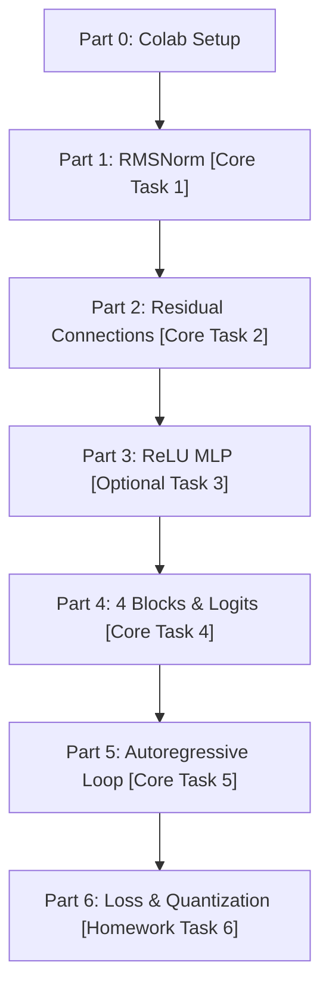
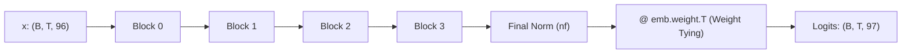

# Activity 2: Completing the Transformer Block, Text Generation, Training Loss, and 8-Bit Compression

> [!NOTE]
> Each section begins with a small calculation before scaling up to the full `Tiny-2.1` model (`D=96`, `L=4`, `H=4`, `HID=256`). Discuss each "Why?" question with your group before expanding the `<details>` hint and answer tabs.



---

## Part 0: Standalone Colab Setup

Run these two cells once at the start of a fresh Colab notebook.

```python
!git clone https://github.com/WollyMonjac/Tiny-2.1.git
%cd /content/Tiny-2.1/training
```

```python
import math, os, random, struct
import numpy as np
import torch
import torch.nn.functional as F
import matplotlib.pyplot as plt
import train2

def load_v2_bin(path):
    """Load a version-2 ('TNY2') 8-bit weight file into train2.Model."""
    b = open(path, "rb").read()
    assert b[:4] == b"TNY2", "Expected a TNY2 weight file"
    D, L, H, HID = struct.unpack_from("<4h", b, 4)
    off = [12]

    def table(r, c):
        w = np.empty((r, c), dtype=np.float32)
        for i in range(r):
            s = struct.unpack_from("<f", b, off[0])[0]
            w[i] = np.frombuffer(b, np.int8, c, off[0] + 4).astype(np.float32) * s
            off[0] += 4 + c
        return torch.tensor(w)

    def gains():
        g = np.frombuffer(b, "<f4", D, off[0]).copy()
        off[0] += 4 * D
        return torch.tensor(g)

    m = train2.Model(train2.Cfg(D, L, H, HID))
    with torch.no_grad():
        m.emb.weight.copy_(table(train2.VOCAB, D))
        m.pos.weight.copy_(table(train2.CTX, D))
        for blk in m.blocks:
            blk.n1.g.copy_(gains())
            for lin in (blk.q, blk.k, blk.v, blk.o):
                lin.weight.copy_(table(D, D))
            blk.n2.g.copy_(gains())
            blk.f1.weight.copy_(table(HID, D))
            blk.f2.weight.copy_(table(D, HID))
        m.nf.g.copy_(gains())
    assert off[0] == len(b), "size mismatch"
    return m

model = load_v2_bin("/content/Tiny-2.1/dos/TINY.BIN")
model.eval()
print("Loaded:", model.c, "| Parameters:", f"{sum(p.numel() for p in model.parameters()):,}")
```

### Code Explanation
* `load_v2_bin(...)`: Unpacks the 373 KB binary file (`dos/TINY.BIN`) row by row, dequantizing 8-bit integer weights into 32-bit float tensors in memory.
* `model.eval()`: Puts the model in inference mode.

---

## Part 1: Normalizing Activations (`RMSNorm`)

### Step 1A — Small Calculation First (2-Number Vector)
Compute `RMSNorm` manually on a 2D vector `[1.0, 7.0]` and examine what happens when the input is scaled $10\times$ (`[10.0, 70.0]`):

```python
x_small = torch.tensor([1.0, 7.0])
g_small = torch.tensor([1.0, 2.0])  # learned per-feature scale (gain)

# 1. Compute Root Mean Square: sqrt(mean(x^2) + eps)
eps = 1e-5
rms_small = torch.sqrt(torch.mean(x_small ** 2) + eps)

# 2. Divide by RMS, then multiply by gain g
normed_small = x_small / rms_small
out_small = normed_small * g_small

# 3. Repeat with a 10x larger input vector [10.0, 70.0]
x_loud = 10.0 * x_small
rms_loud = torch.sqrt(torch.mean(x_loud ** 2) + eps)
normed_loud = x_loud / rms_loud

print("x_small RMS :", round(rms_small.item(), 4), "| normed:", np.round(normed_small.numpy(), 4))
print("x_loud  RMS :", round(rms_loud.item(), 4),  "| normed:", np.round(normed_loud.numpy(), 4))
print("Difference due to eps:", (normed_small - normed_loud).abs().max().item())
print("Final output after gain g:", np.round(out_small.numpy(), 4))
```

### Step 1B — Scale Up to `Tiny-2.1` (`Block 0`, `D = 96`)
Inspect `blk.n1` inside `Tiny-2.1` on the 5-token prompt `"2+2?\n"`. To robustly verify that normalization sets the pre-gain RMS to $\approx 1.0$ without dividing by `blk.n1.g` (which could fail if any gain were near zero), compute the normalized vector directly:

```python
ids = torch.tensor([train2.encode("2+2?\n")], dtype=torch.long)  # shape: (1, 5)
T = ids.shape[1]

with torch.no_grad():
    x_in = model.emb(ids) + model.pos(torch.arange(T))           # shape: (1, 5, 96)
    blk = model.blocks[0]
    h1 = blk.n1(x_in)                                            # shape: (1, 5, 96)

    # Direct calculation of normalized vector before multiplying by gain g
    x_in_normed_direct = x_in * torch.rsqrt(x_in.pow(2).mean(dim=-1, keepdim=True) + 1e-5)
    rms_before = x_in.pow(2).mean(dim=-1).sqrt()
    rms_normed = x_in_normed_direct.pow(2).mean(dim=-1).sqrt()
    rms_final  = h1.pow(2).mean(dim=-1).sqrt()

print("RMS of each token BEFORE n1        :", np.round(rms_before[0].numpy(), 4))
print("RMS of direct normalized vector    :", np.round(rms_normed[0].numpy(), 4))
print("RMS of final output h1 (after gain):", np.round(rms_final[0].numpy(), 4))
print("First 6 learned gains blk.n1.g     :", np.round(blk.n1.g[:6].detach().numpy(), 3))
```

### Code Explanation
* `torch.rsqrt(...)`: Computes $1 / \sqrt{\dots}$ in a single efficient operation.
* `x_in_normed_direct`: Directly evaluates the unit-RMS representation before multiplying by learned vector $g$.
* `rms_final`: Demonstrates that the final token vectors do not necessarily have an RMS of exactly $1.0$; the learned gain $g$ customizes the effective scale of each feature.

### "Why?" Questions

**Q1.1:** Does scaling an input vector by $10\times$ produce *mathematically identical* or *approximately identical* normalized vectors?

<details>
<summary>Hint</summary>

Check the difference printed in Step 1A and look at the role of $\epsilon = 10^{-5}$ in the denominator.

</details>

<details>
<summary>Answer</summary>

It produces **approximately identical** normalized vectors. Because of the numerical stabilizer $\epsilon = 10^{-5}$ inside $\sqrt{\text{mean}(x^2) + \epsilon}$, scaling $x$ by $10$ scales the mean-square term by $100$ while $\epsilon$ stays fixed. The resulting difference is tiny ($\approx 10^{-4}$ in Step 1A), providing practical scale invariance without strict mathematical equality.

</details>

---

**Q1.2:** If normalization rescales activations to a standard magnitude, why does `Norm` still need the learned parameter vector `self.g`?

<details>
<summary>Hint</summary>

What if certain feature dimensions carry critical predictive signals while others are mostly noise?

</details>

<details>
<summary>Answer</summary>

Pure normalization forces all feature dimensions to the same uniform scale. Multiplying by learned gains `self.g` lets the model selectively amplify important features and suppress irrelevant ones while keeping overall vector magnitudes controlled.

</details>

---

### Hands-On Task 1: Test Scale Invariance on `Tiny-2.1`
Test `blk.n1` on `50.0 * x_in` and measure the maximum absolute difference between `blk.n1(x_in)` and `blk.n1(50.0 * x_in)`:

<details>
<summary>Hint</summary>

Evaluate `(blk.n1(x_in) - blk.n1(50.0 * x_in)).abs().max().item()` within `torch.no_grad()`.

</details>

<details>
<summary>Answer / Sample Code</summary>

```python
with torch.no_grad():
    out_normal = blk.n1(x_in)
    out_scaled = blk.n1(50.0 * x_in)
    diff = (out_normal - out_scaled).abs().max().item()

print("Max absolute difference after 50x scaling:", diff)
```
**Observation:** The difference is tiny ($< 10^{-4}$), demonstrating that `RMSNorm` protects deep layers from large amplitude shifts in preceding activations.

</details>

---

## Part 2: Shortcut (Residual) Connections

### Step 2A — Small Calculation First (4-Layer Signal Propagation)
Trace a signal of `1.0` through 4 successive layers under pure multiplication vs. residual addition:

```python
signal_plain = 1.0
signal_resid = 1.0
deltas = [0.05, -0.02, 0.08, 0.04]

print("Signal value across 4 layers:")
for layer_idx, d in enumerate(deltas):
    signal_plain = signal_plain * 0.5          # without shortcut (multiplicative decay)
    signal_resid = signal_resid + d            # with residual shortcut (additive refinement)
    print(f"  After Layer {layer_idx}: plain = {signal_plain:.4f} | residual = {signal_resid:.4f}")
```

### Step 2B — Scale Up to `Tiny-2.1` (`Block 0` Attention Residual)
Trace the first residual shortcut inside `Tiny-2.1`: $x_{\text{mid}} = x_{\text{in}} + \text{attn\_out}$.

```python
with torch.no_grad():
    sp = lambda t: t.view(1, T, 4, 24).transpose(1, 2)
    a = F.scaled_dot_product_attention(sp(blk.q(h1)), sp(blk.k(h1)), sp(blk.v(h1)), is_causal=True)
    attn_out = blk.o(a.transpose(1, 2).reshape(1, T, 96))

    # Additive residual connection
    x_mid = x_in + attn_out

print("x_in shape    :", tuple(x_in.shape))
print("attn_out shape:", tuple(attn_out.shape))
print("x_mid shape   :", tuple(x_mid.shape))
print("Mean vector norm — x_in:", round(x_in.norm(dim=-1).mean().item(), 3),
      "| attn_out:", round(attn_out.norm(dim=-1).mean().item(), 3),
      "| x_mid:", round(x_mid.norm(dim=-1).mean().item(), 3))
```

### Code Explanation
* `x_mid = x_in + attn_out`: Performs element-wise addition between the input embedding highway and the attention sublayer's output. Both tensors must match in shape: `(1, T, 96)`.

### "Why?" Questions

**Q2.1:** Why does the residual connection $x + \text{sublayer}(x)$ protect deep networks from vanishing gradients during training?

<details>
<summary>Hint</summary>

Compute $\frac{\partial}{\partial x}(x + f(x))$. What happens to the gradient when $f(x)$ is small?

</details>

<details>
<summary>Answer</summary>

Differentiating $x + f(x)$ with respect to $x$ yields $1 + f'(x)$. The constant $1$ acts as an unobstructed gradient conduit, allowing error signals to flow back directly to earlier layers even when sublayer weights produce small derivatives.

</details>

---

### Hands-On Task 2: Verify Identity Behavior Under Zero Sublayer Output
Suppose an attention sublayer outputs all zeros (`attn_out = 0`). Verify what reaches the next stage when `attn_out` is replaced with `torch.zeros_like(x_in)`:

<details>
<summary>Hint</summary>

Evaluate `(x_in - (x_in + torch.zeros_like(x_in))).abs().max().item()`.

</details>

<details>
<summary>Answer / Sample Code</summary>

```python
x_mid_zero_attn = x_in + torch.zeros_like(x_in)
diff_identity = (x_in - x_mid_zero_attn).abs().max().item()
print("Max difference from x_in when attn_out is zero:", diff_identity)
```
**Observation:** The difference is exactly `0.0`. A layer whose weights produce near-zero outputs acts as an identity pass-through rather than destroying the input representation.

</details>

---

## Part 3: Feed-Forward Network / MLP (`f1 → ReLU → f2`)

### Step 3A — Small Calculation First (`2 → 4 → 2` ReLU MLP)
Verify the forward pass of a compact MLP with 2 inputs, 4 hidden units, and 2 outputs:

```python
h_tiny = torch.tensor([1.0, -1.0])

W1_tiny = torch.tensor([
    [ 1.5, -0.5],  # neuron 0 -> 1.0*(1.5)  + (-1.0)*(-0.5) =  2.0
    [-1.0,  2.0],  # neuron 1 -> 1.0*(-1.0) + (-1.0)*(2.0)  = -3.0
    [ 0.5,  0.0],  # neuron 2 -> 1.0*(0.5)  + (-1.0)*(0.0)  =  0.5
    [-0.5,  0.5],  # neuron 3 -> 1.0*(-0.5) + (-1.0)*(0.5)  = -1.0
])

W2_tiny = torch.tensor([
    [ 0.3, 0.5, 0.4, -0.2],
    [-0.2, 0.1, 0.0,  0.6],
])

pre_relu = h_tiny @ W1_tiny.T
post_relu = F.relu(pre_relu)
mlp_out_tiny = post_relu @ W2_tiny.T

print("1. Pre-ReLU (4 neurons)  :", pre_relu.numpy())
print("2. Post-ReLU (negatives=0):", post_relu.numpy())
print("3. Final 2D MLP output    :", np.round(mlp_out_tiny.numpy(), 3))
```

### Step 3B — Scale Up to `Tiny-2.1` (`96 → 256 → 96`)
Run the second half of `Block 0` (`n2 → f1 → ReLU → f2 + residual`) and compare with calling `blk(x_in)` directly:

```python
with torch.no_grad():
    h2 = blk.n2(x_mid)
    mlp_hidden = F.relu(blk.f1(h2))     # shape: (1, 5, 256)
    mlp_out = blk.f2(mlp_hidden)        # shape: (1, 5, 96)
    x_out_manual = x_mid + mlp_out      # second residual connection

    x_out_block = blk(x_in)             # direct Block forward call

print("mlp_hidden shape:", tuple(mlp_hidden.shape))
print("x_out_manual shape:", tuple(x_out_manual.shape))
print("Max absolute difference vs blk(x_in):", (x_out_manual - x_out_block).abs().max().item())

active_pct = 100.0 * (mlp_hidden[0, -1] > 0).float().mean().item()
print(f"Active ReLU units at position -1: {active_pct:.1f}% ({int((mlp_hidden[0, -1] > 0).sum())}/256)")
```

### Code Explanation
* `blk.f1(h2)`: Projects the 96-dim normalized representation to 256 dimensions.
* `F.relu(...)`: Clamps negative activations to zero.
* `blk.f2(...)`: Projects the 256 activations back to 96 dimensions to match the residual dimension.

### "Why?" Questions

**Q3.1:** What is the fundamental functional difference between **Attention (`q, k, v, o`)** and the **MLP (`f1 → ReLU → f2`)**?

<details>
<summary>Hint</summary>

Check whether the MLP ever performs matrix operations across sequence positions $t$, or whether it operates on each token independently.

</details>

<details>
<summary>Answer</summary>

Attention mixes information **across positions** in the sequence (token-to-token communication). The MLP operates on each token **independently** (position-wise computation), transforming and non-linearly combining the features gathered by attention.

</details>

---

### Hands-On Task 3: Parameter Breakdown Analysis
Calculate and plot the parameter distribution across all 4 blocks of `Tiny-2.1`:
1. Embeddings + Positions (`emb` + `pos`)
2. All Attention layers (`q, k, v, o`)
3. All MLP layers (`f1, f2`)
4. Normalization parameters (`n1, n2, nf`)

<details>
<summary>Hint</summary>

Iterate over `model.blocks` and sum parameter element counts (`.numel()`).

</details>

<details>
<summary>Answer / Sample Code</summary>

```python
emb_p  = model.emb.weight.numel() + model.pos.weight.numel()
attn_p = sum(getattr(b, n).weight.numel() for b in model.blocks for n in ("q", "k", "v", "o"))
mlp_p  = sum(getattr(b, n).weight.numel() for b in model.blocks for n in ("f1", "f2"))
norm_p = sum(p.numel() for p in model.parameters() if p.dim() == 1)

names  = ["Emb + Pos", "Attention (4L)", "MLP (4L)", "RMSNorm (g)"]
counts = [emb_p, attn_p, mlp_p, norm_p]
for name, cnt in zip(names, counts):
    print(f"{name:15s}: {cnt:7,} ({100*cnt/sum(counts):.1f}%)")

plt.figure(figsize=(6, 3.5))
plt.bar(names, counts, color=["#9ecae1", "#4292c6", "#08519c", "#31a354"])
plt.ylabel("Parameters")
plt.title("Parameter Breakdown in Tiny-2.1")
plt.show()
```
**Observation:** The MLP layers account for over $53\%$ of the model's total capacity ($196,608$ parameters), exceeding the attention mechanism ($40.2\%$).

</details>

---

## Part 4: Stacking 4 Blocks, Final `RMSNorm`, and Weight-Tied Logits



### Step 4A — Small Calculation First (Tied Embeddings in 2D)
Compute candidate token logits via dot products against rows of an embedding matrix:

```python
emb_3 = torch.tensor([
    [0.1,  0.9],  # candidate 0: '2'
    [0.9,  0.7],  # candidate 1: '4'
    [0.0, -0.5],  # candidate 2: '\n'
])
chars_3 = ["'2'", "'4'", "'\\n'"]

h_final_small = torch.tensor([0.8, 0.6])  # final normalized output vector

# Logits = h @ emb^T
logits_3 = h_final_small @ emb_3.T
probs_3 = F.softmax(logits_3, dim=0)

for ch, sc, pr in zip(chars_3, logits_3.tolist(), probs_3.tolist()):
    print(f"  {ch:>4}: logit = {sc:+.3f} -> prob = {pr:.3f}")
```

### Step 4B — Scale Up to `Tiny-2.1` (4 Blocks + `nf` + `emb.weight.t()`)
Pass `"what is 2+2?\n"` through all 4 blocks and compute vocabulary logits:

```python
q_prompt = "what is 2+2?\n"
p_ids = torch.tensor([train2.encode(q_prompt)], dtype=torch.long)

with torch.no_grad():
    x = model.emb(p_ids) + model.pos(torch.arange(p_ids.shape[1]))
    for blk_idx, blk in enumerate(model.blocks):
        x = blk(x)
        print(f"After Block {blk_idx}: shape={tuple(x.shape)}, mean norm={x.norm(dim=-1).mean():.3f}")

    x_final = model.nf(x)                               # (1, T, 96)
    logits_manual = x_final @ model.emb.weight.t()      # (1, T, 97)
    logits_direct = model(p_ids)                        # Model.forward()

    print("Max diff vs model(p_ids):", (logits_manual - logits_direct).abs().max().item())

    # Check top-5 predicted characters for the last token position
    probs_next = F.softmax(logits_manual[0, -1], dim=-1)
    top5_p, top5_id = torch.topk(probs_next, 5)

print(f"\nTop-5 next characters after {repr(q_prompt)}:")
for p_val, tok_id in zip(top5_p.tolist(), top5_id.tolist()):
    ch_str = repr(train2.decode([tok_id]))[1:-1] if tok_id > 0 else "<pad>"
    print(f"  {ch_str:>4} (ID {tok_id:2d}): prob = {p_val:.4f}")
```

### Code Explanation
* `x_final @ model.emb.weight.t()`: Evaluates logits by calculating dot products between final hidden vectors and input embedding vectors.
* `logits_manual[0, -1]`: Selects the final position to predict the immediate continuation.

### "Why?" Questions

**Q4.1:** What is **weight tying**, and what advantage does it provide in `Tiny-2.1`?

<details>
<summary>Hint</summary>

Compare the dimensions of `model.emb.weight` (`97, 96`) with the desired output projection (`96, 97`).

</details>

<details>
<summary>Answer</summary>

Weight tying reuses the input embedding matrix transposed as the final output classification layer. In `Tiny-2.1`, this saves $97 \times 96 = 9,312$ parameters and ensures that the output layer directly compares hidden vectors against the learned token representations in embedding space.

</details>

---

### Hands-On Task 4: Investigate Prediction Uncertainty Across Contexts
Test how the model's next-character probability distribution behaves under two different prompt contexts:
1. An open prompt: `"what is the capital of "` (before the country is identified)
2. A constrained prompt: `"what is the capital of france?\n"` (after the country and question mark are provided)

Compare the top-5 probabilities. Does the model demonstrate greater confidence (sharper distribution) when the country has been specified?

<details>
<summary>Hint</summary>

Write a helper function `top5_next(prompt_str)` using `F.softmax(model(ids)[0, -1], dim=-1)` and `torch.topk(..., 5)`.

</details>

<details>
<summary>Answer / Sample Code</summary>

```python
@torch.no_grad()
def top5_next(prompt_str):
    ids = torch.tensor([train2.encode(prompt_str)], dtype=torch.long)
    probs = F.softmax(model(ids)[0, -1], dim=-1)
    vals, idxs = torch.topk(probs, 5)
    print(f"\nPrompt: {repr(prompt_str)}")
    for v, i in zip(vals.tolist(), idxs.tolist()):
        ch = repr(train2.decode([i]))[1:-1] if i > 0 else "<pad>"
        print(f"  {ch:>4} (ID {i:2d}): {v:.4f}")

top5_next("what is the capital of ")
top5_next("what is the capital of france?\n")
```
**Observation to test:** In the open prompt, probability mass is typically split across multiple plausible starting letters for country names. Once `"france?\n"` is fully specified, the probability mass often concentrates substantially on the top predicted answer character.

</details>

---

## Part 5: Autoregressive Text Generation

Run greedy autoregressive decoding on `"what is the capital of france?\n"`:

```python
prompt = "what is the capital of france?\n"
x = torch.tensor([train2.encode(prompt)], dtype=torch.long)
generated_ids = []

print(f"Starting prompt: {repr(prompt)}")
with torch.no_grad():
    for step in range(35):
        logits = model(x)[:, -1, :]              # (1, 97) at the last token
        probs = F.softmax(logits, dim=-1)
        nxt = int(logits.argmax(dim=-1).item())  # greedy decoding
        conf = float(probs[0, nxt].item())
        ch_str = repr(train2.decode([nxt]))[1:-1]
        print(f"  step {step+1:2d}: char={ch_str:>4} (ID={nxt:2d}, prob={conf:.3f})")

        if nxt <= 1:  # stop on newline (ID 1) or pad (ID 0)
            break
        generated_ids.append(nxt)
        x = torch.cat([x, torch.tensor([[nxt]], dtype=torch.long)], dim=1)

print("Final generated answer:", train2.decode(generated_ids))
```

### "Why?" Questions

**Q5.1:** Why does autoregressive generation generate one token at a time rather than predicting the entire response in a single forward pass?

<details>
<summary>Hint</summary>

Does the choice of the third character in a word depend on what the first character was?

</details>

<details>
<summary>Answer</summary>

Tokens in language are conditionally dependent on prior choices ($P(w_t \mid w_{<t})$). Because there are multiple valid continuations (e.g., answering `"Paris"` vs. `"The capital is Paris"`), predicting all tokens at once would fail to coordinate dependencies across characters. Generating autoregressively conditions every new token on the exact sequence produced so far.

</details>

---

### Hands-On Task 5: Test Prefix Conditioning
Write a helper function `generate_from(prompt_str)` and test the model on:
1. `"is paris in germany?\n"`
2. `"is paris in germany?\nYes, "` (forcing a counterfactual prefix)

Observe how conditioning on a forced initial prefix steers subsequent generated text:

<details>
<summary>Hint</summary>

Wrap the generation loop in a function that returns `train2.decode(generated_ids)`.

</details>

<details>
<summary>Answer / Sample Code</summary>

```python
@torch.no_grad()
def generate_from(prompt_str, max_steps=40):
    x = torch.tensor([train2.encode(prompt_str)], dtype=torch.long)
    out = []
    for _ in range(max_steps):
        nxt = int(model(x)[:, -1, :].argmax(dim=-1).item())
        if nxt <= 1:
            break
        out.append(nxt)
        x = torch.cat([x, torch.tensor([[nxt]], dtype=torch.long)], dim=1)
    return train2.decode(out)

print("Standard prompt continuation :", generate_from("is paris in germany?\n"))
print("Forced 'Yes, ' continuation  :", "Yes, " + generate_from("is paris in germany?\nYes, "))
```
**Observation:** Forcing an early token obligates the autoregressive generation loop to treat that token as ground truth, often leading the model to construct rationalizations matching the forced prefix.

</details>

---

## Part 6: Training Loss and 8-Bit Weight Quantization

### Step 6A — Small Calculation First (4-Weight Quantization)
Step through per-row scale determination and 8-bit quantization on a toy vector:

```python
row_float = torch.tensor([0.0, 0.5, -1.0, 0.25])

# 1. Scale factor s = max(|row|) / 127
s = max(float(row_float.abs().max()), 1e-8) / 127.0

# 2. Quantize to signed 8-bit integers [-127, 127]
row_int8 = torch.clamp(torch.round(row_float / s), -127, 127).to(torch.int8)

# 3. Dequantize to inspect reconstruction error
row_restored = row_int8.float() * s
abs_error = (row_float - row_restored).abs()

print("Original float32:", row_float.numpy())
print("Scale factor s  :", round(s, 6))
print("Stored int8     :", row_int8.numpy())
print("Restored float  :", np.round(row_restored.numpy(), 4))
print("Absolute error  :", np.round(abs_error.numpy(), 4))
```

### Step 6B — Scale Up to `Tiny-2.1` (Untrained Baseline vs. Short Training Run)
Instantiate a randomly initialized model (`fresh`), compare its empirical initial loss to the theoretical uniform baseline $\ln(97) \approx 4.575$, run 60 quick optimization steps, and export to disk:

```python
# 1. Compare initial loss against theoretical uniform-prediction baseline
train2._POOL.clear()
rng = random.Random(0)
fresh = train2.Model(train2.Cfg())
opt = torch.optim.AdamW(fresh.parameters(), lr=2e-3, weight_decay=0.01)

xb, mb = train2.batch(rng, 32)
initial_loss = train2.loss_fn(fresh, xb, mb).item()
uniform_baseline = math.log(97)

print(f"Theoretical uniform baseline ln(97): {uniform_baseline:.3f}")
print(f"Actual empirical initial loss       : {initial_loss:.3f}")

# 2. Run 60 optimization steps on fresh model
losses = [initial_loss]
for _ in range(60):
    xb, mb = train2.batch(rng, 32)
    loss = train2.loss_fn(fresh, xb, mb)
    opt.zero_grad()
    loss.backward()
    torch.nn.utils.clip_grad_norm_(fresh.parameters(), 1.0)
    opt.step()
    losses.append(loss.item())

print(f"Loss after 60 training steps       : {losses[-1]:.3f}")

# 3. Export model to compare file footprints
train2.save_model(model, "check_float.pt")
bin_size = train2.export(model, "check_int8.bin")
pt_size = os.path.getsize("check_float.pt")
print(f"Float32 .pt: {pt_size:,} bytes | Int8 .bin: {bin_size:,} bytes ({pt_size/bin_size:.2f}x smaller)")
```

### "Why?" Questions

**Q6.1:** A uniform prediction over 97 characters yields a cross-entropy loss of $-\ln(1/97) = \ln(97) \approx 4.575$. How does the actual initial loss of our randomly initialized model compare with this baseline, and why might it differ?

<details>
<summary>Hint</summary>

Does random initialization of weight matrices guarantee that output logits across all 97 characters are completely identical?

</details>

<details>
<summary>Answer</summary>

The value $4.575$ is the theoretical baseline for a model whose output probabilities are strictly uniform ($p_i = 1/97$ for all $i$). Because randomly initialized weights produce non-uniform logits with slight random variations across vocabulary classes, the actual initial loss typically hovers near $4.575$ but can deviate above or below depending on the specific random initialization and batch sample.

</details>

---

### Hands-On Task 6 [Take-Home Challenge / Optional]: Measuring True Float32-to-Int8 Quantization Error
> [!NOTE]
> The pre-loaded `model` from Part 0 was loaded from `TINY.BIN`, meaning its weights were already restored from 8-bit storage. Applying `quantized_copy(model)` measures **re-quantization stability**.
> To measure **genuine float32-to-int8 quantization error**, run `quantized_copy` on the full-precision `fresh` model trained in Step 6B.

1. Create a quantized copy of the full-precision model: `fresh_q = train2.quantized_copy(fresh)`.
2. Compute the maximum absolute quantization error across all 2D parameter matrices.
3. Compare next-token predictions between `fresh` and `fresh_q` to verify output consistency.

<details>
<summary>Hint</summary>

Filter for 2D matrices using `if p1.dim() == 2:` across `fresh.named_parameters()` and `fresh_q.named_parameters()`.

</details>

<details>
<summary>Answer / Sample Code</summary>

```python
fresh_q = train2.quantized_copy(fresh)
fresh.eval()
fresh_q.eval()

print("Measuring genuine float32 -> int8 quantization error on newly trained model:")
max_errors = []
with torch.no_grad():
    for (name, p_fp), (_, p_q) in zip(fresh.named_parameters(), fresh_q.named_parameters()):
        if p_fp.dim() == 2:
            err = (p_fp - p_q).abs().max().item()
            max_errors.append(err)
            print(f"  {name:22s}: max error = {err:.6f}")

print(f"\nOverall peak quantization error across all 2D layers: {max(max_errors):.6f}")

# Re-quantization check on published model (verifying round-trip stability)
model_requant = train2.quantized_copy(model)
model_requant.eval()
test_qs = ["what is 2+2?", "what is the capital of france?"]
print("\nPublished model output (restored int8)    :", train2.answer_many(model, test_qs))
print("Published model output (after requantize) :", train2.answer_many(model_requant, test_qs))
```
**Observation:** True quantization error on the full-precision weights is strictly bounded by half the per-row step size ($s / 2 < 0.01$), leaving model predictions and qualitative responses consistent while reducing storage by nearly $4\times$.

</details>
