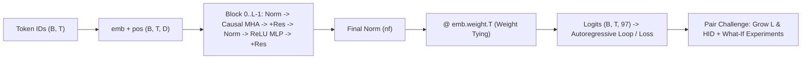

# Pair Programming Activity: Integrating and Extending the Complete Transformer (`Tiny-2.1`)

> [!NOTE]
> **Activity Format:** This worksheet integrates **Module 1** (Tokenization, Embeddings, Multi-Head Causal Attention) and **Module 2** (RMSNorm, Residuals, MLP, Weight Tying, Generation, Quantization) into one end-to-end project. Work in pairs:
> * **Driver:** Writes and executes code in Google Colab.
> * **Navigator:** Predicts tensor shapes, behaviors, and mathematical outcomes *before* each cell runs.
> Swap roles at the end of every part. Each question includes a `<details>` **Hint** only—answers must be reasoned out and verified by running experiments.



---

## Part 0: Standalone Colab Setup

Run these two cells once at the start of a fresh Colab notebook.

```python
!git clone https://github.com/WollyMonjac/Tiny-2.1.git
%cd /content/Tiny-2.1/training
```

```python
import copy, math, os, random, struct
import numpy as np
import torch
import torch.nn as nn
import torch.nn.functional as F
import matplotlib.pyplot as plt
import train2

def load_v2_bin(path):
    """Load a version-2 ('TNY2') 8-bit weight file into train2.Model."""
    b = open(path, "rb").read()
    assert b[:4] == b"TNY2", "Expected a TNY2 weight file"
    D, L, H, HID = struct.unpack_from("<4h", b, 4)
    off = [12]

    def table(r, c):
        w = np.empty((r, c), dtype=np.float32)
        for i in range(r):
            s = struct.unpack_from("<f", b, off[0])[0]
            w[i] = np.frombuffer(b, np.int8, c, off[0] + 4).astype(np.float32) * s
            off[0] += 4 + c
        return torch.tensor(w)

    def gains():
        g = np.frombuffer(b, "<f4", D, off[0]).copy()
        off[0] += 4 * D
        return torch.tensor(g)

    m = train2.Model(train2.Cfg(D, L, H, HID))
    with torch.no_grad():
        m.emb.weight.copy_(table(train2.VOCAB, D))
        m.pos.weight.copy_(table(train2.CTX, D))
        for blk in m.blocks:
            blk.n1.g.copy_(gains())
            for lin in (blk.q, blk.k, blk.v, blk.o):
                lin.weight.copy_(table(D, D))
            blk.n2.g.copy_(gains())
            blk.f1.weight.copy_(table(HID, D))
            blk.f2.weight.copy_(table(D, HID))
        m.nf.g.copy_(gains())
    assert off[0] == len(b), "size mismatch"
    return m

base_model = load_v2_bin("/content/Tiny-2.1/dos/TINY.BIN")
base_model.eval()
print("Base model:", base_model.c, "| Params:", f"{sum(p.numel() for p in base_model.parameters()):,}")
```

---

## Part 1: Putting All Pieces Together (End-to-End Trace)

Run the starter diagnostic trace below on `"what is 2+2?\n"`, then complete the two `TODO`s and answer the questions as a pair.

```python
prompt = "what is 2+2?\n"
ids = torch.tensor([train2.encode(prompt)], dtype=torch.long)
T = ids.shape[1]

with torch.no_grad():
    x = base_model.emb(ids) + base_model.pos(torch.arange(T))
    print(f"Input (emb + pos): shape={tuple(x.shape)}, rms={x.pow(2).mean(-1).sqrt().mean():.3f}")

    for i, blk in enumerate(base_model.blocks):
        # 1. Pre-attention norm + multi-head causal attention + residual
        h1 = blk.n1(x)
        sp = lambda t: t.view(1, T, blk.c.H, blk.c.D // blk.c.H).transpose(1, 2)
        a = F.scaled_dot_product_attention(sp(blk.q(h1)), sp(blk.k(h1)), sp(blk.v(h1)), is_causal=True)
        x_mid = x + blk.o(a.transpose(1, 2).reshape(1, T, blk.c.D))

        # 2. Pre-MLP norm + ReLU MLP + residual
        h2 = blk.n2(x_mid)
        mlp_hid = F.relu(blk.f1(h2))
        x = x_mid + blk.f2(mlp_hid)

        # TODO 1: Print active ReLU neuron percentage in mlp_hid[0, -1]
        # TODO 2: Print the mean vector norm of x after Block i

    logits = base_model.nf(x) @ base_model.emb.weight.t()
    probs = F.softmax(logits[0, -1], dim=-1)
    top3_p, top3_id = torch.topk(probs, 3)

print("Logits shape:", tuple(logits.shape))
print("Top-3 next chars:", [(repr(train2.decode([int(k)])), round(v, 3)) for v, k in zip(top3_p.tolist(), top3_id.tolist())])
```

### Questions (Part 1)

**Q1.1:** Trace how information flows from position `0` (`'w'`) to position `T-1` (`'\n'`). Which **single** sub-operation inside a `Block` allows different character positions to exchange information, and which operations process each position completely independently?

<details>
<summary>Hint</summary>

Check which matrix multiplication multiplies across the `T` axis (`(T, d_k) @ (d_k, T)`) versus which operations multiply only across the `D` (`96`) or `HID` (`256`) axis.

</details>

---

**Q1.2:** Look at `logits = base_model.nf(x) @ base_model.emb.weight.t()`. Why is `base_model.nf(x)` applied *after* the last residual block and right *before* multiplying by `emb.weight.t()`?

<details>
<summary>Hint</summary>

After 4 residual additions (`x = x + delta`), the vector magnitudes of `x` have grown. How does `nf` affect dot products with `emb.weight.t()` and `softmax`?

</details>

---

**Q1.3:** In `TODO 1` and `TODO 2`, compare the vector norms of `x` across Blocks `0, 1, 2, 3`. Does the vector norm stay constant, grow, or shrink across blocks—and why?

<details>
<summary>Hint</summary>

Look at the residual update `x = x_mid + blk.f2(...)`. Adding outputs across blocks accumulates energy in `x`, whereas `n1` and `n2` rescale *inputs* before each sublayer.

</details>

---

## Part 2: "What If?" Transformer Experiments

In each experiment below, **predict the outcome first** (Navigator), then copy `base_model` with `m_test = copy.deepcopy(base_model)` and run a quick check in Colab (Driver) so `base_model` remains untouched.

### What If #1 — Removing Positional Embeddings
**Experiment:** Create a modified forward pass (or zero out `m_test.pos.weight.zero_()`), then run `train2.answer_many(m_test, ["what is 12 + 34?", "what is 34 + 12?", "spell dog", "what is the capital of france?"])`.

**Q2.1:** Before running, predict which types of questions will collapse immediately when `pos` is zeroed, and explain why `"12"` and `"21"` become indistinguishable to attention.

<details>
<summary>Hint</summary>

Without `pos`, two tokens with the same character ID have identical initial vectors, and attention has no built-in knowledge of index `0` vs index `1`.

</details>

---

### What If #2 — Turning Off the Causal Mask (`is_causal=False`)
**Experiment:** Run a forward pass on `"what is 2+2?\n"` with `is_causal=False` vs. `is_causal=True` inside all 4 blocks (or in `Block 0`), and compare the predicted next token. Then test `"what is 2+2?\n4\n"` with `is_causal=False` when predicting at index `4` (`'\n'`).

**Q2.2:** Why might turning off the causal mask during *inference on a prompt alone* sometimes still produce similar answers, whereas turning it off during *training* completely breaks the model?

<details>
<summary>Hint</summary>

During prompt-only inference (`"what is 2+2?\n"`), the answer is not in the tensor yet—wait, why do earlier prompt tokens (`'w'`, `'h'`, `'a'`, `'t'`) still change their representations if `is_causal=False`? And during *training*, what is already sitting at index `5` inside `"2+2?\n4\n"`?

</details>

---

### What If #3 — Changing the Number of Attention Heads (`H`)
**Q2.3:** In `train2.Cfg(D=96, L=4, H=4, HID=256)`:
1. What happens if someone tries to construct `Block(train2.Cfg(D=96, L=4, H=5, HID=256))`?
2. What is the difference in expressiveness and speed between `H=1` (`Dh=96`), `H=4` (`Dh=24`), and `H=16` (`Dh=6`) when `D=96` stays fixed?

<details>
<summary>Hint</summary>

Check `D // H` in `sp = lambda t: t.view(B, T, H, D // H)` and check the total number of parameters in `q, k, v, o` when `H` changes while `D=96` stays fixed.

</details>

---

### What If #4 — Removing Residual Connections (`x = sublayer(x)`)
**Experiment:** Write a small test script that runs `x` through 8 copies of a randomly initialized `Block` **with** residual connections vs. **without** residual connections (`x = blk.o(...)`, `x = blk.f2(...)`), and print the cosine similarity between the original `x_in` and the final `x` (plus gradient norms from `.backward()`).

**Q2.4:** What happens to the input signal and gradients as depth grows from `L=4` to `L=8` or `L=16` without residual connections?

<details>
<summary>Hint</summary>

Each `Block` starts with small random weights (`std = 0.5 / sqrt(in_features)`). Recall the Part 2 multiplication-chain vs. addition-highway example from Module 2.

</details>

---

### What If #5 — Removing `RMSNorm` or Removing `ReLU`
**Q2.5:** Consider two separate ablations:
1. **No `RMSNorm`:** If `n1`, `n2`, and `nf` were removed across `L=4` (or `L=12`) blocks, what happens to the numerical scale of activations entering `Q @ K^T` and `f1`?
2. **No `ReLU`:** If `F.relu(self.f1(h))` were changed to `self.f1(h)` (purely linear), what happens mathematically to the 2-layer MLP `f2(f1(h))`?

<details>
<summary>Hint</summary>

1. Think about `softmax` saturation when inputs to `Q` and `K` grow large.
2. Multiply two matrices $(h W_1^T) W_2^T = h (W_1^T W_2^T)$—is the result linear or nonlinear?

</details>

---

### What If #6 — Removing Weight Tying
**Q2.6:** Suppose `Model` did **not** tie `emb.weight` to the output layer, and instead created a separate `self.lm_head = nn.Linear(96, 97, bias=False)`. How many extra parameters and how many extra bytes (in both float32 and 8-bit `TINY.BIN`) would that add?

<details>
<summary>Hint</summary>

Compute `97 × 96` parameters. Remember `export()` writes each row as `4` bytes (float32 scale) + `96` bytes (`int8` weights).

</details>

---

## Part 3: Extending the Transformer — Growing `Tiny-2.1` (`L=4 → L=6`, `HID=256 → 384`)

A common engineering problem is scaling up an already-trained model without throwing away what it has already learned. Here, `base_model` has `4` blocks and `HID = 256` MLP neurons per block. Your goal is to expand it into a `6`-block model with `HID = 384` MLP neurons per block while preserving its exact initial behavior at step 0.

Run the starter scaffold below and implement `grow_model(small_m, big_m)` using the hints.

```python
# Target larger architecture: 6 Transformer blocks, 384 MLP neurons per block
big_cfg = train2.Cfg(D=96, L=6, H=4, HID=384)
big_model = train2.Model(big_cfg)

print("Small params:", f"{sum(p.numel() for p in base_model.parameters()):,}")
print("Big   params:", f"{sum(p.numel() for p in big_model.parameters()):,}")

test_ids = torch.tensor([train2.encode("what is the capital of france?\n")], dtype=torch.long)

def grow_model(small_m, big_m):
    """Copy small_m into big_m so big_m produces identical logits before further training."""
    with torch.no_grad():
        # TODO A: Copy emb, pos, and final norm (nf.g)

        # TODO B: For blocks 0..3 (existing blocks):
        #   - Copy n1.g, n2.g, q, k, v, o
        #   - Copy f1.weight into the first 256 rows of big_m's f1.weight
        #   - Copy f2.weight into the first 256 columns of big_m's f2.weight,
        #     and handle the remaining columns of f2.weight!

        # TODO C: For blocks 4..5 (newly added blocks):
        #   - Zero the exact weights needed so blocks 4 and 5 act as identity layers at step 0
        pass

grow_model(base_model, big_model)

with torch.no_grad():
    diff = (base_model(test_ids) - big_model(test_ids)).abs().max().item()
print("Max logit difference before training (target ~0.0):", diff)
```

### Progressive Hints for `grow_model` (No Solutions)

<details>
<summary>Hint 1 (Embeddings, Final Norm, and Attention in Blocks 0..3)</summary>

In PyTorch, copy tensor contents in-place inside `with torch.no_grad():` using `.copy_(...)`. `emb.weight`, `pos.weight`, `nf.g`, `n1.g`, `n2.g`, and `q/k/v/o.weight` all have identical shapes between `base_model` and `big_model` for `i < 4`.

</details>

<details>
<summary>Hint 2 (Widening MLP 256 → 384 in Blocks 0..3)</summary>

`f1.weight` has shape `(HID, D)` (`(256, 96)` → `(384, 96)`), and `f2.weight` has shape `(D, HID)` (`(96, 256)` → `(96, 384)`).
* Copy old `f1.weight` into `blk.f1.weight[:256]`. Should `blk.f1.weight[256:]` be zeroed or left randomly initialized? (Think: if both input weights and output weights of neuron `300` are zero, can gradients ever wake neuron `300` up?)
* Zero `blk.f2.weight.zero_()` first, then copy old `f2.weight` into `blk.f2.weight[:, :256]`. Check why zeroing columns `256..383` of `f2` ensures zero change to `x` at step 0.

</details>

<details>
<summary>Hint 3 (Making New Blocks 4 and 5 Identity Layers at Step 0)</summary>

Recall the residual equations inside `Block.forward`:
`x = x + self.o(...)` and `x = x + self.f2(...)`.
If `blk.o.weight.zero_()` and `blk.f2.weight.zero_()` are set in Blocks `4` and `5` while `q, k, v, f1` stay randomly initialized, what does Block 4 output at step 0? Why does keeping `q, k, v, f1` non-zero allow gradients to flow into the new blocks during fine-tuning?

</details>

---

### Extending & Testing the Grown Model

Once `diff` is `0.0` (or `< 1e-5`), run a short fine-tuning check and export the grown binary:

```python
# 1. Verify initial evaluation score matches base_model
big_model.eval()
print("Before training — big_model answers:", train2.answer_many(big_model, ["what is 2+2?", "what is the capital of france?"]))

# 2. Save grown starting checkpoint and fine-tune for 2 minutes
train2.save_model(big_model, "grown_start.pt")
trained_big = train2.train(2, "grown_after.pt", resume="grown_start.pt", peak=1e-3, bs=64, log_every=50)

# 3. Inspect whether Block 4 and Block 5 actually learned (weights moved away from zero)
print("Max |Block 4 o.weight| after training:", trained_big.blocks[4].o.weight.abs().max().item())
print("Max |Block 5 f2.weight| after training:", trained_big.blocks[5].f2.weight.abs().max().item())

# 4. Export to 8-bit binary and compare file size
grown_bytes = train2.export(trained_big, "TINY_GROWN.BIN")
print("TINY.BIN bytes      :", os.path.getsize("/content/Tiny-2.1/dos/TINY.BIN"))
print("TINY_GROWN.BIN bytes:", grown_bytes)
```

### "What If?" Questions on Extending Transformers (Part 3)

**Q3.1:** What if, instead of zeroing `o.weight` and `f2.weight` in Blocks `4` and `5`, someone initialized them by **copying Block `3`'s weights** into Block `4` and Block `5`? Would `big_model` still match `base_model` at step 0?

<details>
<summary>Hint</summary>

If Block 3 transforms `x` into `x + delta`, what happens when `x + delta` passes through *another* copy of Block 3 right after it?

</details>

---

**Q3.2:** Why is growing `L` (`4 → 6`) or `HID` (`256 → 384`) much simpler than growing the embedding width `D` (`96 → 128`) from an existing checkpoint?

<details>
<summary>Hint</summary>

List every tensor in `Model` whose shape depends on `D`: `emb`, `pos`, `n1`, `n2`, `nf`, `q`, `k`, `v`, `o`, `f1`, `f2`. What happens to `q @ k.T` and `emb.weight.t()` if `D` changes?

</details>

---

**Q3.3:** Suppose someone kept adding blocks (`L=16` or `L=32`) while keeping the exact same `~3,500`-fact dataset and only training for a few minutes. What two things would likely go wrong?

<details>
<summary>Hint</summary>

Consider (1) compute/time per step and (2) memorization vs. generalization when parameter count far exceeds dataset diversity.

</details>

---

## Part 4: End-to-End Synthesis Questions

Discuss these five synthesis questions together before finishing the lab:

**Q4.1 (Full Forward Pass):** Trace the exact shapes of a batch of `B = 8` sequences of length `T = 20` as it moves from `ids` through `emb + pos`, inside `sp()` of `Block 0`, through `f1` and `f2`, through `nf`, and finally to `logits`.

<details>
<summary>Hint</summary>

Track the 7 intermediate shapes starting from `(8, 20)` and ending at `(8, 20, 97)`.

</details>

---

**Q4.2 (Training vs. Inference):** List **three** concrete differences between what happens during a **training step** (`loss_fn` + `backward`) and an **inference step** (`answer_many`) in `Tiny-2.1`.

<details>
<summary>Hint</summary>

Compare: (1) how many tokens are processed per forward pass, (2) whether `loss_mask` is used, and (3) whether `argmax` + `torch.cat` loops are run.

</details>

---

**Q4.3 (Neurons vs. Linear Projections):** If asked *"Where are the classic ReLU neural network neurons inside a Transformer?"*, how should a team distinguish `q, k, v, o` from `f1, f2`?

<details>
<summary>Hint</summary>

Compare where `F.relu` is applied versus where `softmax` provides the nonlinearity.

</details>

---

**Q4.4 (Why Tiny-2.1 Hallucinates):** Combine Module 1 (character tokenization + causal attention) and Module 2 (autoregressive decoding + limited MLP capacity) to give a complete explanation of why `Tiny-2.1` can output `"Yes, a elephant is a mammal."` or invent a capital city for `"Mars"`.

<details>
<summary>Hint</summary>

Connect three ingredients: left-to-right token commitment (no backtracking), next-token probability matching on prompt patterns, and capacity limits in `366,528` weights.

</details>

---

**Q4.5 (Memory Budget Tradeoff):** `Tiny-2.1` fits in `381,808 bytes` using 3 design choices: character vocabulary (`97`), weight tying (`emb.weight.t()`), and per-row 8-bit quantization. Explain what each choice sacrifices or risks, and why those tradeoffs make sense for a tiny model.

<details>
<summary>Hint</summary>

Consider: (1) sequence length under character tokenization, (2) forcing input/output embeddings to share geometry, and (3) rounding error (`< 0.005`) per weight.

</details>