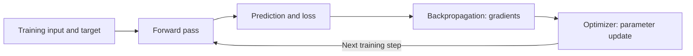
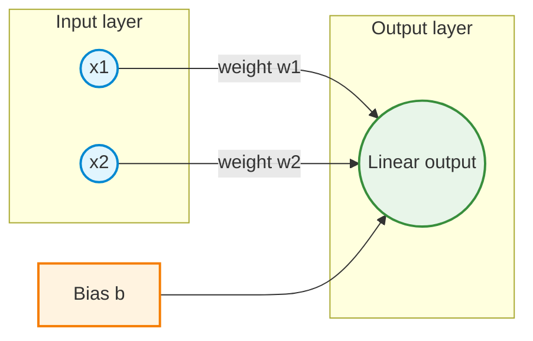
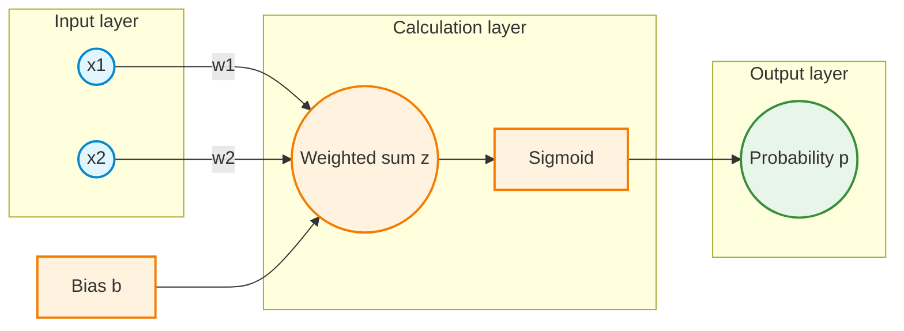
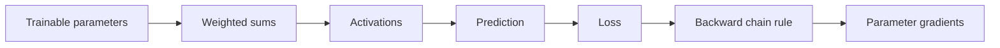
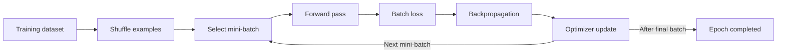
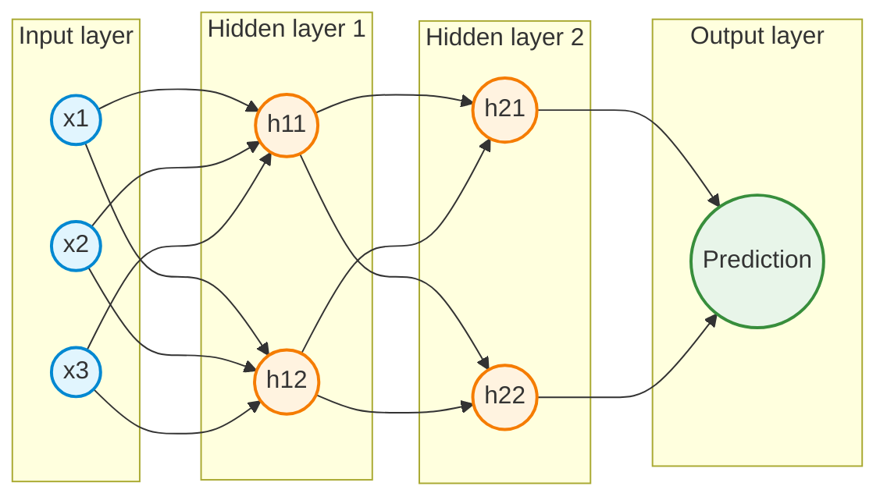

# How Neural Networks Learn

*An introduction to forward propagation, derivatives, loss functions, backpropagation, gradient descent, stochastic gradient descent, and multilayer networks*

## How to use this reading

Use this chapter after class to revisit the demo and guided activities. Sections 3–4 explain derivatives, Section 7 explains binary cross-entropy, Sections 9–11 explain updates and learning rates, Sections 12–13 explain batches and epochs, Section 14 introduces network depth, and Section 15 introduces automatic differentiation. The linked readings at the end offer more detail on individual topics.

## Learning objectives

After studying this chapter, the following ideas should be clear:

- How predictions, targets, and loss functions define a learning problem.
- Why one trainable parameter calls for an ordinary derivative, whereas many independently trainable parameters call for partial derivatives.
- How the chain rule and backpropagation compute gradients.
- How gradient descent, the learning rate, and the selected batch determine parameter updates.
- Why regression and binary classification commonly use different output functions and losses.
- How the same mathematical mechanism extends from a single neuron to multilayer perceptrons and deeper networks.
- How automatic differentiation implements gradient calculations in machine learning frameworks.

**Notation.** Inputs are denoted by $x$ or $x_1,x_2,\ldots$; the true target is $y$; the prediction is $\hat y$; weights are $w,w_1,w_2,\ldots$; a bias is $b$; and the learning rate is $\alpha$ (also commonly written $\eta$). The trainable parameter collection is $\boldsymbol{\theta}$. Unless explicitly stated otherwise, $\log$ means the natural logarithm, $\ln$.

---

## 1. How neural networks learn

A neural network learns by changing its **trainable parameters**—weights and biases—so that predictions increasingly agree with the intended targets. This is an optimization process, not an explicit search for a known correct set of weights.

A training step has four core operations:

1. **Forward pass:** calculate a prediction using current parameters.
2. **Loss calculation:** measure the discrepancy between prediction and target.
3. **Backpropagation:** calculate how sensitive the loss is to the parameters.
4. **Optimization step:** adjust parameters according to the gradients and learning rate.



Repeated updates can reduce training loss, but neither one update nor a lower training loss guarantees better performance on unseen data. The distinction between **optimization** and **generalization** remains important throughout training.

### Parameters versus hyperparameters

- **Parameters**, such as $w_1$, $w_2$, and $b$, are changed by training.
- **Hyperparameters**, such as learning rate, batch size, and number of epochs, govern the training procedure. They are generally selected rather than calculated by backpropagation in ordinary training.

---

## 2. The forward pass: from input to prediction

### 2.1 One input and one weight

The simplest linear neuron, without a bias, computes

$$
\hat y=wx.
$$

For $x=2$ and $w=8$, the prediction is $\hat y=16$. The calculation is a **forward pass**. No weight is changed during this operation.

### 2.2 Two inputs, two weights, and a bias

A two-input linear neuron calculates a weighted sum:

$$
\hat y=w_1x_1+w_2x_2+b.
$$

The bias allows a nonzero output even when every feature is zero and shifts the model's output independently of the feature contributions. It can be interpreted as a weight applied to an always-on input equal to $1$.



For example, with $x_1=2$, $x_2=3$, $w_1=1$, $w_2=2$, and $b=1$:

$$
\hat y=1(2)+2(3)+1=9.
$$

### 2.3 Activation functions

A network often applies an **activation function** after a weighted sum. In binary classification, a widely used activation is the sigmoid:

$$
 z=w_1x_1+w_2x_2+b,
 \qquad
 \hat y=\sigma(z)=\frac{1}{1+e^{-z}}.
$$

The sigmoid maps any finite real score $z$ to a probability-like value strictly between $0$ and $1$. For a model trained as a binary probabilistic classifier, this is interpreted as the estimated probability of class $1$.

---

## 3. Ordinary derivatives: a rate of change

A derivative measures the local rate at which a quantity changes. If a loss depends on one trainable weight, $L=f(w)$, the ordinary derivative $dL/dw$ describes the sensitivity of the loss to that weight.

- A **positive derivative** indicates that a small increase in $w$ increases the loss, locally.
- A **negative derivative** indicates that a small increase in $w$ decreases the loss, locally.
- A **zero derivative** indicates a stationary point; it need not be the best possible minimum.

### 3.1 One-weight example

A loss assigns a numerical penalty to a prediction. Here we use half squared error: half the square of prediction minus target. Section 6 explains this choice in more detail. The chain rule differentiates a composition by multiplying the derivatives of its stages.

For this loss

$$
L(w)=\frac12(wx-y)^2,
$$

the chain rule gives

$$
\frac{dL}{dw}=(wx-y)x.
$$

Using $x=2$, $y=6$, and $w=8$:

$$
\hat y=16,
\qquad L=\frac12(16-6)^2=50,
\qquad \frac{dL}{dw}=(16-6)2=20.
$$

The positive derivative indicates that increasing the weight from $8$ locally increases the loss. Decreasing it is the appropriate local direction.

### 3.2 Why the chain rule matters

The loss is usually a **composition of functions**: a weight determines a prediction, and the prediction determines a loss. The chain rule connects these stages:

$$
\frac{dL}{dw}=\frac{dL}{d\hat y}\frac{d\hat y}{dw}.
$$

In this example, $dL/d\hat y=\hat y-y$ and $d\hat y/dw=x$. The same logic becomes backpropagation when many operations and parameters are involved.

---

## 4. Partial derivatives: learning with multiple parameters

Once there are two independently adjustable weights, loss is a function of several variables:

$$
L=f(w_1,w_2).
$$

A **partial derivative** measures how loss changes when one parameter is varied while the other independent parameters are held fixed. Thus $\partial L/\partial w_1$ and $\partial L/\partial w_2$ describe separate local sensitivities.

When a bias is included, there are three parameters:

$$
\boldsymbol{\theta}=
\begin{bmatrix}
w_1\\
w_2\\
b
\end{bmatrix},
\qquad
\nabla_{\boldsymbol{\theta}}L=
\begin{bmatrix}
\frac{\partial L}{\partial w_1}\\
\frac{\partial L}{\partial w_2}\\
\frac{\partial L}{\partial b}
\end{bmatrix}.
$$

This column of partial derivatives is the **gradient vector**. The gradient dimension equals the number of independently trainable scalar parameters being differentiated.

### 4.1 Worked example: two weights and bias

Consider the linear neuron and loss

$$
\hat y=w_1x_1+w_2x_2+b,
\qquad
L=\frac12(\hat y-y)^2.
$$

| Quantity | Value |
|---|---:|
| $x_1$ | 2 |
| $x_2$ | 3 |
| $y$ | 10 |
| $w_1$ | 1 |
| $w_2$ | 2 |
| $b$ | 1 |
| Learning rate $\alpha$ | 0.1 |

**Forward pass:** $\hat y=1(2)+2(3)+1=9$ and $L=\tfrac12(9-10)^2=0.5$.

**Backward pass:** since $\partial L/\partial\hat y=\hat y-y=-1$,

$$
\frac{\partial L}{\partial w_1}=(\hat y-y)x_1=(-1)(2)=-2,
$$

$$
\frac{\partial L}{\partial w_2}=(\hat y-y)x_2=(-1)(3)=-3,
$$

$$
\frac{\partial L}{\partial b}=\hat y-y=-1.
$$

Consequently,

$$
\nabla_{\boldsymbol{\theta}}L=
\begin{bmatrix}
-2\\
-3\\
-1
\end{bmatrix}.
$$

**Gradient descent update:**

$$
\begin{aligned}
w_1^{\mathrm{new}}&=1-0.1(-2)=1.2,\\
w_2^{\mathrm{new}}&=2-0.1(-3)=2.3,\\
b^{\mathrm{new}}&=1-0.1(-1)=1.1.
\end{aligned}
$$

With the updated parameters, the same example produces $\hat y=1.2(2)+2.3(3)+1.1=10.4$ and $L=0.08$. Thus this particular update reduced loss from $0.5$ to $0.08$.

**Important qualification:** Ordinary derivatives remain useful in multivariable calculus, including along a chosen path. Partial derivatives specifically isolate each independent parameter's contribution to the gradient.

---

## 5. Loss functions: measuring prediction error

A **loss function** maps a prediction and its target to a numerical penalty. A smaller loss generally indicates a better fit under the chosen criterion. The correct loss depends on the kind of prediction and on the errors that the application considers costly.

- **Single-example loss:** $L_i(\boldsymbol{\theta})$ measures one observation's prediction error.
- **Dataset mean loss:**

$$
L(\boldsymbol{\theta})=\frac1n\sum_{i=1}^n L_i(\boldsymbol{\theta}).
$$

A dataset mean combines information from multiple observations. A zero training loss is not necessarily achievable, and the objective may involve regularization terms in addition to the data loss.

### 5.1 What makes a loss useful?

A useful loss reflects the task, discourages undesirable predictions, and provides gradients or other optimization signals. A mathematical expression can be defined as a loss without necessarily being a sensible choice for a particular problem.

---

## 6. Regression: squared error and mean squared error

For a continuous target, squared error is a common starting point:

$$
L_i=\frac12(\hat y_i-y_i)^2.
$$

**Why square the error?** Positive and negative deviations both contribute nonnegative loss, larger errors are penalized more strongly, and the result is smooth and differentiable.

**Why use $1/2$?** It cancels the factor of $2$ produced by differentiation:

$$
\frac{d}{d\hat y}\left[\frac12(\hat y-y)^2\right]=\hat y-y.
$$

The factor is a convenience, not a requirement. Omitting it doubles both the loss and its gradient; it does not change the minimizing prediction, but it changes update sizes at the same learning rate.

The usual mean squared error (MSE) for $n$ observations is

$$
\mathrm{MSE}=\frac1n\sum_{i=1}^n(\hat y_i-y_i)^2.
$$

Another valid convention is **half MSE**, $\tfrac{1}{2n}\sum_i(\hat y_i-y_i)^2$. It is important to state the chosen convention because it changes gradient scale.

Absolute error, Huber loss, and other regression losses are also possible. Different choices express different preferences about outliers and large deviations.

<details>
<summary>Python visualization — squared error for one weight</summary>

```python
import numpy as np
import matplotlib.pyplot as plt

x, y = 2.0, 6.0
w = np.linspace(0.0, 8.5, 400)
loss = 0.5 * (w * x - y) ** 2

plt.figure(figsize=(8, 4.5))
plt.plot(w, loss, label="Half squared error")
plt.scatter([3.0], [0.0], marker="o", label="Minimum at w = 3")
plt.xlabel("Weight w")
plt.ylabel("Loss")
plt.title("Regression loss landscape")
plt.grid(alpha=0.3)
plt.legend()
plt.show()
```

</details>

---

## 7. Binary classification: sigmoid and cross-entropy

A binary target has two possible labels, usually $y\in\{0,1\}$. A model predicts a probability $p=\hat y\in(0,1)$ that the target is $1$.

The sigmoid provides the probability from the model's score $z$:

$$
p=\sigma(z)=\frac{1}{1+e^{-z}},
\qquad z=w_1x_1+w_2x_2+b.
$$

### 7.1 Why use a different loss?

Mean squared error is not forbidden in binary classification. However, **binary cross-entropy (BCE)** is naturally linked to a Bernoulli probability model. It penalizes assigning a very low probability to an event that actually occurred, or a very high probability to an event that did not occur.

For **$y=1$**:

$$
L=-\ln(p).
$$

For **$y=0$**:

$$
L=-\ln(1-p).
$$

The two cases combine into one expression:

$$
L_{\mathrm{BCE}}=-\left[y\ln(p)+(1-y)\ln(1-p)\right].
$$

The mean over $n$ observations is

$$
\overline L_{\mathrm{BCE}}=-\frac1n\sum_{i=1}^n\left[y_i\ln(p_i)+(1-y_i)\ln(1-p_i)\right].
$$

| Probability assigned to class 1 | Loss if $y=1$ | Loss if $y=0$ |
|---:|---:|---:|
| $p=0.9$ | $0.105$ | $2.303$ |
| $p=0.5$ | $0.693$ | $0.693$ |
| $p=0.1$ | $2.303$ | $0.105$ |

These figures use **natural logarithms**. A base-2 logarithm would produce different numerical loss values and gradient scales.

**Numerical caution:** Expressions such as $\ln(0)$ are undefined. Practical software uses numerically stable BCE-with-logits implementations or suitable probability handling rather than directly evaluating the endpoints.

### 7.2 Gradient simplification with sigmoid and BCE

The derivative of sigmoid is

$$
\frac{dp}{dz}=p(1-p).
$$

For binary cross-entropy,

$$
\frac{\partial L}{\partial p}=-\frac{y}{p}+\frac{1-y}{1-p}.
$$

Applying the chain rule and simplifying yields the especially useful identity

$$
\frac{\partial L}{\partial z}=\frac{\partial L}{\partial p}\frac{dp}{dz}=p-y.
$$

Therefore, for a two-input sigmoid neuron,

$$
\frac{\partial L}{\partial w_1}=(p-y)x_1,
\qquad
\frac{\partial L}{\partial w_2}=(p-y)x_2,
\qquad
\frac{\partial L}{\partial b}=p-y.
$$

The form resembles regression's $(\hat y-y)x_j$, but it arises from a different pairing of output activation and loss.

### 7.3 One numerical update

Choose $x_1=2$, $x_2=1$, $w_1=0.2$, $w_2=-0.4$, $b=0$, target $y=1$, and learning rate $\alpha=0.1$.

1. **Forward:** $z=0.2(2)-0.4(1)+0=0$, so $p=0.5$.
2. **Loss:** $L=-\ln(0.5)\approx0.6931$.
3. **Backward:** $p-y=-0.5$, so gradients are $(-1,-0.5,-0.5)$ for $(w_1,w_2,b)$.
4. **Update:** $w_1=0.3$, $w_2=-0.35$, $b=0.05$.
5. **Check:** $z=0.3(2)-0.35(1)+0.05=0.30$, so $p\approx0.5744$ and $L\approx0.5544$.

The updated parameters assign a higher probability to the correct class and give a lower loss for this example.



<details>
<summary>Python visualization — binary cross-entropy for both labels</summary>

```python
import numpy as np
import matplotlib.pyplot as plt

p = np.linspace(0.001, 0.999, 500)
loss_y1 = -np.log(p)
loss_y0 = -np.log(1 - p)

plt.figure(figsize=(8, 4.5))
plt.plot(p, loss_y1, label="True label y = 1")
plt.plot(p, loss_y0, label="True label y = 0")
plt.xlabel("Predicted probability of class 1")
plt.ylabel("Binary cross-entropy loss")
plt.title("Penalty for confident correct and incorrect predictions")
plt.grid(alpha=0.3)
plt.legend()
plt.show()
```

</details>

---

## 8. Backpropagation: computing the gradients

**Backpropagation** is an efficient application of the chain rule backward through a neural network's computational graph. The forward pass produces intermediate results; the backward pass propagates derivatives from the loss to the trainable parameters.

For a computation $w\to z\to p\to L$, the gradient follows the dependency chain:

$$
\frac{\partial L}{\partial w}
=\frac{\partial L}{\partial p}
\frac{\partial p}{\partial z}
\frac{\partial z}{\partial w}.
$$



In deeper networks, each node may influence multiple downstream nodes. Backpropagation efficiently accumulates those contributions, reusing intermediate calculations rather than differentiating each parameter through a separate full model evaluation.

A scalar derivative or an individual gradient component may be positive, negative, or zero. It is the derivative of the **loss** with respect to a parameter—not the prediction error itself in every model. The identity $\partial L/\partial z=p-y$ is specific to the common sigmoid-and-BCE pairing.

---

## 9. Gradient descent: using gradients to update parameters

**Gradient descent** is an optimization algorithm. It takes the gradients and changes parameters in the direction opposite to them:

$$
\boldsymbol{\theta}_{t+1}
=\boldsymbol{\theta}_t-\alpha\nabla_{\boldsymbol{\theta}}L(\boldsymbol{\theta}_t).
$$

For a differentiable scalar loss, the gradient points in the direction of the greatest **local increase** in loss per unit Euclidean distance. Its negative points in the direction of greatest **local decrease**. This is the **hill metaphor**: the gradient describes the uphill slope; a gradient-descent step heads downhill.

A downhill *direction* does not guarantee that an arbitrarily large step reduces loss. The learning rate controls how far the update moves.

For the earlier one-weight example, $x=2$, $y=6$, $w=8$, $\alpha=0.1$:

$$
\frac{dL}{dw}=20,
\qquad
w_{\mathrm{new}}=8-0.1(20)=6,
$$

and the loss changes from $50$ to $18$ after this step.

The minimum for this particular one-observation model occurs at $w=3$, where $\hat y=6$ and $L=0$. With more parameters than constraints, the parameters producing zero training loss may not be unique.

---

## 10. Backpropagation versus gradient descent

These terms name **different stages** of training.

| Operation | Main question | Output |
|---|---|---|
| Forward pass | What does the model predict? | Prediction and intermediate activations |
| Loss calculation | How poorly does that prediction match the target? | Scalar loss |
| Backpropagation | How does the loss change with each parameter? | Gradients |
| Gradient descent | How should parameters change using those gradients? | Updated parameters |

**Metaphor:** Backpropagation provides slope information—indicating which way is uphill for each parameter. Gradient descent takes a step in the **opposite direction**, with step size controlled by the learning rate. More precisely, backpropagation computes the full gradient vector, which is more informative than a single left-or-right instruction.

The distinction remains visible in framework code: `loss.backward()` calculates gradients, whereas `optimizer.step()` updates parameters.

---

## 11. Learning rate: the size of the update

The **learning rate** $\alpha$ scales the gradient in the parameter update equation. Small values lead to smaller adjustments; large values lead to larger adjustments.

- A **small** learning rate may require many iterations to make progress.
- A **moderate** learning rate may approach a minimum efficiently.
- An **excessive** learning rate can overshoot, oscillate, or diverge.

There is no universal optimal learning rate: appropriate values depend on the loss landscape, parameterization, optimizer, and gradient scale.

### 11.1 Exact illustration using the one-weight model

For $x=2$ and $y=6$:

$$
L(w)=\frac12(2w-6)^2=2(w-3)^2,
\qquad
\frac{dL}{dw}=4(w-3).
$$

The update is

$$
w_{t+1}=w_t-4\alpha(w_t-3),
$$

so the distance from the optimum evolves as

$$
w_{t+1}-3=(1-4\alpha)(w_t-3).
$$

For this **specific quadratic example**, convergence occurs for $0<\alpha<0.5$; $\alpha=0.5$ causes a fixed-amplitude oscillation unless initialized at the minimum; and $\alpha>0.5$ causes divergence from a nonoptimal initial weight. These thresholds are **not general rules** for other models.

| Learning rate | Behavior in this example |
|---:|---|
| $0.01$ | Small, gradual changes |
| $0.1$ | Converges without changing sides of the minimum |
| $0.4$ | Oscillates around the minimum with decreasing amplitude |
| $0.5$ | Oscillates without approaching the minimum |
| $0.6$ | Diverges |

<details>
<summary>Python visualization — compare learning rates</summary>

```python
import numpy as np
import matplotlib.pyplot as plt

x, y, w0 = 2.0, 6.0, 8.0
rates = [0.01, 0.1, 0.4, 0.5, 0.6]
steps = 12

plt.figure(figsize=(8, 4.8))
for rate in rates:
    w = w0
    history = []
    for t in range(steps + 1):
        history.append(0.5 * (w * x - y) ** 2)
        gradient = (w * x - y) * x
        if t < steps:
            w -= rate * gradient
    plt.plot(range(steps + 1), history, marker="o", label=f"lr = {rate}")

plt.yscale("symlog", linthresh=0.01)
plt.xlabel("Parameter updates")
plt.ylabel("Loss (symmetric log scale)")
plt.title("Learning-rate sensitivity on a simple quadratic loss")
plt.grid(alpha=0.3)
plt.legend()
plt.show()
```

</details>

---

## 12. Batch gradient descent, SGD, and mini-batches

### 12.1 Why not always use the entire dataset?

In **full-batch gradient descent**, the gradient is computed from all $n$ training observations before each parameter update:

$$
\nabla L(\boldsymbol{\theta})=
\frac1n\sum_{i=1}^{n}\nabla L_i(\boldsymbol{\theta}).
$$

For a very large dataset, one full-gradient computation can require substantial work before a single update. The entire dataset does not have to reside in memory simultaneously; the main issue is the amount of computation per update.

**Mini-batch gradient descent** uses a subset $\mathcal B$ of $m$ observations:

$$
L_{\mathcal B}(\boldsymbol{\theta})=\frac1m\sum_{i\in\mathcal B}L_i(\boldsymbol{\theta}),
$$

$$
\boldsymbol{\theta}\leftarrow
\boldsymbol{\theta}-\alpha\nabla L_{\mathcal B}(\boldsymbol{\theta}).
$$

**Pure stochastic gradient descent (SGD)** uses one observation per update. In many deep-learning discussions and libraries, “SGD” also refers to the same basic optimizer run with mini-batches; the batch-size convention should therefore be made explicit.

### 12.2 What changes among the methods?

| Method | Observations used for each update | Typical property |
|---|---|---|
| Full-batch GD | Entire training set | Consistent full-data gradient at fixed parameters; costly per update on large datasets |
| Mini-batch GD / mini-batch SGD | A subset of observations | More frequent updates; gradient estimates vary between batches |
| Pure SGD | One observation | Very frequent updates; high variability in individual gradients |

All three use the same basic **parameter update formula**. What differs is **which data contribute to the gradient at each step**.

### 12.3 An example with one million observations

- Full-batch GD processes $1{,}000{,}000$ observations per update, making **one update per epoch**.
- Mini-batches of $100$ observations give $1{,}000{,}000/100=10{,}000$ updates per epoch, assuming every example is used once.

More frequent updates do **not** automatically imply lower total training time or faster convergence: gradient quality, parallelism, hardware, and learning rate also matter.

### 12.4 A numerical comparison using four observations

Suppose the current parameter is $w=10$, the learning rate is $\alpha=0.1$, and four per-example gradients (evaluated at this same $w$) are $4,2,-2,0$.

- **Full-batch GD:** average gradient $=(4+2-2+0)/4=1$, so $w_{\mathrm{new}}=9.9$.
- **Mini-batch using examples 1 and 2:** average gradient $=(4+2)/2=3$, so $w_{\mathrm{new}}=9.7$.
- **Pure SGD using example 3:** gradient $=-2$, so $w_{\mathrm{new}}=10.2$.

The SGD step can even point in the opposite direction from the full-data step. This is a normal consequence of estimating a gradient using a subset. **After every parameter update, all gradients needed for the next step must be recalculated at the new parameter values.**

### 12.5 Gradient noise

Different mini-batches contain different examples, so their gradient estimates vary. This is often called **gradient noise**. Such variation may help exploration during nonconvex optimization, although it can also create unstable or inefficient updates. Full-batch methods have less sampling noise but are not automatically free of optimization difficulties.

---

## 13. Training loops: epochs, iterations, and batches

An **epoch** is one complete pass through the training data. An **iteration** or **optimization step** normally means one parameter update. A **mini-batch** is the group of observations used for that update.

For $1{,}000$ training examples, assuming every observation is used once in an epoch:

| Batch size | Parameter updates per epoch |
|---:|---:|
| $1{,}000$ | 1 |
| $100$ | 10 |
| $50$ | 20 |
| $1$ | 1,000 |

For a dataset of size $n$ and batch size $m$, the update count is often $\lceil n/m\rceil$ per epoch when the final smaller batch is retained; it is $\lfloor n/m\rfloor$ if that batch is discarded.



The typical training procedure initializes parameters, shuffles data, constructs mini-batches, computes forward predictions and the loss, computes gradients by backpropagation, updates parameters, and repeats. Training also commonly monitors validation performance, not only training loss.

---

## 14. From a single neuron to multilayer perceptrons

A **multilayer perceptron (MLP)** is a feedforward network made of successive layers of units, usually with nonlinear activation functions between linear transformations. A single linear neuron can model only a linear relationship; nonlinear hidden layers allow more expressive transformations.



Stacking affine transformations without nonlinear hidden activations still gives a single affine transformation. Nonlinear activations are what allow these hidden layers to represent more than an affine model.

A layer often has the vector form

$$
\mathbf z^{(\ell)}=W^{(\ell)}\mathbf a^{(\ell-1)}+\mathbf b^{(\ell)},
\qquad
\mathbf a^{(\ell)}=\phi\left(\mathbf z^{(\ell)}\right).
$$

Here $W^{(\ell)}$ is a matrix of weights, $\mathbf b^{(\ell)}$ is a bias vector, and $\phi$ is an activation function. The forward pass applies this transformation layer by layer. Backpropagation applies the chain rule in reverse layer order.

An MLP can be **shallow or deep**. A sufficiently deep MLP is one kind of **deep neural network**; not every MLP is deep, and not every deep neural network is an MLP (for example, other architectures include convolutional networks and transformers).

The central learning process—forward pass, loss, backward gradients, optimizer step—remains recognizable even as the architecture becomes much larger.

---

## 15. How software computes gradients: automatic differentiation

Calculating partial derivatives by hand is useful for understanding a small model. In practical machine learning, frameworks use **automatic differentiation (autodiff)** to propagate derivatives through operations of a computational graph.

### 15.1 Automatic differentiation versus finite differences

Finite differences estimate a partial derivative by perturbing a parameter:

$$
\frac{\partial L}{\partial\theta_i}
\approx
\frac{L(\boldsymbol\theta+\varepsilon\mathbf e_i)-L(\boldsymbol\theta)}{\varepsilon}.
$$

For $N$ parameters, one-sided finite differences ordinarily need about $N+1$ loss evaluations to estimate an entire gradient if the unperturbed loss evaluation is reused. They also introduce approximation error and numerical precision concerns.

**Reverse-mode autodiff**, the mechanism used for backpropagation, applies the chain rule to the actual operations and reuses intermediate results. A backward traversal can compute derivatives of one scalar loss with respect to many contributing parameters, avoiding a separate full forward evaluation for every parameter. Its computational work still grows with model size; it is not constant-cost differentiation.

### 15.2 Gradient calculation is separate from optimization

The relevant framework interfaces illustrate the distinction:

| Framework | Gradient calculation | Parameter update |
|---|---|---|
| PyTorch | `loss.backward()` | `optimizer.step()` |
| TensorFlow | `tf.GradientTape` and `tape.gradient(...)` | `optimizer.apply_gradients(...)` |
| JAX | `jax.grad(loss_fn)` | Explicit functional update or an optimizer library |

In PyTorch, gradients accumulate by default, so `optimizer.zero_grad()` is typically called before computing gradients for the next optimization step. In JAX, `jax.jit` is a distinct, optional compilation transformation rather than a synonym for `jax.grad`.

<details>
<summary>Python example — automatic differentiation and optimizer step in PyTorch</summary>

```python
import torch

x = torch.tensor([2.0, 3.0])
y = torch.tensor(10.0)
w = torch.tensor([1.0, 2.0], requires_grad=True)
b = torch.tensor(1.0, requires_grad=True)

optimizer = torch.optim.SGD([w, b], lr=0.1)
optimizer.zero_grad()

prediction = (w * x).sum() + b
loss = 0.5 * (prediction - y) ** 2
loss.backward()                 # Computes gradients, not parameter updates

print(w.grad)                  # tensor([-2., -3.])
print(b.grad)                  # tensor(-1.)

optimizer.step()               # Uses gradients to update parameters
print(w.detach())               # approximately tensor([1.2, 2.3])
print(b.detach())               # approximately tensor(1.1)
```

</details>

### 15.3 Connecting autodiff with mini-batch SGD

These ideas answer three different questions:

- **Mini-batching:** which observations contribute to the current loss?
- **Autodiff/backpropagation:** how does that loss depend on the trainable parameters?
- **Optimizer:** how are parameters changed using the computed gradients?

Even in a very large network, there is no requirement to perturb each weight manually to find its gradient. Large-scale training does, however, introduce additional challenges involving memory for parameters, gradients, activations, and optimizer state. Techniques such as activation checkpointing, mixed precision, and distributed sharding address resource constraints without changing the basic chain-rule mathematics.

---

## 16. The demo and two guided activities

The demo and two guided activities follow the same four-stage training cycle while adding one concept at a time.

| Demonstration | Model | Main new idea | Loss |
|---|---|---|---|
| **1. One weight** | $\hat y=wx$ | Ordinary derivative; scalar gradient | $\tfrac12(\hat y-y)^2$ |
| **2. Activity: two weights, then bias** | $\hat y=w_1x_1+w_2x_2+b$ | Partial derivatives; gradient vector | $\tfrac12(\hat y-y)^2$ |
| **3. Activity: binary classification** | $p=\sigma(w_1x_1+w_2x_2+b)$ | Sigmoid; BCE; classification gradients | $-[y\ln(p)+(1-y)\ln(1-p)]$ |

### 16.1 Demonstration 1: one weight

With $x=2$, $y=6$, $w=8$, and $\alpha=0.1$:

$$
\hat y=16,\quad L=50,\quad \frac{dL}{dw}=20,\quad w_{\mathrm{new}}=6.
$$

The new loss is $18$. This demonstrates the relationship between slope, learning rate, and one weight update.

### 16.2 Activity 2: partial derivatives

Without bias, use $x_1=2$, $x_2=1$, $y=6$, $(w_1,w_2)=(3,1)$, and $\alpha=0.1$. The prediction is $7$, the loss is $0.5$, and the gradient is $(2,1)$. One simultaneous update gives $(2.8,0.9)$, prediction $6.5$, and loss $0.125$.

For the bias extension, restart at $(w_1,w_2,b)=(3,1,1)$. The prediction is $8$, the loss is $2$, and the gradient is $(4,2,2)$. The updated parameters are $(2.6,0.8,0.8)$, giving prediction $6.8$ and loss $0.32$.

### 16.3 Activity 3: binary classification

With $x_1=2$, $x_2=1$, $(w_1,w_2,b)=(0,0,0)$, $y=1$, and $\alpha=0.1$:

$$
z=0,\quad p=0.5,\quad L\approx0.693147,
$$

$$
\nabla L=\begin{bmatrix}-1\\-0.5\\-0.5\end{bmatrix},
\qquad (w_1,w_2,b)_{\mathrm{new}}=(0.1,0.05,0.05).
$$

The new logit is $0.3$, the class-1 probability is approximately $0.574443$, and BCE is approximately $0.554355$.

### 16.4 A small training simulation

<details>
<summary>Python code — manual gradient descent with one weight</summary>

```python
x, y = 2.0, 6.0
w = 8.0
lr = 0.1

for step in range(10):
    y_hat = w * x                # Forward pass
    error = y_hat - y
    loss = 0.5 * error ** 2      # Loss
    gradient = error * x        # Backpropagation / derivative
    print(step, round(w, 4), round(loss, 4))
    w -= lr * gradient           # Gradient descent update
```

</details>

An individual example is sufficient to demonstrate a derivative or one update. Multiple observations are needed to illustrate the distinction between full-batch, mini-batch, and pure stochastic gradient estimation in a meaningful way.

---

## 17. Key takeaways and common misconceptions

1. **Forward pass is not training by itself.** It calculates predictions using the current parameters.
2. **Loss is not the gradient.** Loss measures the objective; the gradient measures its local sensitivity to parameters.
3. **A partial derivative is not unrelated to an ordinary derivative.** It is the derivative with respect to one independent variable while the others are held fixed.
4. **The gradient points uphill, locally.** Basic gradient descent moves in the negative-gradient direction; an oversized step can still increase loss.
5. **Backpropagation does not update weights.** It computes the derivatives needed by an optimizer.
6. **A learning rate is not a direction.** It scales the selected optimization step.
7. **SGD does not mean a different chain rule.** It changes which observations are used to calculate each step's gradient.
8. **MSE and BCE are not interchangeable by convention alone.** They correspond to different modeling assumptions and error penalties.
9. **Zero gradient does not always mean a global minimum.** Saddle points and other stationary points are possible.
10. **A low training loss is not proof of good generalization.** Validation and test performance address unseen examples.
11. **An MLP is not automatically a deep network.** Deep MLPs are a subset of deep neural networks.
12. **Frameworks do not calculate all gradients by moving each weight separately.** Reverse-mode autodiff efficiently reuses the computation graph.

### Short conceptual check

<details>
<summary>Question 1 — Why are partial derivatives needed when a bias is added?</summary>

The bias is a separate trainable scalar parameter. The loss must be differentiated independently with respect to each weight and to the bias; these derivatives form the gradient vector.

</details>

<details>
<summary>Question 2 — Does backpropagation perform the gradient descent update?</summary>

No. Backpropagation calculates the gradients. A separate optimizer step uses those gradients (and the learning rate, among other possible rules) to update parameters.

</details>

<details>
<summary>Question 3 — Why does a positive gradient lead to a negative parameter update in basic gradient descent?</summary>

Basic gradient descent subtracts $\alpha\nabla L$. If the corresponding gradient component is positive and $\alpha>0$, the corresponding parameter decreases. For a sufficiently small step, this follows the local downhill direction.

</details>

<details>
<summary>Question 4 — Why can an SGD step disagree with a full-batch gradient?</summary>

A single observation or mini-batch may have a different gradient from the average over the whole dataset. The resulting sampling noise can change the size or direction of an individual update.

</details>

<details>
<summary>Question 5 — Why does sigmoid plus BCE give the convenient expression p minus y?</summary>

The derivatives of the log-loss terms and the sigmoid combine by the chain rule. After simplification, $\partial L/\partial z=p-y$ for a single binary observation.

</details>

---

## Further reading and practice

- [Demo 1: one weight](1-demo-single_neuron_gradient_descent_demo.md).
- [Activity 2: partial derivatives and bias](2-activity-two_weights_partial_derivatives_demo.md).
- [Activity 3: sigmoid and binary cross-entropy](3-activity-binary_classification_backpropagation_demo.md).
- [Derivatives and autodiff](4-a-misc-ordinary_vs_partial_derivatives_autodiff_lecture_notes.md): revisit individual parameter sensitivities and how software computes them. The framework comparisons and large-model scaling section offer optional additional detail.
- [MLP and DNN](4-b-misc-MLP-vs-DNN.md): compare architecture and depth.
- [SGD](4-c-misc-SGD.md): revisit batch selection, update counts, and gradient variability.

Official framework documentation:

- [PyTorch: Autograd mechanics](https://docs.pytorch.org/docs/stable/notes/autograd.html)
- [TensorFlow: Introduction to gradients and automatic differentiation](https://www.tensorflow.org/guide/autodiff)
- [JAX: Automatic differentiation](https://docs.jax.dev/en/latest/automatic-differentiation.html)
