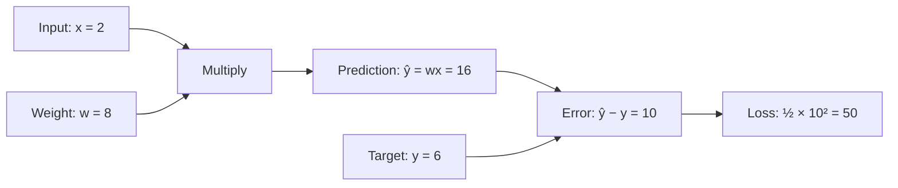
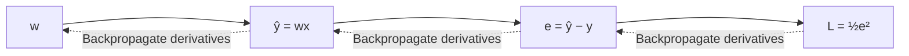
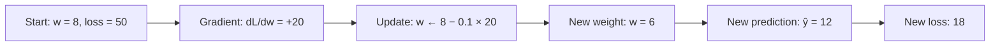
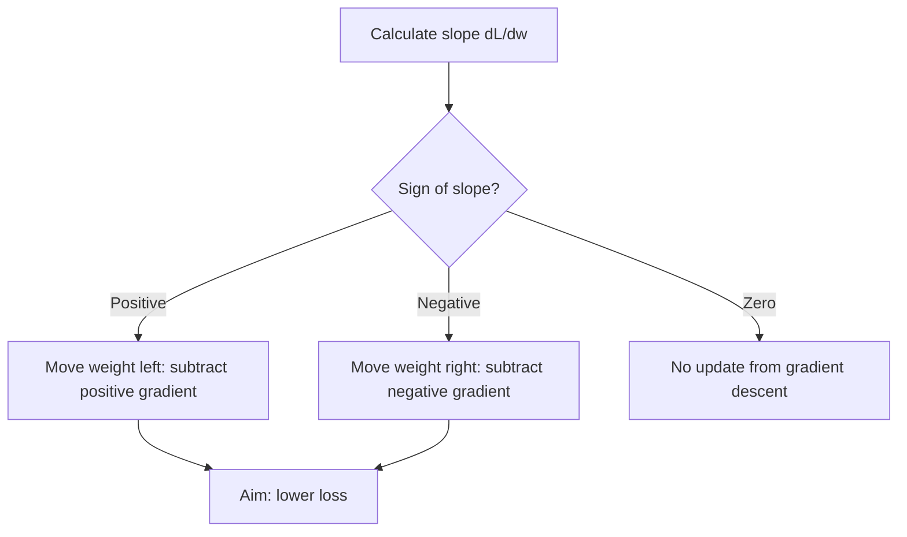
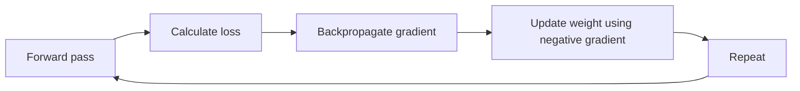

# Worked example: Backpropagation and gradient descent with one weight

## Learning objective

Trace the complete training cycle of a one-parameter model: **forward pass → loss → backward pass → weight update**. Interpret the sign of a gradient and observe the path toward the minimum using Python plots.

## Using this demo

Trace Sections 1–5 first, then run the basic-Python simulation in Section 7. The plots require NumPy and Matplotlib; the arithmetic simulation needs only Python. The learning-rate and alternative-loss sections provide follow-up explanations. Printed step $k$ shows the state after $k$ completed updates.

## 1. Model and initial values

The model contains one input, one trainable weight, and no bias:

$$
\hat y = wx
$$

| Quantity | Symbol | Value |
|---|---|---:|
| Input | $x$ | 2 |
| Target output | $y$ | 6 |
| Initial weight | $w$ | 8 |
| Learning rate | $\eta$ | 0.1 |
| Loss | $L$ | $\tfrac12(\hat y-y)^2$ |



**Training goal:** Find a weight that makes the prediction equal to the target. For this example, the exact solution is $w^*=6/2=3$, but gradient descent will approach it through repeated updates rather than being given the answer.

## 2. Step 1 — Forward pass

**Prediction**

$$
\hat y = wx = 8\times 2 = \boxed{16}
$$

**Prediction error**

$$
e = \hat y-y = 16-6 = \boxed{10}
$$

**Loss**

$$
L=\frac12(\hat y-y)^2=\frac12(10)^2=\boxed{50}
$$

The forward pass computes **how large the error is**. It does not, by itself, determine how the weight should change.

**Pause and predict:** The prediction is too high and the input is positive. Should the weight increase or decrease? Explain before continuing.

## 3. Step 2 — Backward pass (backpropagation)

The question is how sensitive the loss is to a change in the weight:

$$
\frac{dL}{dw} =\; ?
$$

Although this example has just one trainable weight, the same chain-rule principle extends to networks with many parameters.



Introduce intermediate quantities $e=\hat y-y$ and $\hat y=wx$. Apply the chain rule:

$$
\frac{dL}{dw}
=\frac{dL}{de}\cdot\frac{de}{d\hat y}\cdot\frac{d\hat y}{dw}.
$$

Calculate each factor separately.

**A. Loss with respect to error**

$$
L=\tfrac12e^2
\qquad\Longrightarrow\qquad
\frac{dL}{de}=e=10
$$

**B. Error with respect to prediction**

$$
e=\hat y-y
\qquad\Longrightarrow\qquad
\frac{de}{d\hat y}=1
$$

The target $y$ is fixed during this calculation.

**C. Prediction with respect to weight**

$$
\hat y=wx
\qquad\Longrightarrow\qquad
\frac{d\hat y}{dw}=x=2
$$

The input $x$ is fixed during this calculation.

**D. Multiply the three factors**

$$
\boxed{\frac{dL}{dw}=10\times1\times2=20}
$$

The gradient at $w=8$ is **positive**. A small increase in $w$ would increase the loss; a small decrease would reduce it. The number 20 is a *local slope*, not a guarantee that a large step will change the loss by exactly 20 units.

**Terminology note:** With one trainable variable, $dL/dw$ is an ordinary derivative. In a model with several trainable parameters, each derivative is a *partial derivative*, and the collection of partial derivatives forms the gradient vector.

**Pause and calculate:** Using gradient 20 and learning rate 0.1, predict the next weight and loss before reading the update.

## 4. Step 3 — Gradient descent update

Gradient descent changes the weight in the direction **opposite** the gradient:

$$
w_{\mathrm{new}}=w_{\mathrm{old}}-\eta\frac{dL}{dw}.
$$

With $w=8$, $\eta=0.1$, and $dL/dw=20$:

$$
\boxed{w_{\mathrm{new}}=8-0.1(20)=6}.
$$

The updated prediction and loss are:

$$
\hat y_{\mathrm{new}}=6\times2=12
$$

$$
L_{\mathrm{new}}=\tfrac12(12-6)^2=\boxed{18}.
$$

**Result of one update:** Loss decreases from **50** to **18**. The prediction moves from **16** toward the target **6**.



## 5. Repeating the training cycle

For the fixed values $x=2$ and $y=6$, the loss can be expressed entirely in terms of the weight:

$$
L(w)=\frac12(2w-6)^2=2(w-3)^2.
$$

Its derivative is:

$$
\frac{dL}{dw}=4(w-3).
$$

| Update completed | Weight $w$ | Prediction $\hat y$ | Loss $L$ | Gradient $dL/dw$ |
|---:|---:|---:|---:|---:|
| 0 (initial) | 8.0000 | 16.0000 | 50.0000 | 20.0000 |
| 1 | 6.0000 | 12.0000 | 18.0000 | 12.0000 |
| 2 | 4.8000 | 9.6000 | 6.4800 | 7.2000 |
| 3 | 4.0800 | 8.1600 | 2.3328 | 4.3200 |
| 4 | 3.6480 | 7.2960 | 0.8398 | 2.5920 |
| 5 | 3.3888 | 6.7776 | 0.3023 | 1.5552 |
| 6 | 3.2333 | 6.4666 | 0.1088 | 0.9331 |
| Minimum | **3.0000** | **6.0000** | **0** | **0** |

Every row corresponds to another **forward pass → loss → backward pass → update**. The table shows that the gradient shrinks as the weight approaches 3.

## 6. Why the *negative* gradient? The hill analogy

Imagine the loss as the height of a landscape. The current weight is the location on the horizontal axis; the loss is the height. Training attempts to descend toward the lowest point.

The gradient gives the direction of **steepest local increase (uphill)**. Its negative gives the direction of **steepest local decrease (downhill)**. With just one parameter, this means:

- **Positive gradient:** The loss increases when the weight moves right; subtracting the gradient moves the weight left.
- **Negative gradient:** The loss increases when the weight moves left; subtracting the negative gradient moves the weight right.
- **Zero gradient at this example's minimum:** The loss is locally flat; the weight no longer changes.



The gradient is **not** the downhill direction. The **negative gradient** is downhill. In higher-dimensional parameter spaces, this is the direction of steepest *local* descent under the usual Euclidean notion of distance. A learning rate that is too large can nevertheless overshoot the minimum and increase the loss.

### Plot 1 — Loss landscape and weight updates

The curve is $L(w)=2(w-3)^2$. Markers show actual gradient-descent updates, beginning at $w=8$, moving toward $w=3$.

<details>
<summary>Python code — Plot 1: loss landscape and descent path</summary>

```python
import numpy as np
import matplotlib.pyplot as plt

x, y = 2.0, 6.0
w = 8.0
lr = 0.1
n_updates = 8

weights = [w]
losses = [0.5 * (w*x - y)**2]

for _ in range(n_updates):
    prediction = w * x
    gradient = (prediction - y) * x
    w = w - lr * gradient
    weights.append(w)
    losses.append(0.5 * (w*x - y)**2)

weight_grid = np.linspace(2, 8.5, 400)
loss_grid = 0.5 * (weight_grid*x - y)**2

plt.figure(figsize=(9, 5))
plt.plot(weight_grid, loss_grid, label="Loss landscape")
plt.plot(weights, losses, "o--", label="Gradient descent")
plt.scatter([3], [0], s=150, marker="*", label="Minimum: w = 3")

for i in range(5):
    plt.annotate(f"{i}", (weights[i], losses[i]),
                 xytext=(7, 7), textcoords="offset points")
    plt.annotate("", xy=(weights[i+1], losses[i+1]),
                 xytext=(weights[i], losses[i]),
                 arrowprops={"arrowstyle": "->", "lw": 1.5})

plt.title("Gradient descent on the loss landscape")
plt.xlabel("Weight w")
plt.ylabel("Loss L(w)")
plt.grid(alpha=0.25)
plt.legend()
plt.tight_layout()
plt.show()
```

</details>

### Plot 2 — Loss over training iterations

As updates continue, the loss approaches zero. Here the horizontal axis is the number of completed weight updates rather than the weight itself.

<details>
<summary>Python code — Plot 2: loss versus iteration</summary>

```python
import matplotlib.pyplot as plt

x, y = 2.0, 6.0
w = 8.0
lr = 0.1
n_updates = 12

losses = [0.5 * (w*x - y)**2]

for _ in range(n_updates):
    prediction = w * x
    gradient = (prediction - y) * x
    w -= lr * gradient
    losses.append(0.5 * (w*x - y)**2)

plt.figure(figsize=(9, 4))
plt.plot(range(n_updates + 1), losses, "o-")
plt.axhline(0, linestyle="--", linewidth=1)
plt.title("Loss decreases during training")
plt.xlabel("Completed weight updates")
plt.ylabel("Loss")
plt.xticks(range(n_updates + 1))
plt.grid(alpha=0.25)
plt.tight_layout()
plt.show()
```

</details>

## 7. Minimal Python simulation: All four training operations

This version requires only basic Python. Each iteration contains one forward pass, one loss calculation, one gradient calculation, and one weight update.

```python
x = 2.0
true_y = 6.0
w = 8.0
learning_rate = 0.1

print("step | weight | prediction | loss | gradient")
for step in range(10):
    # 1. Forward pass
    y_hat = w * x

    # 2. Loss calculation
    error = y_hat - true_y
    loss = 0.5 * error**2

    # 3. Backpropagation: dL/dw = (y_hat - y) * x
    gradient = error * x

    print(f"{step:4d} | {w:6.3f} | {y_hat:10.3f} | "
          f"{loss:6.3f} | {gradient:8.3f}")

    # 4. Gradient descent update
    w = w - learning_rate * gradient
```

**Observation:** The output moves toward 6, the weight moves toward 3, and the loss moves toward 0.

## 8. What does the learning rate do?

The learning rate $\eta$ determines how far the weight moves in response to its gradient:

$$
\Delta w = -\eta\frac{dL}{dw}.
$$

For the initial gradient of 20:

| Learning rate $\eta$ | First update | New weight |
|---:|---|---:|
| 0.01 | $8 - 0.01(20)$ | 7.8 |
| 0.1 | $8 - 0.1(20)$ | 6.0 |
| 0.4 | $8 - 0.4(20)$ | 0.0 |
| 0.6 | $8 - 0.6(20)$ | −4.0 |

For this specific quadratic loss, $0<\eta<0.5$ gives convergence from any initial weight. A learning rate of $0.6$ overshoots increasingly and diverges. A large learning rate can therefore fail even when the gradient direction is correct.

## 9. Why is the loss $\tfrac12(\hat y-y)^2$?

### Why square the error?

The squared error $(\hat y-y)^2$ is nonnegative, penalizes large mistakes more than small ones, and is smooth and easy to differentiate.

- Error 2 gives squared error 4.
- Error 10 gives squared error 100.

### Why multiply by 0.5?

The factor $\tfrac12$ is a mathematical convenience:

$$
\frac{d}{de}(e^2)=2e,
\qquad
\frac{d}{de}\left(\tfrac12e^2\right)=e.
$$

The $2$ from differentiation cancels the $\tfrac12$. The minimum does not change because multiplication by a positive constant rescales the loss without moving its minimum. **However, the numerical gradient changes**, so using the same learning rate with and without $\tfrac12$ produces different weight updates.

### Can a different loss be used?

Yes, provided the loss represents the task appropriately and supports a useful optimization method. Loss functions are selected deliberately rather than arbitrarily.

| Loss | Expression | Typical use |
|---|---|---|
| Half squared error | $\tfrac12(\hat y-y)^2$ | Simple regression examples |
| Squared error | $(\hat y-y)^2$ | Regression |
| Absolute error | $\lvert\hat y-y\rvert$ | Regression with less sensitivity to large errors |
| Binary cross-entropy | $-[y\log p+(1-y)\log(1-p)]$ | Binary classification, where $p$ is a predicted probability |

Absolute error is not differentiable at zero error, but can be optimized using subgradients or related methods. Binary cross-entropy is more suitable for the subsequent binary-classification example.

## 10. Main takeaway



**In this example:**

$$
\boxed{w:8\rightarrow6\rightarrow4.8\rightarrow\cdots\rightarrow3}
$$

$$
\boxed{L:50\rightarrow18\rightarrow6.48\rightarrow\cdots\rightarrow0}
$$

The essential training process remains the same when the model contains more weights: evaluate a prediction, measure the loss, calculate the influence of each parameter through the chain rule, and update the parameters in directions that aim to reduce the loss. A sufficiently small step is needed for a local downhill direction to reduce loss.
