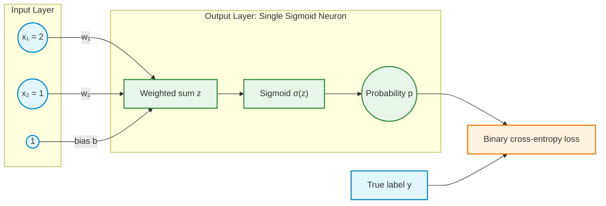
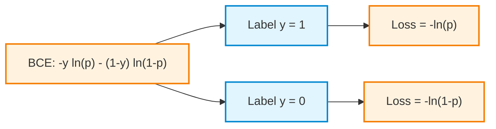
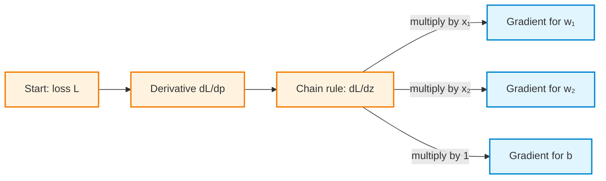
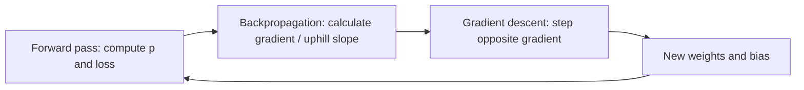

# Activity 3 — Binary Classification: Sigmoid, Binary Cross-Entropy, Backpropagation, and Gradient Descent

**Guided reinforcement | Two input features, two weights, one bias, one sigmoid output**

This activity extends the earlier regression examples. The trainable parameters are still weights and a bias, and the learning cycle is still **forward pass → loss → backpropagation → gradient descent**. The important changes are the **sigmoid activation** and the **binary cross-entropy (BCE) loss**.

## How to use this guided activity

This activity reinforces the theory. Try each question, then open its worked answer to check your reasoning. Use the solutions while learning, and explain each step rather than only matching the numbers. Record predictions, losses, gradients, and updated parameters on paper or in a notebook.

The core tasks are the forward pass, gradients, and one update for each label. Repeated-update plots and learning-rate experiments are extensions. Python simulations and plots in this file require NumPy; plots also require Matplotlib.

## Learning objectives

After this activity, the following ideas should be clear:

1. This sigmoid-based binary classifier produces an estimated probability between 0 and 1 rather than an unrestricted numerical prediction.
2. Sigmoid converts a weighted sum, called a *logit*, into a probability.
3. BCE measures how well the predicted probability matches a binary target.
4. Backpropagation applies the chain rule to calculate a partial derivative for each parameter.
5. Gradient descent uses those gradients and a learning rate to update the parameters.
6. Learning rate affects how quickly and how reliably training proceeds.

> **Core distinction:** **Backpropagation calculates gradients. Gradient descent updates parameters using those gradients and the learning rate.** In the hill metaphor, backpropagation supplies the slope information (the gradient points uphill); gradient descent moves in the *opposite* direction, downhill.

---

## 1. From regression to binary classification

Regression predicts a continuous number. Binary classification predicts the probability of one of two possible labels, conventionally $y \in \{0,1\}$.

| Feature | Regression demonstrations | Binary classification demonstration |
|---|---|---|
| Output | Any real-valued prediction | Probability $p$ between 0 and 1 |
| Linear calculation | $z=w_1x_1+w_2x_2+b$ | $z=w_1x_1+w_2x_2+b$ |
| Output transformation | None in the earlier linear examples | Sigmoid: $p=\sigma(z)$ |
| Example loss | Half squared error | Binary cross-entropy |
| Learning method | Backpropagation + gradient descent | Backpropagation + gradient descent |

A possible application is to predict whether an event is present ($y=1$) or absent ($y=0$). The calculations here use abstract numerical input features.

### 1.1 The two-input network



The constant input $1$ represents the bias term: multiplying it by $b$ adds $b$ to the weighted sum. The network has **one output neuron and no hidden layer**. This model is binary **logistic regression**, rather than an MLP or a deep network.

The model consists of two equations:

$$
z=w_1x_1+w_2x_2+b
$$

$$
p=\hat y=\sigma(z)=\frac{1}{1+e^{-z}}
$$

For a class decision, a threshold such as $p\geq0.5$ may be used to predict class 1. **Training uses the probability $p$, not the thresholded class label**, so gradients remain available.

---

## 2. The sigmoid activation: from logit to probability

A logit $z$ can be any real number. The sigmoid function maps it to the open interval $(0,1)$.

| Logit $z$ | Sigmoid probability $\sigma(z)$ |
|---:|---:|
| $-2$ | $0.1192$ |
| $-1$ | $0.2689$ |
| $0$ | $0.5000$ |
| $1$ | $0.7311$ |
| $2$ | $0.8808$ |

A positive logit produces $p>0.5$; a negative logit produces $p<0.5$; a zero logit produces $p=0.5$.

### Plot 1 — Sigmoid function

<details>
<summary>Show Python code — Plot 1: sigmoid probability versus logit</summary>

```python
import numpy as np
import matplotlib.pyplot as plt

z = np.linspace(-8, 8, 401)
p = 1 / (1 + np.exp(-z))

plt.figure(figsize=(8, 4.5))
plt.plot(z, p, label="Sigmoid: p = 1 / (1 + exp(-z))")
plt.axhline(0.5, linestyle="--", linewidth=1, label="p = 0.5")
plt.axvline(0, linestyle=":", linewidth=1)
plt.scatter([0, 0.3], [0.5, 1 / (1 + np.exp(-0.3))],
            label="Before and after first update")
plt.xlabel("Logit z")
plt.ylabel("Predicted probability p")
plt.title("Sigmoid maps any logit to a probability")
plt.ylim(-0.03, 1.03)
plt.grid(alpha=0.25)
plt.legend()
plt.tight_layout()
plt.show()
```

</details>

---

## 3. Why binary cross-entropy instead of squared error?

The earlier examples used a squared-error loss for continuous predictions. Squared error can also be applied to a probability, but BCE is a more natural choice for a binary target: it corresponds to the negative log-likelihood of a Bernoulli outcome and gives a useful gradient when combined with sigmoid.

BCE assigns a particularly large penalty to **confident but wrong** probabilities.

### 3.1 Case A: the true label is $y=1$

The correct class is 1. A predicted probability close to 1 should have very small loss; a probability close to 0 should have very large loss.

$$
L=-\ln(p) \qquad \text{when }y=1
$$

| Probability $p$ | Loss $-\ln(p)$ |
|---:|---:|
| $0.999$ | $0.0010$ |
| $0.9$ | $0.1054$ |
| $0.5$ | $0.6931$ |
| $0.1$ | $2.3026$ |
| $0.001$ | $6.9078$ |

### 3.2 Case B: the true label is $y=0$

The correct class is 0. A probability close to 0 should have very small loss; a probability close to 1 should have very large loss.

$$
L=-\ln(1-p) \qquad \text{when }y=0
$$

| Probability $p$ | Loss $-\ln(1-p)$ |
|---:|---:|
| $0.001$ | $0.0010$ |
| $0.1$ | $0.1054$ |
| $0.5$ | $0.6931$ |
| $0.9$ | $2.3026$ |
| $0.999$ | $6.9078$ |

Here, $\ln$ denotes the **natural logarithm** (base $e$). All BCE calculations here use natural logarithms; this convention gives the sigmoid/BCE logit gradient $p-y$.

### 3.3 The two cases become one formula

The binary label $y$ selects the applicable term:

$$
\boxed{L=-\left[y\ln(p)+(1-y)\ln(1-p)\right]}
$$

- If $y=1$, then $1-y=0$, so $L=-\ln(p)$.
- If $y=0$, then $y=0$, so $L=-\ln(1-p)$.



### Plot 2 — BCE loss curves for both labels

<details>
<summary>Show Python code — Plot 2: binary cross-entropy versus probability</summary>

```python
import numpy as np
import matplotlib.pyplot as plt

# Avoid exact 0 and 1 because ln(0) is undefined.
p = np.linspace(0.001, 0.999, 500)
loss_if_y1 = -np.log(p)
loss_if_y0 = -np.log1p(-p)

plt.figure(figsize=(8, 4.8))
plt.plot(p, loss_if_y1, label="True label y = 1: -ln(p)")
plt.plot(p, loss_if_y0, label="True label y = 0: -ln(1-p)")
plt.axvline(0.5, linestyle="--", linewidth=1, label="p = 0.5")
plt.xlabel("Predicted probability p of class 1")
plt.ylabel("Loss")
plt.title("Binary cross-entropy penalizes confident wrong predictions")
plt.ylim(0, 7)
plt.grid(alpha=0.25)
plt.legend()
plt.tight_layout()
plt.show()
```

</details>

**Important:** The loss becomes arbitrarily large as the predicted probability of the true class approaches zero. For real-valued finite logits, sigmoid probabilities are mathematically strictly between 0 and 1. Numerical implementations usually calculate BCE from logits directly to avoid floating-point problems near 0 and 1.

---

## 4. Step 1 — Forward pass with two weights and a bias

**Question 1:** Use `x1=2`, `x2=1`, `y=1`, and initial `w1=w2=b=0`. Calculate the logit, sigmoid probability, and natural-log BCE. Does this change any parameters? Use learning rate 0.1 for the later update.

<details>
<summary>Show worked answer</summary>


For a transparent hand calculation, the following starting values are used. The inputs match the earlier two-weight example; the target is now a *binary label*.

| Quantity | Initial value |
|---|---:|
| Input $x_1$ | $2$ |
| Input $x_2$ | $1$ |
| True label $y$ | $1$ |
| Weight $w_1$ | $0$ |
| Weight $w_2$ | $0$ |
| Bias $b$ | $0$ |
| Learning rate $\eta$ | $0.1$ |

Zero initial parameters are suitable for this **single output logistic neuron**. This does not imply that initializing every weight to zero is suitable for a network with multiple symmetric hidden neurons.

**A. Compute the logit**

$$
z=w_1x_1+w_2x_2+b
$$

$$
z=(0)(2)+(0)(1)+0=\boxed{0}
$$

**B. Apply sigmoid**

$$
p=\sigma(0)=\frac{1}{1+e^0}=\boxed{0.5}
$$

**C. Calculate BCE**

Since $y=1$:

$$
L=-\ln(p)=-\ln(0.5)=\boxed{0.693147}
$$

The output is currently uncertain: the predicted probability of class 1 is $0.5$. The forward pass has calculated a prediction and a loss, but has not changed any parameters.

---

</details>

## 5. Step 2 — Backpropagation: calculate three partial derivatives

**Question 2:** Calculate the BCE derivative with respect to probability, the sigmoid derivative, and their product. Then find all three parameter gradients. How does the logit gradient simplify to `p-y`?

<details>
<summary>Show worked answer</summary>


Backpropagation calculates **how the loss changes with each trainable parameter**. The parameters are $w_1$, $w_2$, and $b$.



### 5.1 Differentiate BCE with respect to probability

$$
L=-\left[y\ln(p)+(1-y)\ln(1-p)\right]
$$

Treating $y$ as fixed:

$$
\frac{\partial L}{\partial p}=-\frac{y}{p}+\frac{1-y}{1-p}
$$

For $y=1$ and $p=0.5$:

$$
\frac{\partial L}{\partial p}=-\frac{1}{0.5}+0=\boxed{-2}
$$

### 5.2 Differentiate sigmoid with respect to the logit

$$
p=\sigma(z)=\frac{1}{1+e^{-z}}
$$

Its derivative is:

$$
\frac{\partial p}{\partial z}=p(1-p)
$$

At $p=0.5$:

$$
\frac{\partial p}{\partial z}=(0.5)(0.5)=\boxed{0.25}
$$

### 5.3 Apply the chain rule

$$
\frac{\partial L}{\partial z}
=\frac{\partial L}{\partial p}\frac{\partial p}{\partial z}
=(-2)(0.25)=\boxed{-0.5}
$$

The same result can be simplified *symbolically* for **any** label $y\in\{0,1\}$:

$$
\begin{aligned}
\frac{\partial L}{\partial z}
&=\left(-\frac{y}{p}+\frac{1-y}{1-p}\right)p(1-p)\\
&=-y(1-p)+(1-y)p\\
&=\boxed{p-y}
\end{aligned}
$$

This is an important cancellation: for **sigmoid + natural-log BCE**, the gradient with respect to the logit is simply **prediction minus target**.

### 5.4 Calculate the partial derivative for each parameter

The logit is:

$$
z=w_1x_1+w_2x_2+b
$$

Holding all other parameters fixed in each partial derivative:

$$
\frac{\partial z}{\partial w_1}=x_1=2
$$

$$
\frac{\partial z}{\partial w_2}=x_2=1
$$

$$
\frac{\partial z}{\partial b}=1
$$

By the chain rule:

$$
\frac{\partial L}{\partial w_1}
=\frac{\partial L}{\partial z}\frac{\partial z}{\partial w_1}
=(p-y)x_1=(-0.5)(2)=\boxed{-1}
$$

$$
\frac{\partial L}{\partial w_2}
=(p-y)x_2=(-0.5)(1)=\boxed{-0.5}
$$

$$
\frac{\partial L}{\partial b}
=(p-y)(1)=\boxed{-0.5}
$$

The gradient vector is:

$$
\nabla L=
\begin{bmatrix}
\frac{\partial L}{\partial w_1} \\
\frac{\partial L}{\partial w_2} \\
\frac{\partial L}{\partial b}
\end{bmatrix}
=
\begin{bmatrix}
-1 \\
-0.5 \\
-0.5
\end{bmatrix}
$$

**Interpretation:** With positive input features, the negative gradients indicate that a small *increase* in these parameters will reduce the loss for this positive training example. Backpropagation has computed the three gradients; the parameters have not yet changed.

---

</details>

## 6. Step 3 — Gradient descent updates the parameters

**Question 3:** Update both weights and the bias using learning rate 0.1. Calculate the new logit, probability, and loss. Evaluate all gradients at the same original parameters before changing any of them.

<details>
<summary>Show worked answer</summary>


Gradient descent applies the rule:

$$
\theta_{\text{new}}=\theta_{\text{old}}-\eta\frac{\partial L}{\partial\theta}
$$

Here $\theta$ means any trainable parameter; $\eta=0.1$.

**Update the first weight**

$$
w_{1,\text{new}}=0-0.1(-1)=\boxed{0.1}
$$

**Update the second weight**

$$
w_{2,\text{new}}=0-0.1(-0.5)=\boxed{0.05}
$$

**Update the bias**

$$
b_{\text{new}}=0-0.1(-0.5)=\boxed{0.05}
$$

### Evaluate the updated network

The new logit is:

$$
z=(0.1)(2)+(0.05)(1)+0.05=\boxed{0.30}
$$

The new probability is:

$$
p=\sigma(0.30)=\boxed{0.574443}
$$

The new loss is:

$$
L=-\ln(0.574443)\approx\boxed{0.554355}
$$

| Measurement | Before update | After update |
|---|---:|---:|
| $w_1$ | $0$ | $0.1$ |
| $w_2$ | $0$ | $0.05$ |
| $b$ | $0$ | $0.05$ |
| Logit $z$ | $0$ | $0.3$ |
| Probability $p$ | $0.500000$ | $0.574443$ |
| BCE loss | $0.693147$ | $0.554355$ |

**Result:** One gradient-descent update increased the probability assigned to the correct class and reduced the loss.

</details>

### Backpropagation versus gradient descent: the hill metaphor



- **Loss landscape:** Height represents loss; position represents model parameters $(w_1,w_2,b)$.
- **Backpropagation:** Supplies the local slope information. The gradient points in the direction of steepest uphill increase for a fixed small Euclidean step.
- **Gradient descent:** Moves in the *negative-gradient* direction, locally downhill. The learning rate controls the scale of the step.
- **Caution:** A large step can overshoot a low-loss region. A locally downhill direction does not guarantee that an arbitrarily large step decreases loss.

---

## 7. Repeat the learning cycle

**Question 4:** Predict how probability and loss change over repeated updates on this positive example. Calculate the second update. Can finite parameters attain exactly zero BCE?

<details>
<summary>Show worked answer</summary>


For the **same positive example**, repeated updates produce the following values at the *start* of each iteration:

| Iteration | $w_1$ | $w_2$ | $b$ | Predicted $p$ | BCE loss |
|---:|---:|---:|---:|---:|---:|
| 0 | 0.000000 | 0.000000 | 0.000000 | 0.500000 | 0.693147 |
| 1 | 0.100000 | 0.050000 | 0.050000 | 0.574443 | 0.554355 |
| 2 | 0.185111 | 0.092556 | 0.092556 | 0.635372 | 0.453544 |
| 3 | 0.258037 | 0.129019 | 0.129019 | 0.684410 | 0.379199 |
| 4 | 0.321155 | 0.160578 | 0.160578 | 0.723815 | 0.323219 |
| 5 | 0.376392 | 0.188196 | 0.188196 | 0.755687 | 0.280128 |

**Limitation of this single-example experiment:** With only a positive label, the model can keep increasing its logit and driving BCE toward zero. There is no finite parameter vector that attains exactly zero BCE for that single example. A collection of positive and negative examples provides a more meaningful learning-rate experiment.

</details>

### Python simulation — forward pass, backpropagation, gradient descent

```python
import numpy as np

x1, x2 = 2.0, 1.0
y = 1.0
w1, w2, b = 0.0, 0.0, 0.0
learning_rate = 0.1

print("step |   w1   |   w2   |   b    | probability |   loss")
for step in range(10):
    # 1. Forward pass
    z = w1 * x1 + w2 * x2 + b
    p = 1.0 / (1.0 + np.exp(-z))
    loss = np.logaddexp(0.0, z) - y * z  # Stable BCE from logit

    print(f"{step:4d} | {w1:6.3f} | {w2:6.3f} | {b:6.3f} |"
          f" {p:11.6f} | {loss:7.5f}")

    # 2. Backpropagation (chain-rule gradients)
    dz = p - y
    dw1 = dz * x1
    dw2 = dz * x2
    db = dz

    # 3. Gradient descent (parameter updates)
    w1 -= learning_rate * dw1
    w2 -= learning_rate * dw2
    b -= learning_rate * db
```

The expression `np.logaddexp(0.0, z) - y*z` is numerically stable and mathematically equivalent to BCE for a sigmoid probability with a binary label.

### Plot 3 — Loss decreases during repeated updates

<details>
<summary>Show Python code — Plot 3: BCE loss versus training iterations</summary>

```python
import numpy as np
import matplotlib.pyplot as plt

x1, x2, y = 2.0, 1.0, 1.0
w1 = w2 = b = 0.0
lr = 0.1
steps = 25
loss_history = []

for step in range(steps + 1):
    z = w1*x1 + w2*x2 + b
    p = 1.0 / (1.0 + np.exp(-z))
    loss_history.append(np.logaddexp(0.0, z) - y*z)
    gradient_z = p - y
    if step < steps:
        w1 -= lr * gradient_z * x1
        w2 -= lr * gradient_z * x2
        b -= lr * gradient_z

plt.figure(figsize=(8, 4.5))
plt.plot(range(steps + 1), loss_history, marker="o")
plt.xlabel("Number of parameter updates")
plt.ylabel("BCE loss for the positive example")
plt.title("Loss decreases as the correct-class probability improves")
plt.grid(alpha=0.25)
plt.tight_layout()
plt.show()
```

</details>

### Plot 4 — Predicted probability approaches the target

<details>
<summary>Show Python code — Plot 4: predicted probability versus iterations</summary>

```python
import numpy as np
import matplotlib.pyplot as plt

x1, x2, y = 2.0, 1.0, 1.0
w1 = w2 = b = 0.0
lr = 0.1
steps = 25
probability_history = []

for step in range(steps + 1):
    z = w1*x1 + w2*x2 + b
    p = 1.0 / (1.0 + np.exp(-z))
    probability_history.append(p)
    gradient_z = p - y
    if step < steps:
        w1 -= lr * gradient_z * x1
        w2 -= lr * gradient_z * x2
        b -= lr * gradient_z

plt.figure(figsize=(8, 4.5))
plt.plot(range(steps + 1), probability_history, marker="o",
         label="Predicted probability p")
plt.axhline(1.0, linestyle="--", label="Target y = 1")
plt.xlabel("Number of parameter updates")
plt.ylabel("Probability of class 1")
plt.title("The model assigns increasing probability to the true class")
plt.ylim(0.4, 1.05)
plt.grid(alpha=0.25)
plt.legend()
plt.tight_layout()
plt.show()
```

</details>

---

## 8. What changes when the label is $y=0$?

**Question 5:** Restart at zero weights and bias with the same inputs, but set `y=0`. Calculate the initial loss, gradients, updated parameters, new probability, and new loss. Why is the initial loss unchanged while the gradients reverse sign?

<details>
<summary>Show worked answer</summary>


Use the *same initial model* and inputs: $x_1=2$, $x_2=1$, $w_1=w_2=b=0$. This time the correct label is $y=0$.

The forward pass still gives $z=0$ and $p=0.5$, with $L=-\ln(1-0.5)=0.693147$.

The gradient with respect to the logit changes sign:

$$
\frac{\partial L}{\partial z}=p-y=0.5-0=\boxed{+0.5}
$$

Thus:

$$
\frac{\partial L}{\partial w_1}=+1,\qquad
\frac{\partial L}{\partial w_2}=+0.5,\qquad
\frac{\partial L}{\partial b}=+0.5
$$

After a gradient-descent step with $\eta=0.1$:

$$
w_1=-0.1,\qquad w_2=-0.05,\qquad b=-0.05
$$

$$
z=-0.3,\qquad p=\sigma(-0.3)\approx0.425557
$$

$$
L=-\ln(1-0.425557)\approx0.554355
$$

The update now **decreases** the probability of class 1, which is correct for an example labeled 0. The algorithm is unchanged; the target determines the gradient.

---

</details>

## 9. Learning rate: small, moderate, and excessively large steps

The learning rate $\eta$ determines the multiplier on each gradient:

$$
w_j\leftarrow w_j-\eta\frac{\partial L}{\partial w_j},\qquad
b\leftarrow b-\eta\frac{\partial L}{\partial b}
$$

- **Very small learning rate:** Often stable but makes slow progress.
- **Moderate learning rate:** Can reduce loss efficiently.
- **Excessively large learning rate:** May overshoot, oscillate, or increase loss.

The appropriate numerical range depends on the dataset, feature scale, loss function, and model; there is no universally best learning rate.

### Why use a dataset for this experiment?

A positive-only example can make even an excessively large learning rate appear successful after one update, because the model only needs to push a single logit upward. To demonstrate possible overshooting, the next experiment uses **both classes** and averages BCE over a small dataset.

| Example | $x_1$ | $x_2$ | Label $y$ |
|---:|---:|---:|---:|
| 1 | 0 | 0 | 0 |
| 2 | 1 | 0 | 0 |
| 3 | 0 | 1 | 0 |
| 4 | 1 | 1 | 0 |
| 5 | 2 | 0 | 1 |
| 6 | 0 | 2 | 1 |

All six examples participate in each update in this experiment: **full-batch gradient descent**.

For $n$ examples, the mean BCE is:

$$
L_{\text{mean}}=-\frac{1}{n}\sum_{i=1}^{n}
\left[y^{(i)}\ln(p^{(i)})+(1-y^{(i)})\ln(1-p^{(i)})\right]
$$

The average gradients become:

$$
\frac{\partial L_{\text{mean}}}{\partial w_1}
=\frac{1}{n}\sum_{i=1}^{n}(p^{(i)}-y^{(i)})x_1^{(i)}
$$

$$
\frac{\partial L_{\text{mean}}}{\partial w_2}
=\frac{1}{n}\sum_{i=1}^{n}(p^{(i)}-y^{(i)})x_2^{(i)}
$$

$$
\frac{\partial L_{\text{mean}}}{\partial b}
=\frac{1}{n}\sum_{i=1}^{n}(p^{(i)}-y^{(i)})
$$

**Extension question 6:** Predict which learning rate below is most likely to oscillate. Run the code and explain why the final loss alone cannot describe stability. Is this full-batch GD, mini-batch GD, or one-example SGD?

### Plot 5 — Compare four learning rates on the same dataset

<details>
<summary>Show Python code — Plot 5: learning-rate comparison</summary>

```python
import numpy as np
import matplotlib.pyplot as plt

X = np.array([
    [0.0, 0.0],
    [1.0, 0.0],
    [0.0, 1.0],
    [1.0, 1.0],
    [2.0, 0.0],
    [0.0, 2.0],
])
y = np.array([0., 0., 0., 0., 1., 1.])

learning_rates = [0.05, 0.5, 2.0, 20.0]
epochs = 80

plt.figure(figsize=(9, 5))

for lr in learning_rates:
    w = np.zeros(2)
    b = 0.0
    history = []

    for epoch in range(epochs + 1):
        z = X @ w + b
        p = 1.0 / (1.0 + np.exp(-z))
        # Stable mean BCE from logits:
        loss = np.mean(np.logaddexp(0.0, z) - y*z)
        history.append(loss)

        # Full-batch backpropagation and gradient descent:
        error = p - y
        dw = X.T @ error / len(y)
        db = np.mean(error)
        if epoch < epochs:
            w -= lr * dw
            b -= lr * db

    print(f"lr={lr:>5}: initial loss={history[0]:.4f}, "
          f"loss after 80 updates={history[-1]:.4f}")
    plt.plot(range(epochs + 1), history, label=f"lr = {lr}")

plt.xlabel("Full-batch parameter updates")
plt.ylabel("Mean binary cross-entropy")
plt.title("Learning rate affects stability and convergence")
plt.grid(alpha=0.25)
plt.legend()
plt.tight_layout()
plt.show()
```

</details>

<details>
<summary>Show interpretation and batching answer</summary>

**Expected interpretation for this fixed experiment:** $\eta=0.05$ improves slowly; $\eta=0.5$ and $\eta=2$ make more rapid progress; $\eta=20$ causes large temporary increases and oscillations. The final loss alone can hide unstable steps, so the **entire curve** matters.

The dataset has deliberately conflicting labels for a linear boundary: $(2,0)$ and $(0,2)$ have label 1, while their midpoint $(1,1)$ has label 0. Thus no single linear decision boundary can classify all six training samples perfectly. However, failure to separate the labels perfectly does not guarantee a finite unregularized optimum. In this dataset, some parameter values can keep growing while loss decreases. This experiment illustrates learning-rate stability, not convergence to finite optimal parameters.

**Optional question:** Why does this dataset have no finite unregularized loss minimizer?

<details>
<summary>Show explanation</summary>

Change $(w_1,w_2,b)$ by $t(1,1,-2)$ for any $t>0$. The logits at $(0,0)$, $(1,0)$, and $(0,1)$ decrease by $2t$, $t$, and $t$ respectively. All three labels are 0, so their losses strictly decrease. The logits of the remaining points stay unchanged because $x_1+x_2=2$ there. Thus every finite parameter vector admits a further improvement. This is called **quasi-separation**.

</details>

> **Gradient descent versus SGD:** The previous code averages gradients over *all six examples* before each update (full-batch gradient descent). **Stochastic gradient descent (SGD)** instead updates using an individual training example, or a small group of examples in mini-batch SGD. The local chain-rule calculations are the same; the data used for each update differ.

</details>

---

## 10. Questions and answers

### Question 1 — What does the forward pass calculate?

<details>
<summary>Show answer</summary>

The forward pass calculates the logit $z=w_1x_1+w_2x_2+b$, converts it to a probability $p=\sigma(z)$, and evaluates BCE using the target label. It does not modify any parameters.

</details>

### Question 2 — What is the difference between backpropagation and gradient descent?

<details>
<summary>Show answer</summary>

**Backpropagation calculates** the partial derivatives of loss with respect to the weights and bias, using the chain rule. **Gradient descent updates** those parameters by subtracting the learning rate multiplied by the corresponding gradient. The raw gradient points locally uphill; the update follows its negative.

</details>

### Question 3 — What is a learning rate, and why is it needed?

<details>
<summary>Show answer</summary>

The learning rate $\eta$ is the multiplier controlling the magnitude of the parameter update. For a parameter $\theta$, the update is $\theta\leftarrow\theta-\eta\,\partial L/\partial\theta$. The gradient supplies slope information; the learning rate determines the size of the move. Without an appropriate step size, progress can be excessively slow or unstable.

</details>

### Question 4 — How is the derivative of loss with respect to $w_1$ calculated?

<details>
<summary>Show answer</summary>

The chain rule gives:

$$
\frac{\partial L}{\partial w_1}=
\frac{\partial L}{\partial p}
\frac{\partial p}{\partial z}
\frac{\partial z}{\partial w_1}
=(p-y)x_1
$$

For the initial example, $(0.5-1)\times2=-1$.

</details>

### Question 5 — Why are partial derivatives required when there are multiple weights?

<details>
<summary>Show answer</summary>

Loss depends on multiple independently trainable parameters. A partial derivative isolates the sensitivity to one parameter while holding the others fixed. Separate gradients are required for $w_1$, $w_2$, and $b$, even though they all contribute to the same loss.

</details>

### Question 6 — Why does the bias have a gradient of $p-y$?

<details>
<summary>Show answer</summary>

Because $z=w_1x_1+w_2x_2+b$, the derivative $\partial z/\partial b=1$. Therefore, by the chain rule, $\partial L/\partial b=(p-y)\times1=p-y$.

</details>

### Question 7 — Why does sigmoid + BCE simplify to $\partial L/\partial z=p-y$?

<details>
<summary>Show answer</summary>

The BCE derivative with respect to probability is $-y/p+(1-y)/(1-p)$. The sigmoid derivative is $p(1-p)$. Multiplying cancels the denominators:

$$
\left(-\frac{y}{p}+\frac{1-y}{1-p}\right)p(1-p)
=-y(1-p)+(1-y)p=p-y
$$

This exact simplification assumes the natural-log version of BCE and a sigmoid output.

</details>

### Question 8 — What changes if the true label is 0 instead of 1?

<details>
<summary>Show answer</summary>

At $p=0.5$, the logit gradient changes from $0.5-1=-0.5$ to $0.5-0=+0.5$. For positive input features, gradient descent then reduces the parameters and the predicted probability of class 1. The same algorithm works for both labels.

</details>

### Question 9 — Why not use a thresholded prediction (0 or 1) to calculate BCE gradients?

<details>
<summary>Show answer</summary>

Thresholding loses continuous probability information. A hard threshold has zero derivative almost everywhere and is not differentiable at the threshold, preventing the useful gradient-based update. BCE is calculated from the unthresholded probability, or from the logit using a numerically stable equivalent.

</details>

### Question 10 — Does a large learning rate always reduce the loss faster?

<details>
<summary>Show answer</summary>

No. A large learning rate may jump past a low-loss region and cause oscillation or loss increases. The learning-rate plot compares multiple values on exactly the same dataset, demonstrating why stability matters as much as early progress.

</details>

### Question 11 — Is the six-example program SGD?

<details>
<summary>Show answer</summary>

No. It calculates the **average gradient of all six examples** before every update, so it is full-batch gradient descent. SGD uses the gradient of one selected training example for each update. Mini-batch SGD uses a small subset of the training data.

</details>

---

## 11. Summary: the complete learning cycle

| Stage | Operation | Example result from first training step |
|---|---|---|
| **Forward pass** | Calculate $z$, $p$, and BCE | $z=0$, $p=0.5$, $L=0.693147$ |
| **Backpropagation** | Calculate partial derivatives | $\partial L/\partial w_1=-1$, $\partial L/\partial w_2=-0.5$, $\partial L/\partial b=-0.5$ |
| **Gradient descent** | Subtract learning rate times gradient | $w_1=0.1$, $w_2=0.05$, $b=0.05$ |
| **Next forward pass** | Check new probability and loss | $p\approx0.574443$, $L\approx0.554355$ |

The learning algorithm is conceptually unchanged from the regression examples. Binary classification adds an activation function to express a probability and uses a loss designed for binary outcomes. The chain rule still calculates the gradients, and gradient descent still applies the updates.

