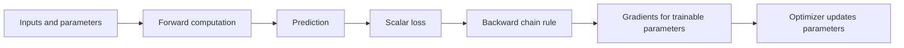

# Ordinary Derivatives, Partial Derivatives, and How Deep Learning Frameworks Compute Gradients

## The central idea

Neural network training requires understanding **how the loss changes when model parameters change**. With one trainable parameter, an ordinary derivative describes that change. With multiple independent parameters, we calculate a **partial derivative for each parameter**. Together, those partial derivatives form the **gradient**.

Libraries such as **PyTorch, TensorFlow, and JAX** compute these gradients efficiently through **automatic differentiation**, usually using **reverse-mode automatic differentiation** (the mechanism underlying backpropagation).

> **Important distinction:** Automatic differentiation computes gradients; an **optimizer** such as SGD or Adam uses those gradients to update the parameters. These are related but different steps.

---

## 1. A network with one weight: ordinary derivative

Suppose a very small model has one trainable weight $w$, and everything else—including the input $x$ and target $y$—is fixed. The loss depends on one variable:

$$
L=f(w)
$$

The **ordinary derivative** tells us the instantaneous rate at which the loss changes when $w$ changes:

$$
\frac{dL}{dw}
$$

- A positive derivative means increasing $w$ slightly increases the loss (locally).
- A negative derivative means increasing $w$ slightly decreases the loss (locally).
- A derivative of zero means the loss is locally stationary; this does **not** necessarily mean we found the best possible solution.

### Example: one weight

Let the prediction be $\hat{y}=wx$, with squared-error loss:

$$
L(w)=\frac{1}{2}(wx-y)^2
$$

By the chain rule:

$$
\frac{dL}{dw}=(wx-y)x
$$

If $x=2$, $y=6$, and $w=2$, the prediction is $4$ and:

$$
\frac{dL}{dw}=(4-6)\times 2=-4
$$

For learning rate $\alpha=0.1$, gradient descent updates the weight as follows:

$$
w_{\mathrm{new}}=w-\alpha\frac{dL}{dw}=2-0.1(-4)=2.4
$$

The weight increases, which moves the prediction from $4$ toward the target $6$.

**Key idea:** When only one independent parameter varies, one ordinary derivative describes the local sensitivity of the loss to that parameter.

---

## 2. A network with two weights: partial derivatives

Now suppose the model has two independently trainable weights, $w_1$ and $w_2$:

$$
L=f(w_1,w_2)
$$

We need to know how the loss changes when **one weight varies and the other is held fixed**. That is what a partial derivative describes:

$$
\frac{\partial L}{\partial w_1}
\qquad\text{and}\qquad
\frac{\partial L}{\partial w_2}
$$

These two values form the **gradient vector**:

$$
\nabla_{\mathbf{w}}L=
\begin{bmatrix}
\frac{\partial L}{\partial w_1} \\
\frac{\partial L}{\partial w_2}
\end{bmatrix}
$$

Each entry measures the loss's local sensitivity to one parameter, **while the other independent parameters remain fixed**.

> **Mathematical clarification:** Ordinary derivatives are not “forbidden” in a multivariable setting. A *total derivative* can describe how the loss changes along a path where several parameters change together. But to obtain the individual parameter sensitivities needed for gradient-based training, we use **partial derivatives**.

---

## 3. Add a bias: one more trainable parameter

A typical linear neuron computes:

$$
\hat{y}=w_1x_1+w_2x_2+b
$$

Here $b$ is the **bias**. With fixed inputs and target, the loss depends on three trainable parameters:

$$
L=f(w_1,w_2,b)
$$

The gradient therefore contains three partial derivatives:

$$
\nabla_{\boldsymbol{\theta}}L=
\begin{bmatrix}
\frac{\partial L}{\partial w_1} \\
\frac{\partial L}{\partial w_2} \\
\frac{\partial L}{\partial b}
\end{bmatrix},
\qquad
\boldsymbol{\theta}=
\begin{bmatrix}
w_1\\w_2\\b
\end{bmatrix}
$$

One way to interpret a bias is as a weight on a constant input $x_0=1$. It still counts as its **own trainable scalar parameter**.

**Key idea:** Every independently trainable scalar parameter contributes a coordinate to the gradient, whether it is called a weight or a bias.

### Worked numerical example: two weights and one bias

Use the prediction and loss:

$$
\hat{y}=w_1x_1+w_2x_2+b,
\qquad
L=\frac{1}{2}(\hat{y}-y)^2
$$

Suppose:

| Quantity | Value |
|---|---:|
| $x_1$ | $2$ |
| $x_2$ | $3$ |
| Target $y$ | $10$ |
| Weight $w_1$ | $1$ |
| Weight $w_2$ | $2$ |
| Bias $b$ | $1$ |
| Learning rate $\alpha$ | $0.1$ |

**Step 1 — Forward pass: compute the prediction.**

$$
\hat{y}=1(2)+2(3)+1=9
$$

**Step 2 — Compute the loss.**

$$
L=\frac{1}{2}(9-10)^2=0.5
$$

**Step 3 — Apply the chain rule.** Since $\partial L/\partial\hat{y}=\hat{y}-y=-1$:

$$
\frac{\partial L}{\partial w_1}=(\hat{y}-y)x_1=(-1)(2)=-2
$$

$$
\frac{\partial L}{\partial w_2}=(\hat{y}-y)x_2=(-1)(3)=-3
$$

$$
\frac{\partial L}{\partial b}=\hat{y}-y=-1
$$

The gradient is:

$$
\nabla_{\boldsymbol{\theta}}L=
\begin{bmatrix}-2\\-3\\-1\end{bmatrix}
$$

**Step 4 — Update all three parameters using gradient descent.**

$$
w_1\leftarrow 1-0.1(-2)=1.2
$$

$$
w_2\leftarrow 2-0.1(-3)=2.3
$$

$$
b\leftarrow 1-0.1(-1)=1.1
$$

**Step 5 — Check the result using the same observation.**

$$
\hat{y}_{\mathrm{new}}=1.2(2)+2.3(3)+1.1=10.4
$$

$$
L_{\mathrm{new}}=\frac{1}{2}(10.4-10)^2=0.08
$$

For this particular example and learning rate, the loss fell from **$0.5$ to $0.08$**.

**Key idea:** The framework does not need to derive three unrelated formulas from scratch. The same intermediate calculation, $\hat{y}-y$, is reused to calculate all three partial derivatives.

---

## 4. Why the chain rule is the key to backpropagation

A neural network is a composition of smaller mathematical operations. For the example above:

$$
(w_1,w_2,b)\;\longrightarrow\;\hat{y}\;\longrightarrow\;L
$$

The forward pass calculates the prediction and loss. The backward pass starts from the loss and applies the **chain rule** through these operations in reverse order.

For example:

$$
\frac{\partial L}{\partial w_1}
=
\underbrace{\frac{\partial L}{\partial\hat{y}}}_{\text{loss sensitivity}}
\underbrace{\frac{\partial\hat{y}}{\partial w_1}}_{\text{effect of }w_1\text{ on prediction}}
$$

Because $\partial\hat{y}/\partial w_1=x_1$, the result is $(\hat{y}-y)x_1$. The same principle applies to $w_2$ and $b$.



**Backpropagation** is the efficient application of reverse-mode differentiation to a neural network's computational graph. **Automatic differentiation (autodiff)** is the more general computational technique that performs these derivative calculations.

---

## 5. Scaling up: from three parameters to billions

A large model may have $N$ independently trainable scalar parameters:

$$
\boldsymbol{\theta}=(\theta_1,\theta_2,\ldots,\theta_N)
$$

For a fixed mini-batch of training data, its scalar loss can be written as:

$$
L=L(\boldsymbol{\theta})
$$

The gradient is an $N$-dimensional vector:

$$
\nabla_{\boldsymbol{\theta}}L=
\begin{bmatrix}
\frac{\partial L}{\partial\theta_1}\\
\frac{\partial L}{\partial\theta_2}\\
\vdots\\
\frac{\partial L}{\partial\theta_N}
\end{bmatrix}
$$

If **all 70 billion parameters are trainable** in a hypothetical 70-billion-parameter model, the gradient has 70 billion scalar components. A parameter that is frozen, or not involved in the computed loss, does not necessarily receive a gradient in the training program.

The mathematical principle is exactly the same as in the three-parameter example. Only the scale and computational organization change.

**Important practical note:** The gradient need not exist as one giant contiguous vector in memory. Frameworks normally keep gradients as tensors associated with individual parameters, and distributed systems can partition them across devices.

---

## 6. Why not approximate each partial derivative numerically?

One possible approach is **finite differences**: change one parameter slightly, recompute the loss, and estimate its sensitivity.

Let $\mathbf{e}_i$ be a vector containing $1$ in coordinate $i$ and $0$ elsewhere. A one-sided finite-difference estimate is:

$$
\frac{\partial L}{\partial\theta_i}
\approx
\frac{L(\boldsymbol{\theta}+\varepsilon\mathbf{e}_i)-L(\boldsymbol{\theta})}{\varepsilon}
$$

For **$N$ parameters**, obtaining all partial derivatives this way requires approximately **$N+1$ loss evaluations** if the unperturbed loss $L(\boldsymbol{\theta})$ is computed once and reused. A centered-difference scheme generally needs **$2N$ evaluations**.

For $N=70{,}000{,}000{,}000$, this would mean about 70 billion extra model evaluations for a *single* full gradient estimate—far too expensive for routine neural network training.

Finite differences also introduce approximation error and can suffer from numerical precision problems.

> **Distinguish the two methods:** Finite differences **estimate derivatives by perturbing inputs**. Automatic differentiation **propagates derivatives through the actual operations using the chain rule** (up to floating-point numerical precision). They are not the same technique.

---

## 7. How PyTorch, TensorFlow, and JAX compute gradients

These libraries implement automatic differentiation differently at the programming interface, but the basic mathematical idea is shared.

### A. What happens behind the scenes?

1. **Forward pass:** The program executes operations such as multiplication, addition, matrix multiplication, and nonlinear activations to compute a scalar loss.
2. **Record or trace the required computation:** The differentiation system tracks dependencies and, where needed, stores intermediate values for later derivative calculations. The details differ by framework.
3. **Backward pass:** Starting at the scalar loss, reverse-mode autodiff propagates derivative information backward through the recorded or transformed computation.
4. **Collect gradients:** The system produces partial derivatives for the requested trainable parameters that contribute to the loss.
5. **Optimizer step:** A separate optimizer uses those gradients to update the parameters (for example, SGD or Adam).

Reverse-mode autodiff is especially well suited to neural network training because there are often **many inputs to differentiate with respect to (parameters)** but **one scalar loss**.

### B. Why is reverse-mode autodiff efficient?

The framework **reuses intermediate calculations** and propagates gradient information backward. It does **not** rerun the entire model independently for each parameter.

A single reverse traversal can compute the gradients of a scalar loss with respect to all contributing trainable parameters. The backward computation is typically of a **similar order of computational cost** to the forward computation, rather than requiring $N$ separate forward passes.

The precise cost depends on the operations, architecture, hardware, and implementation. **“Backward always costs exactly twice as much as forward” is not a general rule**; it can be a rough rule of thumb for some workloads.

Internally, frameworks often use **vector-Jacobian products (VJPs)**, which propagate derivatives without explicitly constructing enormous Jacobian matrices. Tensor operations can take advantage of parallel hardware, including GPUs and TPUs. Not every operation is a matrix multiplication: elementwise operations, reductions, and other specialized kernels also matter.

The examples below show equivalent calculations in three frameworks. Use the framework available in your course environment; you do not need to install all three. The comparison is optional if your goal is to understand the mathematics.

At isolated nondifferentiable points, such as the corner of ReLU, frameworks use a defined derivative convention.

### C. PyTorch: `torch.autograd`

PyTorch generally records a dynamic computation graph as tensor operations execute. When `loss.backward()` is called, it applies the chain rule to compute gradients; leaf tensors with `requires_grad=True` normally receive their gradients in `.grad`.

The example below reproduces the **two-weight, one-bias calculation from Section 3**:

```python
import torch

x = torch.tensor([2.0, 3.0])
y = torch.tensor(10.0)

w = torch.tensor([1.0, 2.0], requires_grad=True)
b = torch.tensor(1.0, requires_grad=True)

optimizer = torch.optim.SGD([w, b], lr=0.1)
optimizer.zero_grad()  # Clear gradients from earlier steps

prediction = (w * x).sum() + b
loss = 0.5 * (prediction - y) ** 2  # 0.5

loss.backward()  # Compute partial derivatives
print(w.grad)    # approximately tensor([-2., -3.])
print(b.grad)    # approximately tensor(-1.)

optimizer.step()  # Update w and b; backward() did NOT update them
print(w.detach())  # approximately tensor([1.2, 2.3])
print(b.detach())  # approximately tensor(1.1)
```

**What to notice:**

- `requires_grad=True` marks values whose gradients we want to track.
- `loss.backward()` **computes** gradients; it does not change the weights.
- `optimizer.step()` **updates** weights using those gradients.
- Gradients accumulate by default in PyTorch, so training loops typically call `optimizer.zero_grad()` before the next backward pass.

### D. TensorFlow: `tf.GradientTape`

TensorFlow's `tf.GradientTape` records operations for differentiation. By default, it watches trainable `tf.Variable` objects used inside the tape's context. Gradients are then requested with `tape.gradient(...)`.

```python
import tensorflow as tf

x = tf.constant([2.0, 3.0])
y = tf.constant(10.0)

w = tf.Variable([1.0, 2.0])
b = tf.Variable(1.0)

with tf.GradientTape() as tape:
    prediction = tf.reduce_sum(w * x) + b
    loss = 0.5 * (prediction - y) ** 2

dw, db = tape.gradient(loss, [w, b])
print(dw.numpy())  # approximately [-2., -3.]
print(db.numpy())  # approximately -1.

optimizer = tf.keras.optimizers.SGD(learning_rate=0.1)
optimizer.apply_gradients([(dw, w), (db, b)])
```

**What to notice:** The tape calculates derivatives; the optimizer applies parameter updates.

### E. JAX: `jax.grad`

JAX takes a **functional approach**. `jax.grad` transforms a scalar-output function into a function that calculates its gradient. `jax.jit` is a **separate, optional transformation** that compiles computations for performance; calling `jax.grad` does not itself mean that the entire function was automatically JIT-compiled.

```python
import jax
import jax.numpy as jnp

x = jnp.array([2.0, 3.0])
y = jnp.array(10.0)

def loss_fn(w, b):
    prediction = jnp.dot(w, x) + b
    return 0.5 * (prediction - y) ** 2

w = jnp.array([1.0, 2.0])
b = jnp.array(1.0)

dw, db = jax.grad(loss_fn, argnums=(0, 1))(w, b)
print(dw, db)  # approximately [-2., -3.] and -1.

# Explicit functional update; original arrays are not mutated.
w_new = w - 0.1 * dw
b_new = b - 0.1 * db

# Optional compilation for repeated use:
compiled_grad = jax.jit(jax.grad(loss_fn, argnums=(0, 1)))
```

**What to notice:** In JAX, differentiation returns a new function. Parameter updates are typically expressed functionally rather than as mutations of trainable variables.

### Summary: framework interfaces

| Question | PyTorch | TensorFlow | JAX |
|---|---|---|---|
| How do we request gradients? | `loss.backward()` | `tape.gradient(loss, variables)` | `jax.grad(loss_fn)` |
| How is differentiation represented? | Dynamic autograd graph | Recorded gradient tape (and graph execution options) | Function transformations / tracing |
| Where do gradients appear? | Usually leaf parameter `.grad` | Returned by the tape | Returned by the transformed function |
| How are parameters updated? | Optimizer such as `torch.optim.SGD` | Optimizer such as `tf.keras.optimizers.SGD` | Explicit functional update or optimizer library |

---

## 8. How this connects to mini-batch SGD

Automatic differentiation and mini-batching solve **different problems**:

- **Mini-batch SGD** specifies **which training observations** contribute to the loss and gradient of the current update.
- **Automatic differentiation** specifies **how to calculate the derivatives** of that mini-batch loss with respect to model parameters.
- **The optimizer** specifies **how to use the calculated gradients** to change the parameters.

For a mini-batch $\mathcal{B}$ of size $m$:

$$
L_{\mathcal{B}}(\boldsymbol{\theta})
=\frac{1}{m}\sum_{i\in\mathcal{B}}L_i(\boldsymbol{\theta})
$$

Reverse-mode autodiff computes:

$$
\nabla_{\boldsymbol{\theta}}L_{\mathcal{B}}
$$

Then a basic SGD optimizer updates the parameters:

$$
\boldsymbol{\theta}\leftarrow
\boldsymbol{\theta}-\alpha\nabla_{\boldsymbol{\theta}}L_{\mathcal{B}}
$$

**Putting the ideas together:** “Mini-batching decides *how much data we use*; backpropagation calculates *how the loss depends on the weights*; the optimizer decides *how to update the weights*.”

---

## 9. Optional enrichment: memory and distributed training at LLM scale

Computing gradients efficiently does not remove the memory requirements of very large models. Training may require storage for:

- Model parameters.
- Gradients.
- Intermediate activations needed for the backward pass.
- Optimizer states, which can add substantial memory overhead.

Common approaches to address these costs include:

- **Fully Sharded Data Parallel (FSDP)** and **DeepSpeed ZeRO:** Distribute some combination of parameters, gradients, and optimizer states across devices, depending on the configuration.
- **Activation checkpointing:** Save memory by retaining fewer intermediate activations and recomputing selected quantities during the backward pass, at the cost of additional computation.
- **Mixed precision and distributed parallelism:** Use lower-precision operations and multiple accelerators where appropriate to manage memory and computational demand.

These are **scaling techniques**, not changes to the basic mathematics of partial derivatives or the chain rule.

---

## 10. Summary

| Situation | Mathematical idea | What the training system does |
|---|---|---|
| One trainable weight | Ordinary derivative $dL/dw$ | Determines the loss sensitivity to that weight |
| Two independently trainable weights | Two partial derivatives | Determines the loss sensitivity to each weight |
| Two weights and a bias | Three partial derivatives | Computes a gradient for all three scalar parameters |
| Deep network with $N$ trainable parameters | Gradient in $\mathbb{R}^N$ | Differentiates a scalar loss with respect to its participating trainable parameters |
| Finite-difference gradient | Perturb one coordinate and reevaluate loss | Generally requires many loss evaluations and introduces approximation error |
| Reverse-mode autodiff | Chain rule applied backward through operations | Computes many parameter gradients efficiently from one scalar loss |
| SGD or Adam | Optimization rule | Updates parameters using the computed gradients |

### The five points to remember

1. **One independent parameter → an ordinary derivative** describes how loss changes when that parameter changes.
2. **Multiple independent parameters → partial derivatives** describe how loss changes with each parameter separately.
3. **All partial derivatives together → the gradient**, which points in the direction of greatest local increase of loss.
4. **Backpropagation/reverse-mode autodiff → efficient gradient computation** using the chain rule, instead of rerunning the whole model separately for every parameter.
5. **An optimizer → parameter updates** using the calculated gradient; computing gradients and updating weights are separate operations.

## Official reference documentation

- [PyTorch — Autograd mechanics](https://docs.pytorch.org/docs/stable/notes/autograd.html)
- [PyTorch — Automatic differentiation tutorial](https://docs.pytorch.org/tutorials/beginner/basics/autograd_tutorial.html)
- [TensorFlow — Introduction to gradients and automatic differentiation](https://www.tensorflow.org/guide/autodiff)
- [JAX — Automatic differentiation](https://docs.jax.dev/en/latest/automatic-differentiation.html)
- [JAX — Function transformations](https://docs.jax.dev/en/latest/101/transformations.html)
- [JAX — Just-in-time compilation](https://docs.jax.dev/en/latest/201/jit.html)
- [PyTorch — Fully Sharded Data Parallel](https://docs.pytorch.org/docs/stable/fsdp.html)
- [PyTorch — Activation checkpointing](https://docs.pytorch.org/docs/stable/checkpoint.html)
